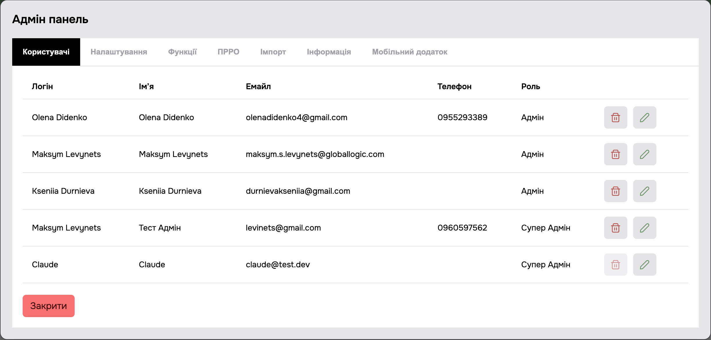
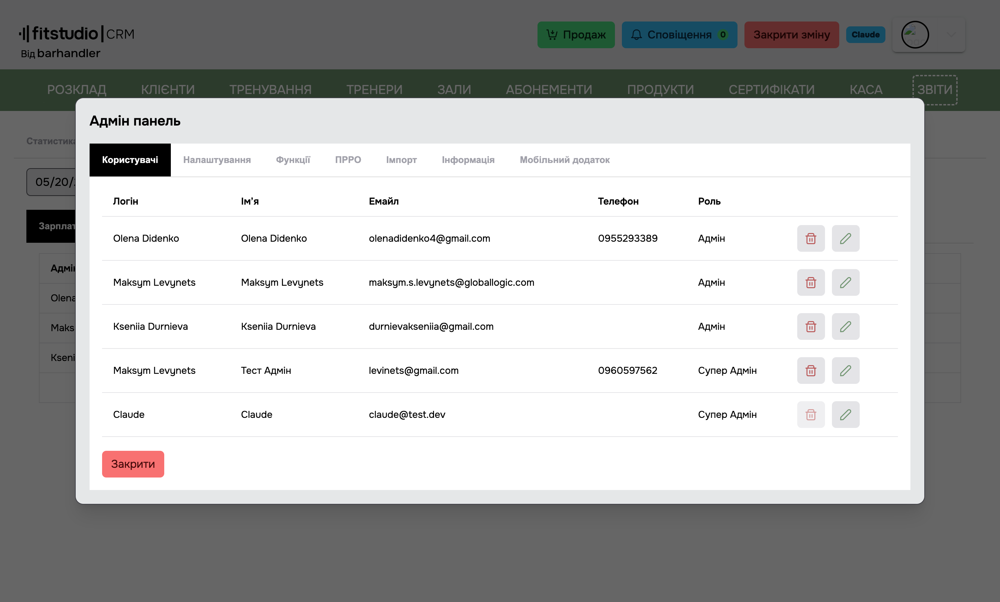
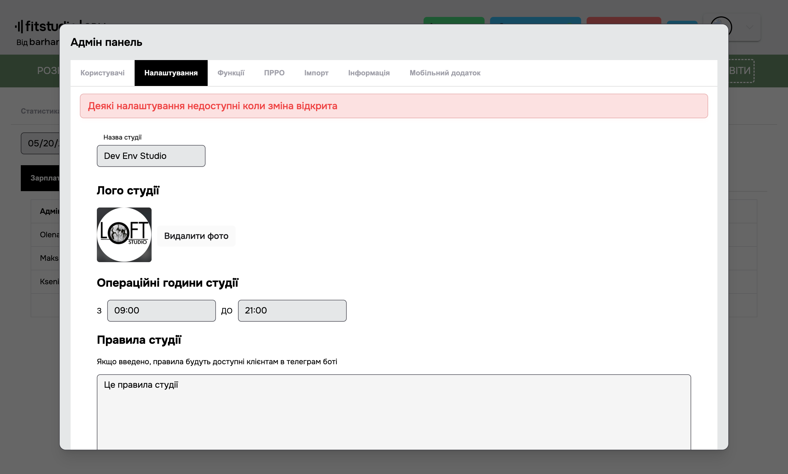
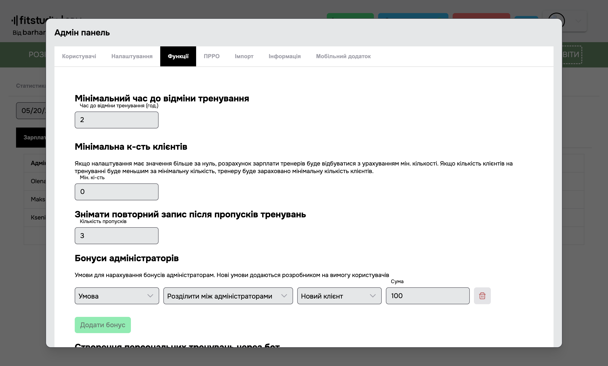
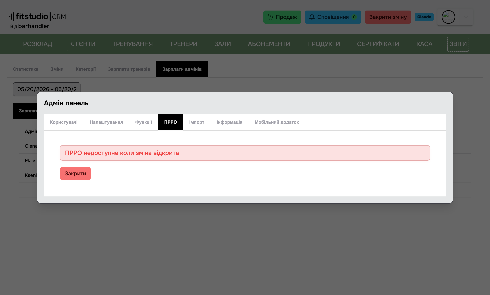
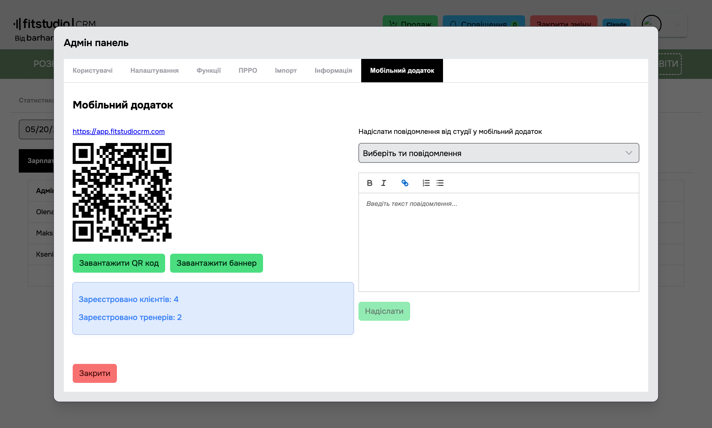

<a href="javascript:void(0)" onclick="history.back()">⬅️ Back</a>

[Back to home](/en/)

# 1.3.2.2 Settings

> The **Налаштування** (Settings) page opens from the **Налаштування** item of the main menu and consists of tabs. It is available to the **Супер Адмін** (Super Admin), **Адмін** (Admin) and **Менеджер** (Manager) roles.

**Tabs:**

- [1. Users](#users) — studio users, invitations by email.
- [2. Settings](#settings) — operating hours, studio rules, time zone, clearing workouts.
- [3. Features](#features) — studio business rules.
- [4. Integrations](#integrations) — fiscalization, acquiring, devices. The tab is shown only to the **Супер Адмін** role.
- [5. Information](#information) — versions and contacts.
- [6. Mobile Application](#mobile-application) — client app, online booking, SMS, self check-in.
- [7. Reminders](#reminders) — custom reminders for studio staff.
- [8. Categories](#categories) — workout categories for coach salary calculation.
- [9. Studio Information](#studio-information) — studio name, logo, description, photos and contacts.

> Client import and export is done on the [Clients](/en/menu/clients#_3214-excel-import-and-export-of-clients) page.

---

## Users

> The list of studio users, inviting new ones, editing roles and rates, removal.

The full description of the tab is on the [Users](/en/login/users) page.

---

## Settings

> General studio parameters. Changes are saved with the **Зберегти** (Save) button.

While a shift is open, the message «Деякі налаштування недоступні коли зміна відкрита» (Some settings are unavailable while the shift is open) is shown at the top of the tab.

> The studio name and logo are set on the [Studio Information](#studio-information) tab.

### Studio Operating Hours

Start (**З**, From) and end (**ДО**, To) of the working day in 30-minute steps. The **Зберегти** button is inactive if the start time is later than the end time.

### Studio Rules

A multi-line text field. The entered text is shown to clients in the mobile app under **Правила студії** (Studio rules) on the studio card.

> ℹ️ The caption under the heading in the settings reads «Якщо введено, правила будуть доступні клієнтам в телеграм боті» (If entered, the rules will be available to clients in the Telegram bot). The rules are shown to clients in the mobile app.

### Studio Time Zone

The **Часовий пояс** (Time zone) drop-down (default Kyiv, `Europe/Kyiv`). The time zone defines the dates and times of the studio's workouts and reports.

> ⚠️ If the studio has at least one workout, the list is locked and the message «Зміна часового поясу недоступна» (Changing the time zone is unavailable) is shown under it.

### Danger Zone

The **Очистити тренування** (Clear workouts) button opens the **Очистити тренування** window: «Ця дія незворотня. Всі тренування будуть видалені, а клієнти — відписані. Повернути видалену інформацію буде неможливо.» (This action is irreversible. All workouts will be deleted and clients unsubscribed. The deleted information cannot be restored.)

The **Продовжити** (Continue) button becomes active only after the **Я підтверджую видалення** (I confirm the deletion) switch is on and the word **DELETE** is typed in the field. Clearing runs as a [background task](/en/pages/processing#_65-background-tasks).

---

## Features

> Studio business rules (tab **Функції**). Changes are saved with the **Зберегти** button; after saving, the message «Функції збережено» (Features saved) appears.

### Minimum Time Before Workout Cancellation

- Field **Час до відміни тренування (год.)** (Time before workout cancellation, h) — an integer.
- If a client cancels a booking later than the given number of hours before the start, the workout is deducted from the membership as **Не відвідано** (Not visited).

### Automatic Logout on Inactivity

Field **Годин** (Hours) — the number of hours of inactivity after which the user is signed out automatically. `0` turns automatic logout off.

### Minimum Number of Clients

- Field **Мін. кі-сть** (Min. number) — an integer.
- If the value is greater than zero and the workout had fewer clients, the coach is credited with the minimum number of clients.
- Applies to categories with the **За людину** (Per person) rate type.

### Remove Recurring Booking After Consecutive Misses

- Field **Пропусків підряд** (Misses in a row) — an integer from `1`; an empty field turns the rule off.
- If a client with a recurring booking misses the given number of sessions in a row (status **Не відвідано**), the system removes the recurring booking. A visit resets the counter. A cancellation, including a late one, is not a miss.
- The administrator receives a notification. See [Removal from a recurring booking after misses](/en/pages/processing#_69-removal-from-a-recurring-booking-after-misses).

### Administrator Bonuses

> Bonus conditions taken into account in the [Administrator payroll](/en/menu/reports#_385-administrator-payroll) report.

Each bonus is a row of fields:

| Field | Value |
| --- | --- |
| **Умова** (Condition) | **Перший абонемент клієнта** (Client's first membership) |
| **Нарахування** (Accrual) | **Розділити між адміністраторами** (Split between administrators) / **Адміністратор що продав абонемент** (Administrator who sold the membership) |
| **Тип клієнта** (Client type) | **Будь-який клієнт** (Any client) / **Новий клієнт** (New client) |
| **Сума** (Amount) | Bonus amount, an integer |

The **Додати бонус** (Add bonus) button adds a row; if all conditions are already used, the button is inactive with the hint «Немає доступних умов» (No conditions available). The bin icon removes a row.

Bonus accrual for an individual administrator is turned on with the **Нараховувати бонуси** (Accrue bonuses) switch on the [Users](/en/login/users) page.

### Personal Workouts Created by Coaches

The section titled **Створення персональних тренувань у мобільному застосунку** (Creating personal workouts in the mobile app). The setting defines the categories in which a coach can create a personal workout in the mobile app.

- Switch **Дозволити тренерам створювати персональні тренування в мобільному застосунку** (Allow coaches to create personal workouts in the mobile app) — turns the feature on.
- Switch **Всі категорії** (All categories) — allows all studio categories.
- With **Всі категорії** off, the **Додати категорію** (Add category) button adds a row with the **Виберіть категорію** (Select a category) drop-down; the bin icon removes a row.

### Remind About Coach Birthdays

- Field **Днів** (Days) — how many days before a coach's birthday a reminder appears in the notifications.
- `0` turns the reminders off.

### Features (Switches)

| Switch | Effect |
| --- | --- |
| **Повідомляти клієнтам про заміну тренера (Додаток)** (Notify clients about a coach substitution (App)) | When a substitute coach is assigned, booked clients receive a mobile app notification. |
| **Враховувати максимальну к-сть людей при підрахунку зарплат** (Take the maximum number of people into account in salaries) | The number of clients credited to the coach does not exceed the workout's maximum number of people. |
| **Закривати зміну автоматично(закриється 23:57)** (Close the shift automatically (closes at 23:57)) | An open shift is closed every day at 23:58 Kyiv time. See [Automatic Shift Closing](/en/pages/shifts#_24-automatic-shift-closing). |
| **Нараховувати борг за неявку на персональне (без абонемента) та зараховувати тренеру** (Charge a debt for a no-show at a personal workout (without a membership) and credit the coach) | See below. |
| **Автоматична реєстрація при скануванні картки (клієнт з активним абонементом і записом на сьогодні)** (Automatic registration on card scan (client with an active membership and a booking for today)) | See [Automatic registration on card scan](/en/pages/processing#_610-automatic-registration-on-card-scan). |

**Debt for a no-show at a personal workout.** When the switch is on and a personal workout client gets the **Не відвідано** status without a membership deduction (manually, through a late cancellation or by the nightly job), and the client has no active personal membership:

- the client gets the debt «Борг за неявку на персональне тренування: <name>» (Debt for a no-show at a personal workout) for the price of the membership linked to the workout category;
- the workout is credited to the coach's salary.

No debt is created if no membership is linked to the category or its price is zero. A debt is created once per session.

---

## Integrations

> The tab (**Інтеграції**) is available only to the **Супер Адмін** role. It contains fiscal integrations (Vchasno Kasa, Checkbox), Monobank acquiring and devices.

### Fiscal Integrations

Each fiscal integration is added as a separate card — with the **Додати інтеграцію Вчасно Каса (фіскалізація)** or **Додати інтеграцію Checkbox (фіскалізація)** button.

| Integration | Fields |
| --- | --- |
| **Вчасно Каса (фіскалізація)** | **Назва** (Name), **Token** |
| **Checkbox (фіскалізація)** | **Назва**, **Пінкод касира** (Cashier PIN), **Client Name**, **Client Version**, **License Key** |

- The **Активна** (Active) switch turns a card on. Before activation the window «Активувати інтеграцію?» (Activate the integration?) — «Зараз перевіримо облікові дані у провайдера. Продовжити?» (We will now check the credentials with the provider. Continue?) — appears. If the check fails, the message «Не вдалося активувати інтеграцію» (Could not activate the integration) appears.
- Only one card of each type can be active at a time.
- Turning a card off is confirmed in the «Деактивувати інтеграцію?» (Deactivate the integration?) window.

### Monobank Acquiring

The **Додати інтеграцію Monobank** (Add Monobank integration) button adds an acquiring card: **Token (X-Token)**, the QR code list (button **Зчитати QR-коди** (Read QR codes), field **Активний QR** (Active QR)) and physical terminals (button **Додати термінал** (Add terminal), terminal name and `terminal_id`).

> ⚠️ The Monobank Acquiring card is not used during payment at the [Cash Register](/en/menu/pos).

### Devices (Device Manager)

Settings of the local device manager through which the system works with POS terminals and printers. The settings are stored only on this device.

- Switch **Використовувати менеджер пристроїв** (Use the device manager), field **URL менеджера** (Manager URL, default `http://localhost:9999`), buttons **Зберегти URL** (Save URL) and **Перевірити зʼєднання** (Check connection) (result: «Менеджер підключено» (Manager connected) / «Менеджер недоступний» (Manager unavailable)).
- Links **Завантажити девайс менеджер** (Download the device manager): **Windows**, **Mac Apple Silicon**, **Mac Intel**, **Android-планшет** (Android tablet).
- **POS-термінали** (POS terminals) — buttons **Знайти пристрої** (Find devices), **Додати вручну** (Add manually; fields **Банк / протокол** (Bank / protocol), **IP-адреса термінала** (Terminal IP address), **Порт** (Port), **Назва (не обовʼязково)** (Name, optional), button **Додати та перевірити** (Add and check)) and **Перевірити** (Check). Column **Звʼязок** (Connection): **Відповідає** (Responds) / **Не відповідає** (Does not respond) / **Не перевірявся** (Not checked).
- Printers — **Зареєструвати** (Register), **Тестовий друк** (Test print), **Видалити реєстрацію** (Remove registration); **Принтер для чеків** (Receipt printer), **Принтер цінників** (Label printer), switch **Друкувати чек після оплати** (Print a receipt after payment).

If a POS terminal is registered and the device manager is on, payment with the **Картка** (Card) method goes through the terminal. Otherwise a card payment is recorded without a terminal — see [Card payment without a terminal](/en/pages/processing#_612-card-payment-without-a-terminal).

### Fiscalization of Operations

When a fiscal integration is active:

- sales (cash, card, non-cash) are fiscalized; a fiscal receipt is created for each operation;
- a debt payment is fiscalized at the moment of payment; a sale marked **Сплатити пізніше** (Pay later) creates no receipt — see [Debts](/en/pages/processing#_613-debts);
- a personal account top-up is fiscalized; a payment from the personal account is not fiscalized;
- opening and closing a shift is synchronized with the integration, the Z-report is shown in the **Зміну закрито** (Shift closed) window — see [Opening and Closing a Shift with a Fiscal Integration](/en/pages/shifts#_23-opening-and-closing-a-shift-with-a-fiscal-integration).

> ℹ️ The **X Звіт** (X report) and **Звіт за день** (Daily report) buttons on the [Cash Register](/en/menu/pos) page are available while a shift is open, regardless of the fiscal integration. With an integration, the reports also contain fiscal data.

---

## Information

App (**App**) and server (**Api**) versions, the contact address and the **Посібник користувача** (User guide) link. Details — [Information](/en/login/info).

---

## Mobile Application

> Settings of the studio's client mobile app (tab **Мобільний додаток**). The tab is split into sections that can be collapsed; collapsed sections are remembered in the browser. Switches are saved immediately after a change.

> ℹ️ The app as seen by the client is described in [7. Mobile app](/en/mobile/mobile).

The **Онлайн-запис і вхід** (Online booking and sign-in), **Оцінки й відгуки** (Ratings and reviews), **SMS-сповіщення** (SMS notifications) and **Самореєстрація через застосунок** (Self check-in through the app) sections are shown only when the **Використовувати мобільний додаток для клієнтів** (Use the mobile app for clients) switch is on.

### App

The **Використовувати мобільний додаток для клієнтів** switch turns on the studio's client app: studio selection, booking, the public page.

If clients or coaches of the studio are already registered in the app, turning it off is confirmed in the «Вимкнути мобільний додаток?» (Turn off the mobile app?) window: the studio stops appearing in the app (in studio selection, in the phone number search during client and coach registration), and connected clients and coaches no longer see it in their list. The **Вимкнути** (Turn off) button becomes active after **SWITCHOFF** is typed in capital letters.

### Online Booking and Sign-in

| Switch | Effect |
| --- | --- |
| **Онлайн запис із веб сторінки** (Online booking from the web page) | If off, the studio's public page shows «Онлайн запис тимчасово недоступний» (Online booking is temporarily unavailable); the schedule stays visible. |
| **Підтверджувати записи з веб сторінки** (Confirm bookings from the web page) | A booking from the web page first reaches the administrator as a notification with the **Підтвердити** (Confirm) / **Відхилити** (Reject) buttons. Until confirmed, the seat is not counted for the person; after confirmation the person receives a message. Bookings from the app are not affected. On by default. |
| **Підтвердження запису гостя по SMS** (Guest booking confirmation by SMS) | A guest confirms the number with an SMS code (paid). Confirmation through Telegram is always available. |

> ⚠️ The **Підтвердження запису гостя по SMS** switch is also a general condition for all paid SMS of the studio: if it is off, SMS reminders, SMS about cancellation, booking cancellation and moves, booking confirmations and rating requests are not sent.

**Публічне посилання на студію** (Public studio link) — the link to the studio's public page (`<app link>/s/<studio identifier>`), the **Копіювати** (Copy) button and a QR code. Through the link clients view the studio and the schedule without registering, then sign in to book.

### Ratings and Reviews

| Switch | Effect |
| --- | --- |
| **Пропонувати оцінити заняття** (Offer to rate the session) | After a visited session the client sees an offer in the app to rate it (stars and a review). The rating is shown in [Reports](/en/menu/reports). |
| **Пропонувати оцінити заняття в смс (для клієнтів без застосунку)** (Offer to rate the session by SMS (for clients without the app)) | After the session the client receives a message with a rating link. Channels — see [Messages to clients](/en/pages/processing#_614-messages-to-clients). Active only with **Пропонувати оцінити заняття** on. |
| **Показувати рейтинг клієнтам** (Show the rating to clients) | Studio stars, reviews and the rating in the studio list. If off, clients do not see the rating; ratings are still collected and shown in Reports. Active only with **Пропонувати оцінити заняття** on. |

### SMS Notifications

| Setting | Effect |
| --- | --- |
| **SMS про відміну заняття** (SMS about a cancelled session) | A paid SMS to clients without the app when the studio cancelled a session. |
| **SMS про скасування запису** (SMS about a cancelled booking) | A paid SMS when the studio cancelled the client's booking. No message is sent about a cancellation made by the client in the app. |
| **SMS про перенесення заняття** (SMS about a moved session) | A paid SMS when the date or time of a session changed. |
| **Нагадувати про візит** (Remind about the visit) | Field **Годин** (Hours), from `0` to `24`: how many hours before the session to remind clients without the app. `0` turns reminders off. The value is saved automatically. |

The three SMS switches are off by default. They concern only paid SMS: app notifications and Telegram messages are sent regardless of them.

Under the **Нагадувати про візит** field, SMS usage is shown: «SMS цього періоду: <sent> / <limit> (залишилось <N>)» (SMS this period: … (N left)) or «SMS цього періоду: без ліміту» (SMS this period: no limit).

**Message texts.** Each message kind has its own text in Ukrainian and in English (English — for those who booked from the English page):

| Block | When sent | Default text |
| --- | --- | --- |
| **Текст SMS-нагадування** (SMS reminder text) | Reminder before the visit | «Fitshandler: <date>.» |
| **Текст SMS про відміну заняття** (Text of the SMS about a cancelled session) | The studio removed the session from the schedule | «Тренування на яке ви записані <date> було відмінено.» (The class you booked on <date> has been cancelled.) |
| **Текст SMS про скасування запису** (Text of the SMS about a cancelled booking) | A particular person's booking was cancelled | «Ваш запис на тренування <date> було скасовано.» (Your booking for <date> has been cancelled.) |
| **Текст повідомлення про перенесення заняття** (Text of the message about a moved session) | The session was moved; the text contains the new time | «Час вашого тренування змінено. <date>» (Your class has been moved. <date>) |

- The text consists of the **Текст до дати** (Text before the date) field, the fixed **дата та час** (date and time) chip (substituted automatically) and the **Текст після дати** (Text after the date) field.
- The text, including the date, is up to 500 characters. Under the fields the number of characters and the number of SMS the message is billed as are shown: one SMS holds 70 Cyrillic characters (67 in each part of a longer message) or 160 Latin characters (153).
- The **Приклад:** (Example:) line shows the finished message.
- The **Зберегти текст** (Save text) button saves the text; the message «Текст збережено» (Text saved) appears.

### Self Check-in Through the App

| Setting | Effect |
| --- | --- |
| **Реєстрація через мобільний застосунок** (Registration through the mobile app) | The client scans the studio QR code at the reception and registers for the workout; the membership is deducted automatically. |
| **Реєстрація тільки з записом** (Registration only with a booking) | The client registers only for a workout they are booked for. If off, the client sees today's workouts with free places and can register for any of them. On by default. |
| **Приймати оплату** (Accept payment) | The switch is inactive. |
| **Реєстрація в борг** (Registration on credit) | The switch is inactive. |

The **Банер для рецепції** (Reception banner) block (shown when self check-in is on): the **Зали** (Rooms) list and the **Показати банер** (Show banner) button, which opens a banner with a QR code. The code changes every hour. Self check-in rules — [Self check-in by QR code](/en/pages/processing#_611-self-check-in-by-qr-code).

### App Link and Messages

- **App link** — the app installation address (`https://app.fitshandler.com`) and a QR code for it.
- **Завантажити QR код** (Download QR code) — downloads the QR code image.
- **Завантажити баннер** (Download banner) — downloads a print-ready banner with the QR code.
- **Зареєстровано клієнтів: N** (Registered clients), **Зареєстровано тренерів: N** (Registered coaches) — the number of the studio's clients and coaches connected to the app.

### Send a Message from the Studio

The **Надіслати повідомлення від студії у мобільний додаток** (Send a message from the studio to the mobile app) block:

- **Виберіть тип повідомлення** (Select the message type) — **Повідомлення клієнтам** (Message to clients) or **Повідомлення тренерам** (Message to coaches).
- A text editor with formatting. If the text is empty or longer than 4000 characters including markup, «Повідомлення пусте або занадто довге» (The message is empty or too long) is shown.
- The **Надіслати** (Send) button is active once a message type is selected. After sending, «Повідомлення успішно надіслано» (Message sent successfully) appears.

The message is delivered only to the mobile app, marked «Студія: <name>», to users who have this notification type enabled. It is not sent through Telegram or SMS.

---

## Reminders

> Custom reminders for studio staff (tab **Нагадування**). Visit reminders for clients are set on the [Mobile Application](#mobile-application) tab.

Table: **Назва** (Name), **Коли** (When), **Активне** (Active), **Дії** (Actions). The **Додати** (Add) button opens the **Нове нагадування** (New reminder) window (when editing — **Редагувати нагадування**, Edit reminder):

- **Назва \*** — required;
- **Опис** (Description);
- **Тип** (Type) — one-off or recurring;
- **Дата і час** (Date and time); for a recurring one — **Періодичність** (Frequency), **З числа** (From day), **До числа** (To day);
- the **Активне** switch.

Buttons **Відміна** (Cancel) and **Зберегти**. The reminder appears in the studio notifications at the given time.

---

## Categories

> Workout categories (tab **Категорії**) for coach salary calculation and linking to a membership.

| Column | Description |
| --- | --- |
| **Назва** (Name) | Category name |
| **Базова ставка категорії** (Category base rate) | Amount in UAH used in the salary calculation |
| **Тип ставки** (Rate type) | **За людину** (Per person) — number of clients × rate; **За тренування** (Per workout) — number of workouts × rate |
| **Абонемент** (Membership) | Membership linked to the category |
| **Дії** (Actions) | Edit / Delete |

The search field above the table searches by name. Calculation — [Calculating coach salaries](/en/pages/processing#_63-calculating-coach-salaries).

### Add / Edit a Category

The **Додати категорію** (Add category) button or the edit button in a row opens the form:

- **Назва** — required, at least 3 characters («Мінімум 3 символи», Minimum 3 characters);
- **Базова ставка** (Base rate) — amount in UAH;
- **Тип ставки** — **За людину** / **За тренування**;
- **Абонемент** — required for **За тренування** (marked `*`), optional for **За людину**. Under the field «Ціна: N грн» (Price: N UAH) is shown.

Buttons **Закрити** (Close) and **Зберегти**. If no membership is selected for **За тренування**, the server rejects saving with the message «Абонемент обов'язковий для типу 'За тренування'» (A membership is required for the 'Per workout' type).

---

## Studio Information

> Information the client sees in the app in the studio header, in the **Про нас** (About us) window and on the studio's public page (tab **Інформація про студію**).

- **Назва студії** (Studio name) — used in the app, messages to clients and fiscal receipts.
- **Лого студії** (Studio logo) — button **Завантажити лого** (Upload logo); **Видалити фото** (Delete photo) removes the logo. File size — up to 5 MB.
- **Про нас** — studio description.
- **Фото студії** (Studio photos) — up to 10 photos shown to the client in «Про нас». Photos are saved right after they are selected.
- **Місто** (City) — also used to search for the studio by city.
- **Телефон** (Phone, format `+380XXXXXXXXX`) and **Адреса** (Address).

Text fields are saved with the **Зберегти інформацію** (Save information) button; until the changes are saved, «Є незбережені зміни» (There are unsaved changes) is shown next to it.

---

<a href="javascript:void(0)" onclick="history.back()">⬅️ Back</a>

[Back to home](/en/)
