<a href="javascript:void(0)" onclick="history.back()">⬅️ Back</a>

[Back to home](/en/)

# 3.2 Clients

## 3.2.1 Client table

> The client table contains:

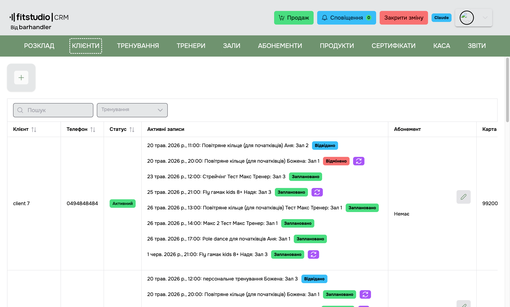

- **Client** ("Клієнт") — the client's surname and first name. Badges are shown next to the name:
  - **Debt** ("Борг", red) — the client has an unpaid debt, see [Client debt](#_3212-client-debt);
  - **Awaiting confirmation** ("Очікує підтвердження", orange) — the client card was created from a request in the mobile app or from a booking on the public page, and the studio has not confirmed the request yet.
- **Phone**
- **Status** — **Active** ("Активний") or **Inactive** ("Неактивний").
- **Active bookings** — shown in the format:  
  `Date, time, Workout name, Coach, Room — Status`  
  If a vacation is set for the client, a **Vacation** ("Відпустка") badge with the period "З … по …" (from … to …) is shown above the bookings. The repeat icon (tooltip "Тренування повторюється", the workout repeats) marks a repeating booking.
- **Booking status**:
  - **Planned** ("Заплановано", green) — the client is booked for the workout
  - **Visited** ("Відвідано", blue) — the client was checked in to the workout
  - **Cancelled** ("Відмінено", red) — the workout was cancelled, or the client cancelled it in advance
  - **Not visited** ("Не відвідано", orange) — the client did not show up or cancelled late
  - **Paused** ("Призупинено") — the booking is paused
  - **Waiting list** ("Лист очікування") — the client is on the workout's waiting list
  - **Removed from waiting list** ("Видалено з листа очікування") — the client was taken off the waiting list
- **Plan** — for each plan: the name, **Status** (Active / Inactive / Paused), **Ends** ("Закінчується", a date or "--") and **Sessions left** ("Залишок тренувань"); on a separate line **Single: N** ("Разові: N", the number of purchased and unused single sessions). If there are no plans, "Немає" (none) is shown.  
  The SuperAdmin and Admin roles have the **Edit plans** ("Редагувати абонементи", pencil icon) button, which opens the [Editing plans](#_324-editing-plans) window.

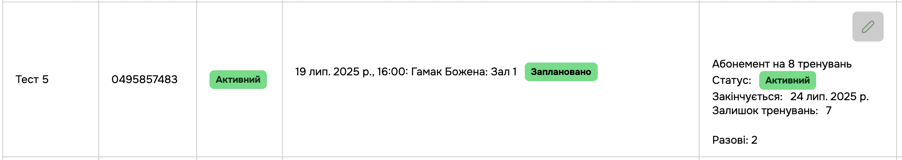

- **Card** — the client's card number
- **Personal account** ("Особовий рахунок") — the [personal account](#_3211-personal-account) balance in UAH; shown when the balance is above 0.
- **Actions** (SuperAdmin and Admin roles):
  - **[Pay debt](#_32122-paying-off-debt)** ("Сплатити борг") — shown only when there is a debt; disabled when no shift is open.
  - **[History](#_325-history)** 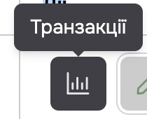
  - **[Edit](#_326-editing-a-client)** 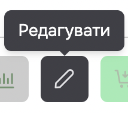
  - **[Sale](#_327-sale)** 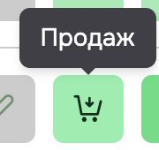 — only for an active client and with an open shift.
  - **[Booking](#_328-booking)** 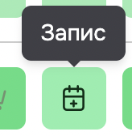 — only for an active client.
  - **[Registration](#_329-registration)** 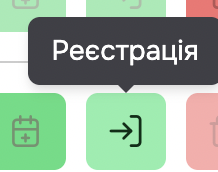 — only for an active client and with an open shift.
  - **[Delete](#_3210-deleting-a-client)** 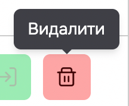 — only for an inactive client.

For an inactive client the button tooltips explain the restriction: "Продаж доступний тільки для активного клієнта", "Запис доступний тільки для активного клієнта", "Реєстрація доступна тільки для активного клієнта" (available only for an active client), "Деактивуйте клієнта щоби видалити" (deactivate the client to delete).

The table can be sorted by the **Client**, **Phone** and **Status** columns. The table is paginated (10, 20 or 50 rows per page). If no clients are found, "Не знайдено жодного клієнта" is shown.

> ℹ️ Going to a client from other sections (for example, the **Go to client** ("Перейти до клієнта") button in [Registration](#_329-registration)) opens the table with this client only: instead of the search and the filter, the text "Показано 1 клієнта" (1 client shown) and the **Show all** ("Показати всі") button are displayed; the button returns the full list.

---

## 3.2.2 Creating a client

> The **+** button (add client) is at the top left; next to it are the [Excel import and export](#_3214-excel-import-and-export-of-clients) buttons. The buttons are available to the SuperAdmin and Admin roles.

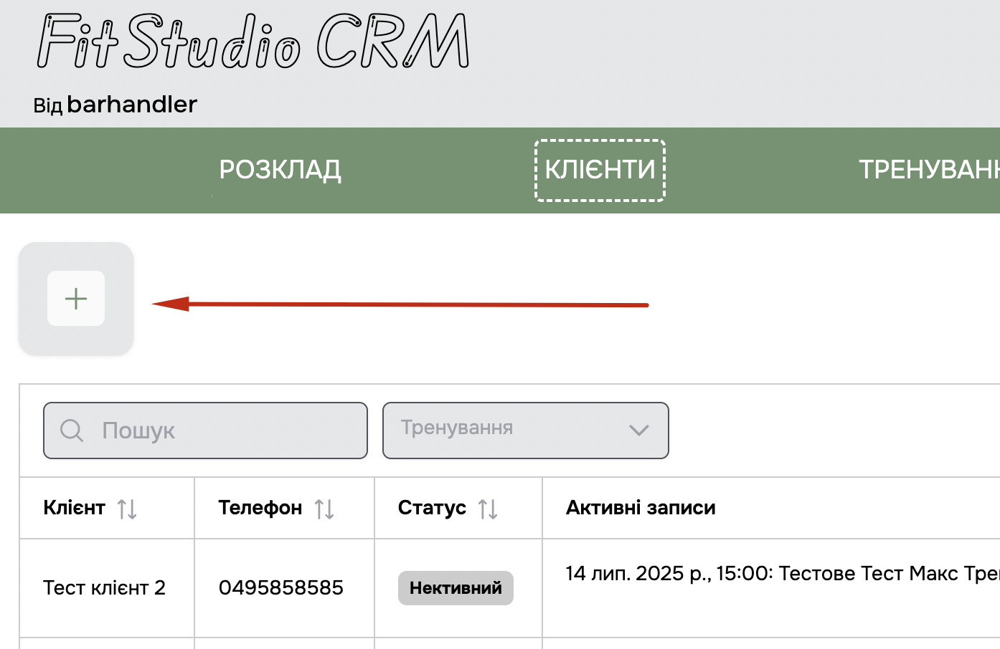

> Clicking it opens the **New client** ("Новий клієнт") modal window:

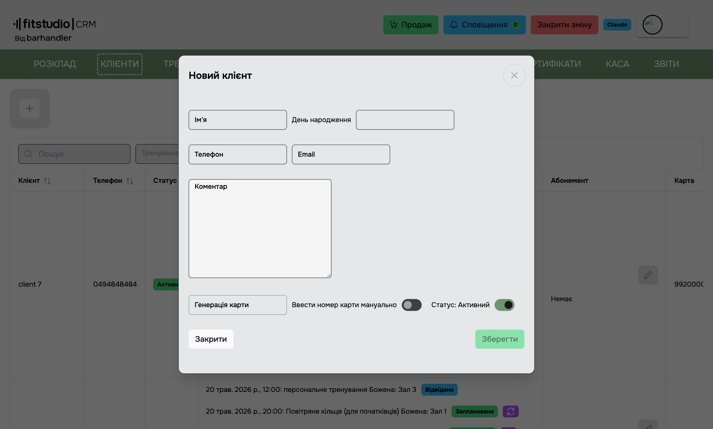

| Field | Requirements |
|---|---|
| **Surname** ("Прізвище") | Optional. |
| **First name** ("Імʼя") | Required. |
| **Birthday** ("День народження") | Optional, format `dd/mm/yy`. The latest selectable date is three years before today. |
| **Phone** ("Телефон") | Required, format `0XXXXXXXXX`. |
| **Email** | Optional; the address format is checked. |
| **Comment** ("Коментар") | A free-form note about the client. |
| **Card generation** ("Генерація карти") / **Client card** ("Карта клієнта") | The card number has 13 digits. |
| **Status** | **Active** / **Inactive** toggle; Active by default. |

The card number is set in one of three ways:

- The **Enter card number manually** ("Ввести номер карти мануально") toggle is off — the system generates an electronic card automatically; the field is called **Card generation** and cannot be edited.
- The toggle is on — the field is called **Client card** and the number is entered by hand. The field is required; only digits are allowed, exactly 13 ("Номер карти клієнта має 13 цифр").
- The **Scan** ("Сканувати") button opens the **Card scanning** ("Сканування картки") window: the card is read with the scanner, the number appears in the **Card number** field, and the **Continue** ("Продовжити") button is enabled only for a valid 13-digit number. After confirmation the number is put into the **Client card** field and the manual-entry toggle is switched on automatically.

Window buttons: **Close** ("Закрити"), **Save** ("Зберегти").

---

## 3.2.3 Scanning a card

> Scan the client's card with the scanner (from the physical card, a phone screen, or the mobile app).  
> Scanning works on any page, except when the create or edit client modal window is open. While the **Card scanning** window is open (the **Scan** button in the client form), the scanned number goes into the form and registration is not opened.

- If the scan succeeds — the **[Registration](#_329-registration)** modal window opens.
- If the data is not recognized — a message appears:

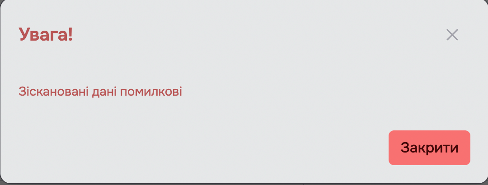

---

## 3.2.4 Editing plans

> Clicking the **Edit plans** button opens the **Editing client plans** ("Редагування абонементів клієнта") modal window:

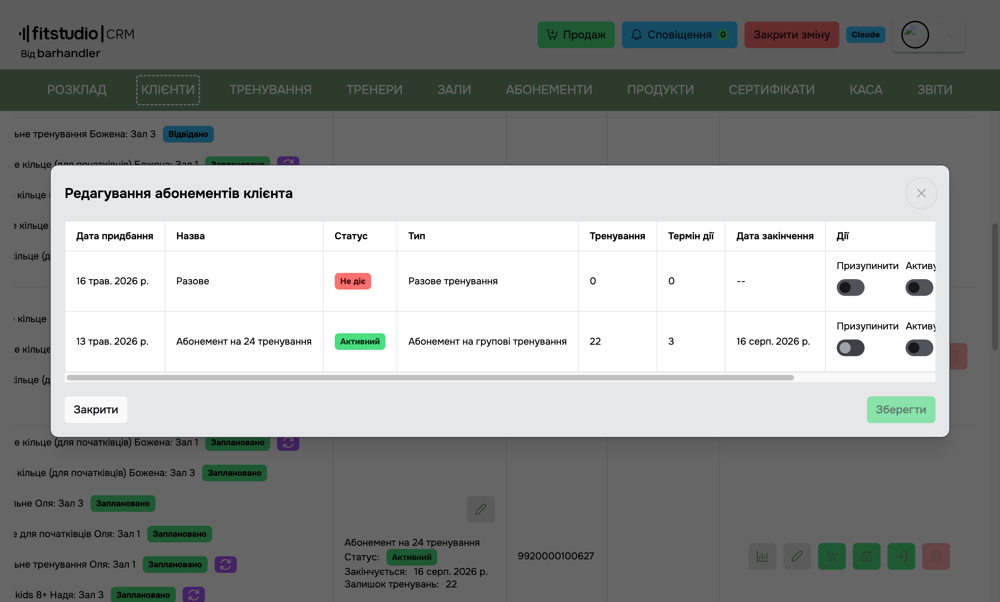

**Columns:**

- **Purchase date**
- **Name**
- **Status**:
  - **Active** ("Активний", green)
  - **Inactive** ("Неактивний", grey)
  - **Paused** ("Призупинено", orange)
  - **Not valid** ("Не діє", red)
- **Type** — group-workout plan / personal-workout plan / rent / single session / single personal session
- **Sessions** (remaining) — editable for an active plan (tooltip "Редагувати залишок тренувань"); for others — "Неможливо редагувати залишок тренувань." (cannot be edited)
- **Validity period**
- **End date** — editable for an active plan (tooltip "Редагувати дату закінчення"); for others — "Неможливо редагувати дату закінчення."
- **Actions**:
  - **Pause** ("Призупинити") — available for an active plan.
  - **Activate** ("Активувати") — available for an inactive or paused plan when the client has no other active plan of the same type.
  - **Delete** ("Видалити") — available only for single-session plans; deletion requires confirmation.

> After changes are made, the **Save** button becomes active. Clicking it saves the changes and closes the window. The **Close** button closes the window without saving.

---

## 3.2.5 History

> Clicking the **History** button opens the **History** ("Історія") modal window with three tabs: **Plans** ("Абонементи"), **Personal account** ("Особовий рахунок", [3.2.11.3](#_32113-account-history)) and **Debts** ("Борги", [3.2.12.3](#_32123-debt-history)).

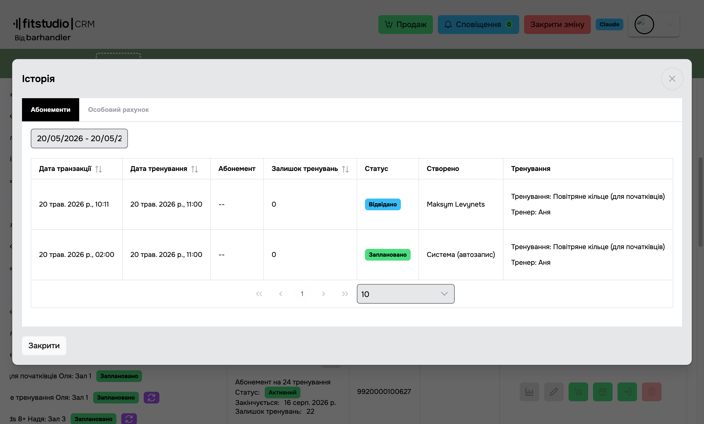

The **Plans** tab holds the history of session movements on plans. The period is set by picking a date range in the calendar (no later than today).

| Column | Description |
|---|---|
| **Transaction date** | Date and time of the operation |
| **Workout date** | Date and time of the workout the operation relates to |
| **Plan** | Plan name or "--" |
| **Sessions left** | Balance after the operation |
| **Description** | Explanation of the operation |
| **Status** | Reason of the operation (badge) or "--" |
| **Created by** | User who made the operation |
| **Workout** | "Тренування: <name>", "Тренер: <name>" (workout, coach) |

If there are no operations, "Не знайдено жодної транзакції" is shown.

---

## 3.2.6 Editing a client

> Clicking the **Edit** button opens the **Editing a client** ("Редагування клієнта") window with the same fields as [client creation](#_322-creating-a-client); the fields hold the current data.  
> The **Client card** field can be edited only when the **Enter card number manually** toggle is on; the number can also be read with the **Scan** button.

> ℹ️ If the studio belongs to a **network** (a group of venues) and the client is known to other studios of the group, the **"Клієнт із мережі"** (client from the network) tag is shown at the top of the form. The tag does not restrict editing: the name and the phone can be changed, and the change is applied to the shared registry and to the other studios of the network.

---

## 3.2.7 Sale

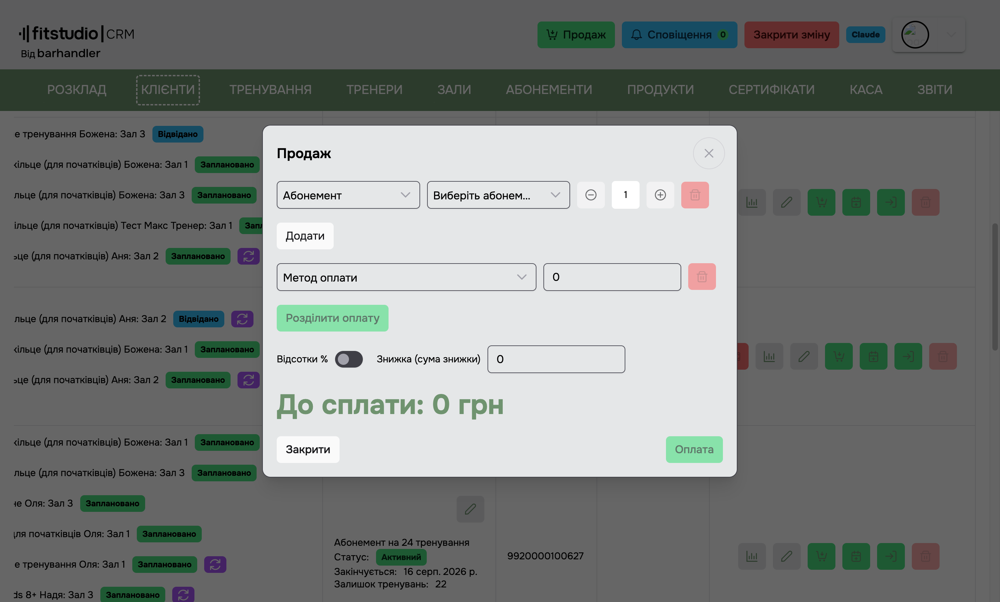

**The sale modal window contains:**

- Sale rows. In each row a type is chosen — **Plan** ("Абонемент"), **Product** ("Товар") or **Account top-up** ("Поповнення рахунку") — and then:
  - for **Plan** — a plan from the list;
  - for **Product** — a product from the list. A product with zero stock is marked "(немає в наявності)" (out of stock) and cannot be selected; when stock is below 3, "(залишилось N шт.)" is shown. Below the selected product "Залишок: N шт." (stock) is shown;
  - for **Account top-up** — the **Top-up amount** ("Сума поповнення") field, see [3.2.11.1](#_32111-topping-up-the-account).
- A quantity control (1 to 20) for plans and products.
- The **Add** ("Додати") button — adds one more sale row.
- **Payment method** — Card ("Картка") / Cash ("Готівка") / Bank transfer ("Безготівкова"); when the personal account has funds, also "Особовий рахунок — X грн". The **Split payment** ("Розділити оплату") button adds another payment method.
- The discount field (**Знижка (сума знижки)**, or **Знижка (%)** with the **Відсотки %** toggle on).
- **To pay** ("До сплати") — the total.
- The **Close** ("Закрити") and **Pay** ("Оплата") buttons.

Restrictions:

- If the sum of payments does not equal the amount due, "Сума платежів меньша або більша за суму до оплати!" is shown and payment is unavailable.
- A product priced at 0 UAH is not sold: the system shows "Товар за 0 грн не продається" and asks to set a price or remove the product from the sale.
- If a payment terminal is available for the **Card** method, "Термінал доступний — оплата пройде через нього при підтвердженні" (the terminal is available, payment will go through it) is shown below the method.

---

## 3.2.8 Booking

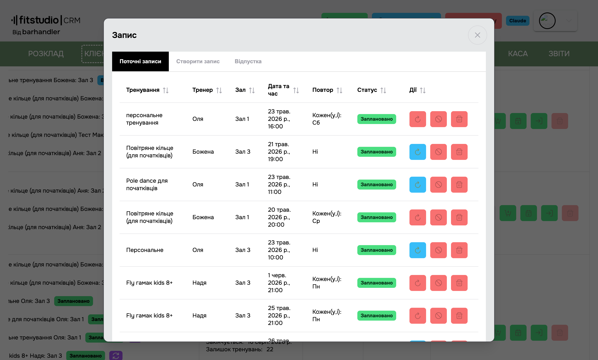

The **Booking** ("Запис") modal window has three tabs: **Current bookings** ("Поточні записи"), **Create booking** ("Створити запис"), **Vacation** ("Відпустка").

**The "Current bookings" tab** — a table of the client's bookings with the columns **Workout**, **Coach**, **Room**, **Date and time**, **Repeat** ("Кожен(у,і): <days>" or "Ні"), **Status**, **Actions**. The available actions depend on the booking status:

| Action | When available |
|---|---|
| **Cancel the current workout** ("Відмінити поточне тренування") | Booking with the **Planned** status |
| **Delete the booking and repeats** ("Видалити запис та повтори") | **Planned** booking on a regular workout |
| **Restore the booking** ("Повернути запис") | Booking with the **Cancelled** or **Not visited** status |
| **Change status to cancelled** ("Змінити статус на відмінено") | Booking with the **Not visited** status |
| **Resume** ("Поновити") | Booking with the **Paused** status |
| **Repeat** / **Do not repeat** ("Повторювати" / "Не повторювати", **Repeat settings**) | Repeating workout |

Cancelling a repeating booking opens the **Cancel booking** ("Скасувати запис") window with the options **Cancel only this session** ("Скасувати тільки це заняття") and **Cancel this and all following** ("Скасувати це і всі наступні"). Turning a repeat off requires confirmation in the **Turn off repeat** ("Вимкнути повтор") window, which lists the future dates the client will be removed from. The **Save changes** ("Зберегти зміни") button saves the changes on the tab.

**The "Create booking" tab:**

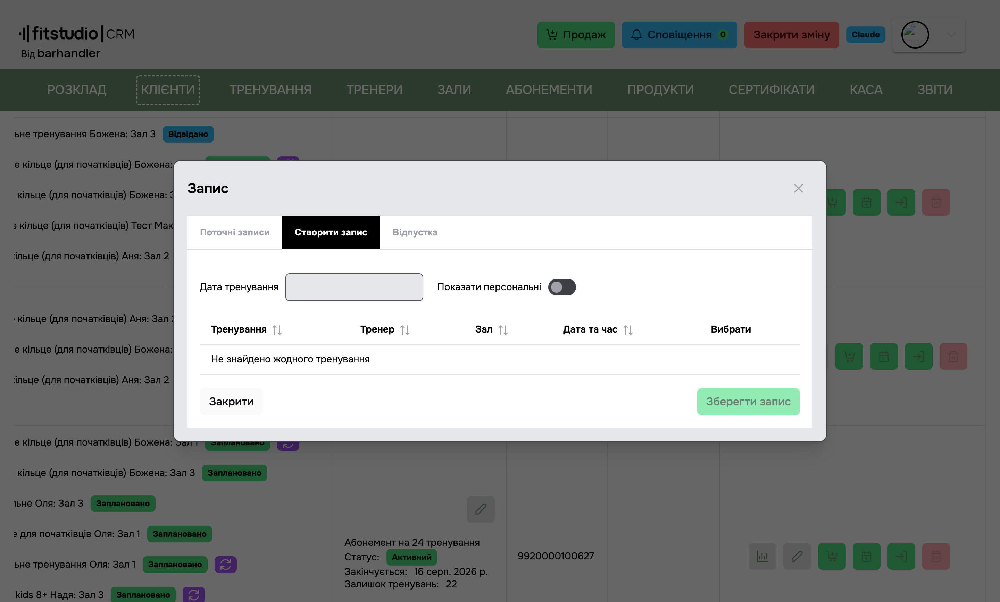

- Choose the **Workout date** ("Дата тренування") — a list of workouts appears (columns **Workout**, **Coach**, **Room**, **Date and time**, **Select**). The **Show personal** ("Показати персональні") toggle adds personal workouts to the list.
- If a workout was moved for the chosen date, the list shows that date's time, room and substitute coach. A workout cancelled for the chosen date (a moved one included) is not listed. Today's workout is listed until it starts (hour and minute, in the studio's time zone).
- Turn on the **Select** ("Вибрати") toggle to add a workout. Two different workouts starting at the same hour cannot be selected.

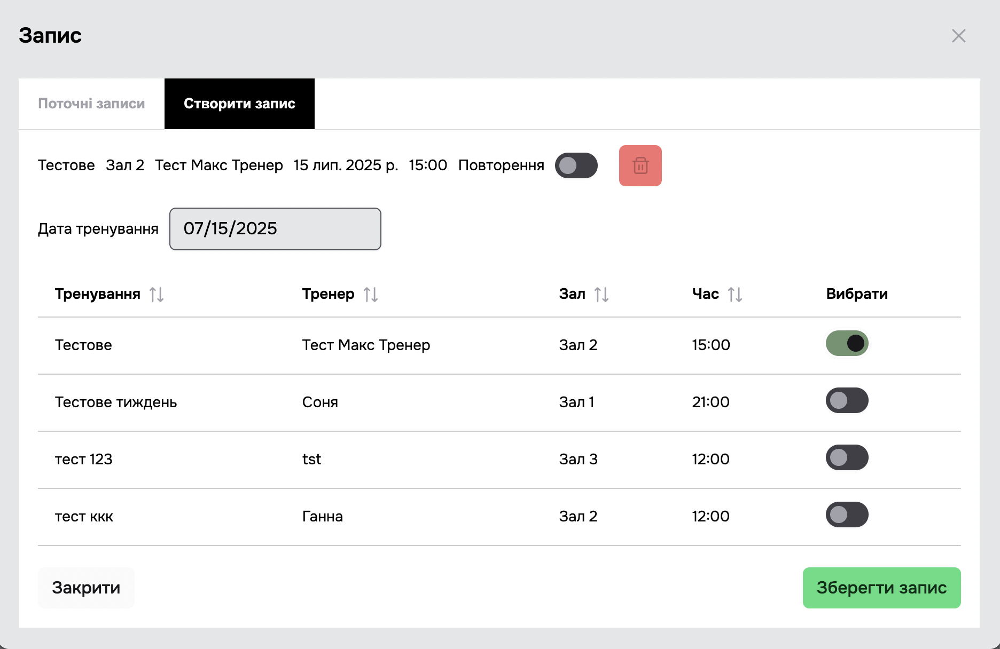

- The selected workout appears in the list at the top.
- A regular workout has the **Repeat** ("Повторення") toggle. If the workout takes place on several days of the week, the repeat days are chosen; at least one day must be selected ("Будь ласка виберить принаймні один день").
- If several following workouts are full, the system shows the **Repeat restriction** ("Обмеження повтору") window and offers to book the client from the first date with free spots (the **Записати з <date>** button). If no following workout has free spots, the **Cannot set a repeat** ("Неможливо поставити повтор") window is shown.
- The **Save booking** ("Зберегти запис") button creates the booking; the notification "Запис успішно створено" (booking created) is shown.

### 3.2.8.1 No spots available

> If a workout is full, it is marked in red. Hovering over it shows the tooltip _"Немає місць"_ (no spots available).

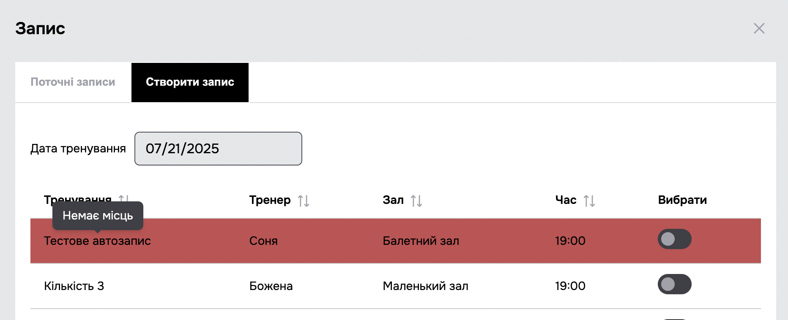

- The administrator can still book or check in the client.
- In the mobile app a client can only join the waiting list of a full workout, see [7.5 Workouts](/en/mobile/workouts).

### 3.2.8.2 Client vacation

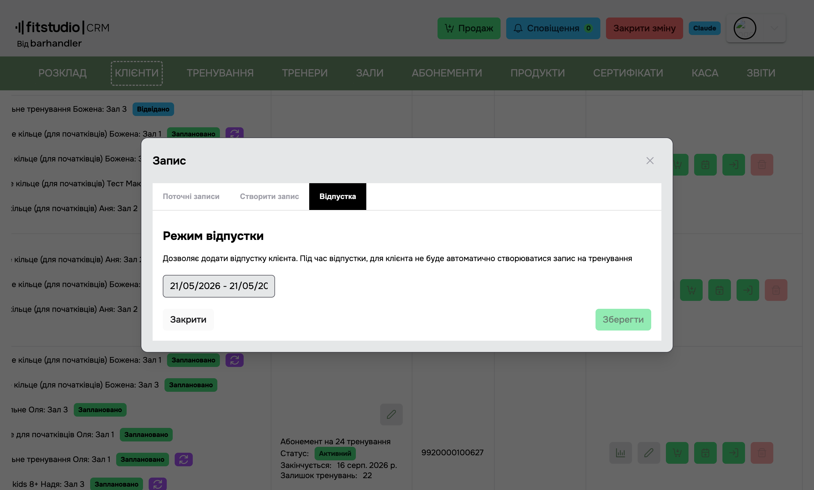

- The **Vacation** tab (**Vacation mode**, "Режим відпустки") lets you add a client vacation period.
- During the vacation, bookings are not created automatically for the client.

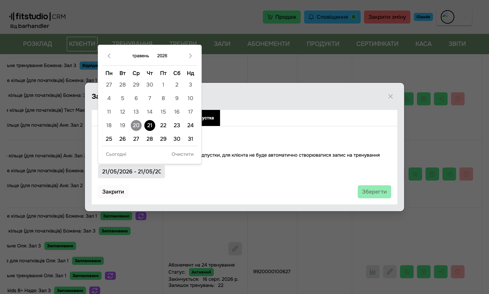

- The vacation is set by choosing a period in the calendar; the earliest start date is tomorrow. An added period is shown as "Відпустка з … по …".
- The period can be deleted. The **Save** button saves the changes.

---

## 3.2.9 Registration

> The **Registration** ("Реєстрація") modal window has the heading "Клієнт: <surname and first name>" and the **Go to client** ("Перейти до клієнта") button, which opens the [client table](#_321-client-table) with this client only.

Warnings are shown above the data:

- "Увага!!! Клієнт потребує уточнення даних" (client data needs to be completed) — the client card has no phone;
- "Увага!!! У клієнта є борг: …" (the client has a debt) — the client has an unpaid debt.

Active plans are shown in separate blocks **Current plan (group workouts)** ("Поточний абонемент (групові тренування)") and **Current plan (personal workouts)** ("Поточний абонемент (персональні тренування)") with the number of sessions left.

- If the client has active bookings, the current day's workouts are shown in the **Current workouts** ("Поточні тренування") list; the selected workouts are shown in the **Selected workouts:** ("Вибрані тренування:") table (columns **Name**, **Room**, **Coach**, **Date**, **Time**, **Plan**, **Workout price**, **Delete**).
- Unneeded workouts can be removed from the table.

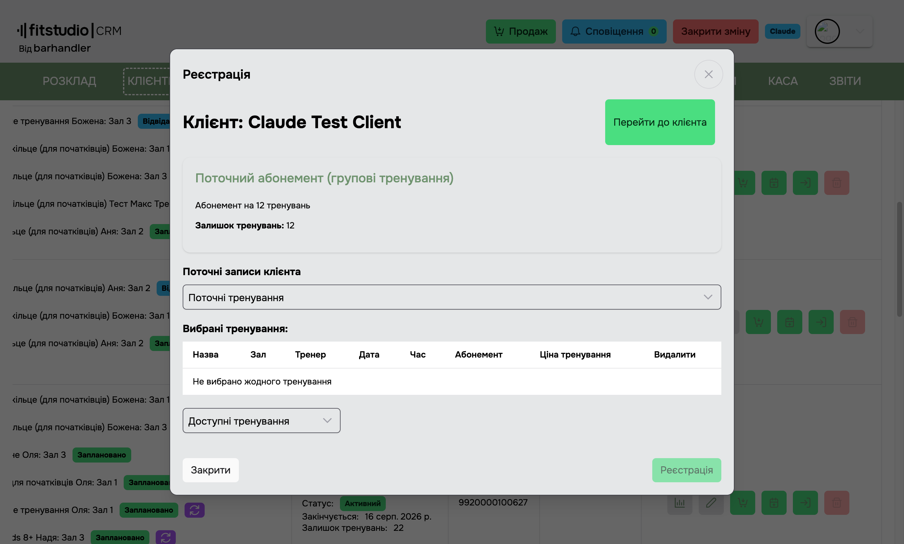

- If there is an active plan, the **Registration** button is active and the amount due is 0.
- Clicking it checks the client in and deducts a session from the plan.

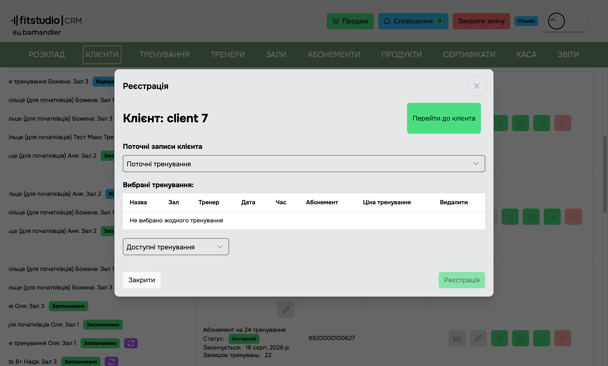

- If there are no plans, click **Add plan**.
- A single session or a plan can be purchased.

**`Warning! You cannot sell more single sessions than are needed for the selected workouts.`**

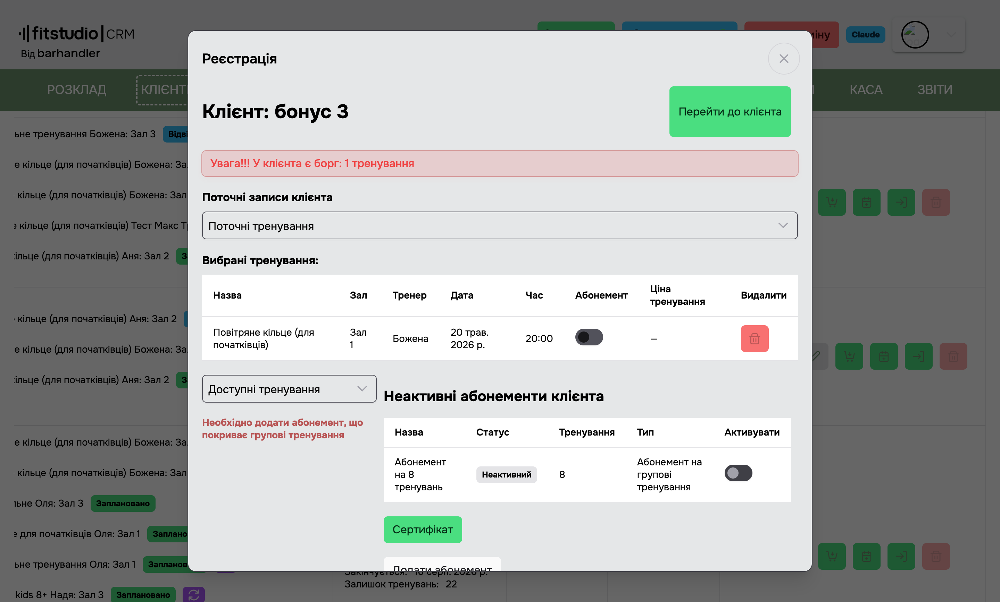

- The **Pay later** ("Сплатити пізніше") toggle — for deferred payment.
- In that case a [client debt](#_3212-client-debt) is created and the client gets the **Debt** badge.

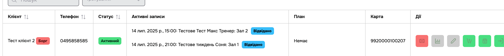

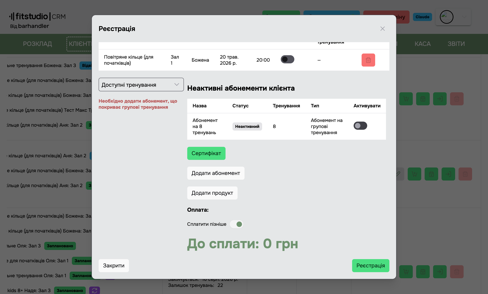

- If the client has no bookings, a workout can be chosen from the **Available workouts** ("Доступні тренування") list (each shows "Місць: N" (spots) and "Записи: N" (bookings)).
- Booking is also possible even if the client already has planned bookings.

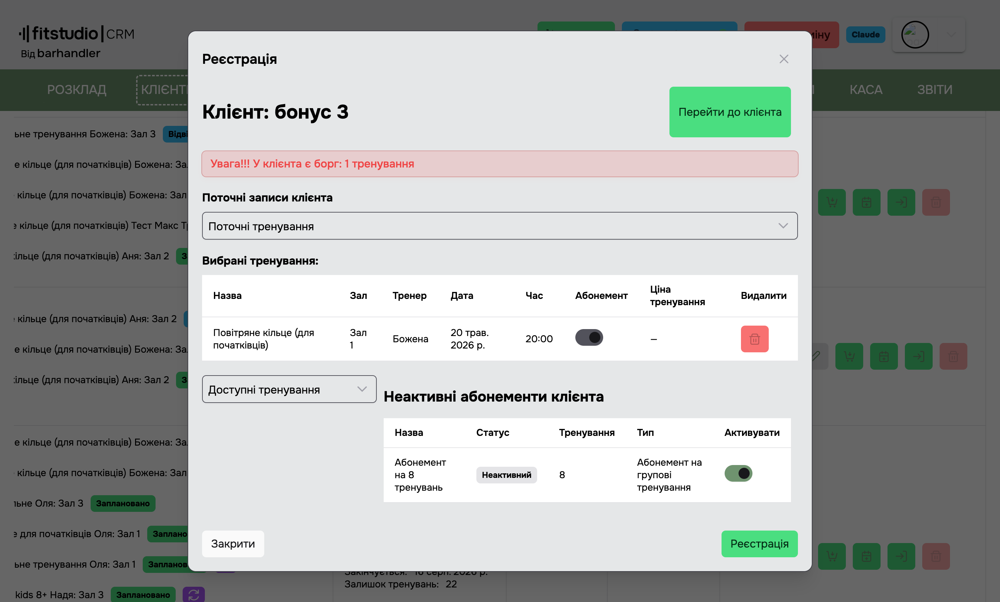

- If there are inactive plans, they can be activated (the **Inactive client plans** ("Неактивні абонементи клієнта") table, **Activate** column).
- If single sessions were purchased in advance, they can be used (the **Single client plans** ("Разові абонементи клієнта") table, **Use** ("Використовувати") column).
- The **Certificate** ("Сертифікат") button opens [certificate](/en/menu/certificates) redemption.

**Plan information:**

- If a plan is about to expire, the system shows a warning.

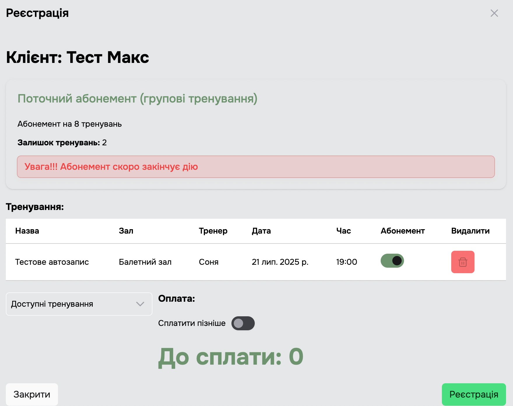

**Add product** ("Додати товар") — lets you add a product to the transaction, even if the workout registration itself is paid for from a plan.

**Why the "Registration" button is disabled.** When the button is disabled, a list of reasons is shown above it, including:

| Message | Condition |
|---|---|
| Виберіть хоча б одне тренування | No workout selected |
| Необхідно додати абонемент, що покриває групові тренування / оренду / вибране персональне тренування | No plan covers the selected workout |
| Вибрано надлишок разових абонементів | More single sessions than selected workouts |
| Перевірте суми оплат — разом вони не дають потрібної суми | The sum of payments does not equal the amount due |
| Вкажіть оплату за вибрані заняття | No payment entered for a workout priced per session |
| У переліку абонементів є незаповнений рядок — виберіть у ньому абонемент або приберіть рядок | An added plan row is empty |

### 3.2.9.1 Registering for a personal workout

> Personal workouts have a **fixed price for the whole workout** (not per client). In the registration modal window, a different payment method applies to them — with partial payments and automatic debt tracking shared across all booked clients.

**Specifics:**

- The **Workout price** column shows the **amount still owed** for this workout — not the plan price, but the actual remaining balance for that specific session.
- If the client made a [prepayment](/en/menu/schedule#personal-training-prepayment) for this training, its amount is deducted from the price of the plan sold for the training: only the remainder is due.
- If a plan with a duration covers the prepaid training, the prepayment is credited automatically to the client's personal account after the registration.
- The amount field next to the **Payment method** field accepts any amount (for example, part of the price).

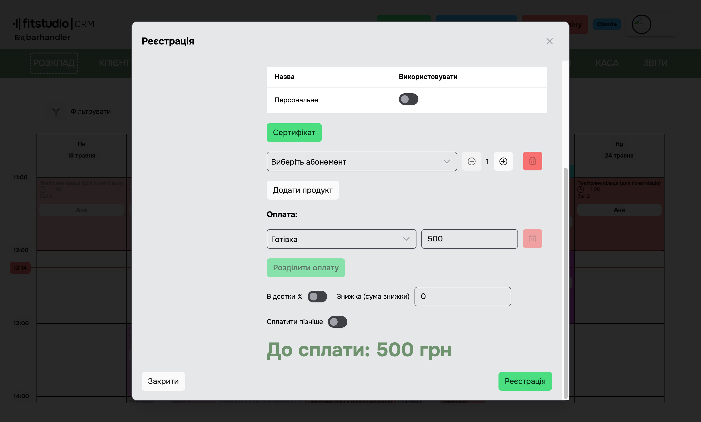

**Partial payment and debt shared between clients:**

> If a workout is for 2+ people and one of the booked clients pays **partially**, the system automatically calculates the **debt for the entire workout** and shows it to all the other booked clients. As soon as the studio has received the full workout price across all the clients combined, the debt closes automatically.

Example: a personal workout for 2 people, priced at **UAH 1300**. The first client (`client 5`) pays **UAH 500** in cash. When opening [Registration](#_329-registration) for the second client (`тест бонус`) for that same workout:

- a red badge at the top of the modal window reads **"Warning!!! The client has a debt: UAH 800"** (1300 − 500);
- the **Workout price** column also shows **UAH 800** — the amount still owed for the workout to be paid in full.

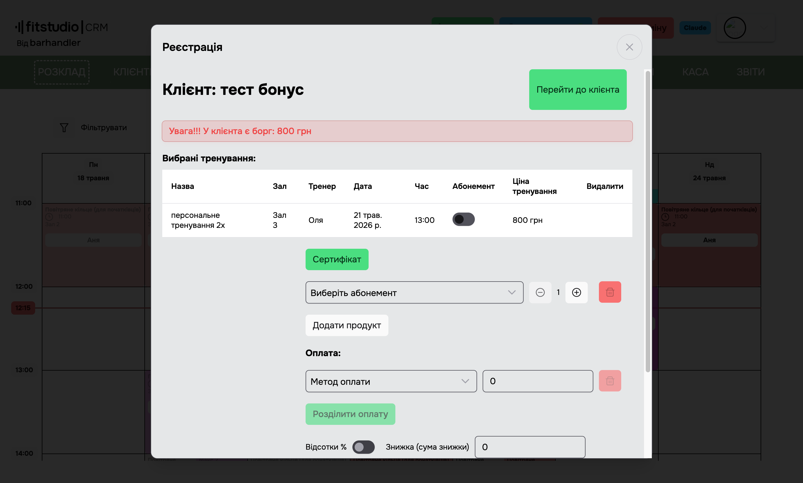

> ℹ️ A [Client debt](#_3212-client-debt) record is created for both the first and the second client, for the same remaining amount — either of them can pay it off (in cash, by card, from the [Personal account](#_3211-personal-account), or via a plan). Once paid in full, the record is automatically closed for all participants.

---

## 3.2.10 Deleting a client

- A client with status **Active** cannot be deleted.
- The client must first be deactivated, after which the **Delete** button becomes available.

---

## 3.2.11 Personal account

> Every client has a **Personal account** ("Особовий рахунок") — a prepayment that can be used to pay for plans, products and single sessions. The balance is shown in the **Personal account** column of the client table and in the client's mobile app.

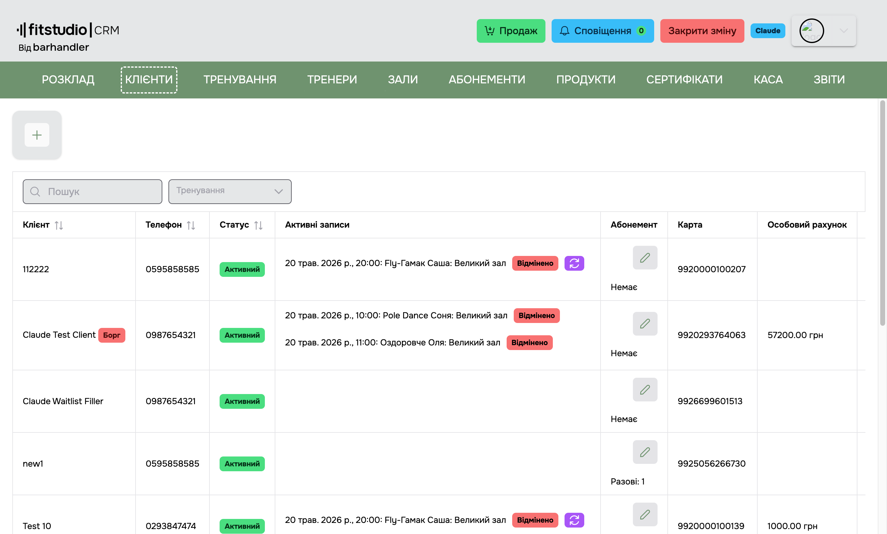

### 3.2.11.1 Topping up the account

> Top-ups are made through the **Sale** modal window:

1. Click  in the client's row.
2. Choose the **Account top-up** ("Поповнення рахунку") type.
3. Enter the **Top-up amount** (an integer) and choose the payment method — **Cash**, **Card** or **Cashless**. Payment from the personal account is not available for a top-up. The amount can be split between several methods (**Split payment**).
4. Click **Pay** ("Оплата").

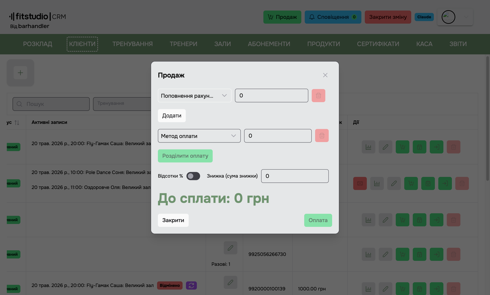

Requirements and behaviour:

- A top-up is made as a separate operation. If the same sale also contains plans or products, the system shows "Поповнення проводиться окремо" (top-up is made separately) and does not process the operation.
- Each payment method is posted as a separate register transaction for its own amount. The amount of a **Cash** or **Card** transaction is credited to the account immediately; the amount of a **Cashless** transaction is credited after the payment is confirmed.
- A top-up transaction with the **Cashless** method gets the **Awaiting confirmation** payment status, like other cashless transactions. Until it is confirmed, the amount is not credited to the personal account. Confirming it with the **Confirm** button in the [POS](/en/menu/pos) credits the amount once; a repeated confirmation credits nothing.
- If one of the transactions fails after others have been posted, "Поповнення проведено частково" (top-up partially posted) is shown with the amount already credited. Clicking **Pay** again without changes in the form posts only the remaining parts. If the amount or the payments are changed after a partial posting, the system shows "Поповнення вже проведено частково" and does not process the operation.
- A top-up with the **Cash** method increases the register cash balance by the top-up amount; the **Card** and **Cashless** methods do not change the cash balance.
- With an active fiscal integration, a top-up is fiscalized with a receipt holding one line "Поповнення особового рахунку" (personal account top-up) for the transaction amount.
- In the account history a top-up has the description "Поповнення особового рахунку".
- A top-up cannot be refunded. Its payment method is changed with the **Change payment method** action in the [POS](/en/menu/pos); the rules of the change, including for an unconfirmed **Cashless** top-up, are given in the description of that action.

### 3.2.11.2 Paying from the account

> When selling a plan or a product, or during a client's [Registration](#_329-registration), if the account balance is above 0, **"Особовий рахунок — X грн"** (personal account — X UAH) appears in the list of payment methods, where X is the current balance.

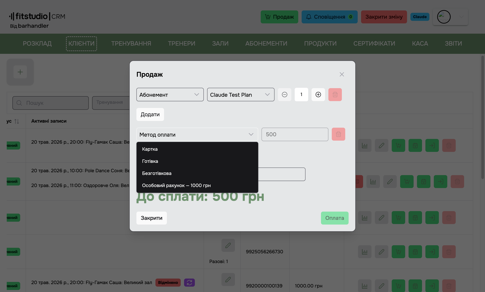

- Choose **Personal account** as the method (full payment), or enter an amount in a split payment via **Split payment** together with cash or card.
- If the amount exceeds the balance, "Недостатньо коштів на особовому рахунку (доступно X грн)" (insufficient funds) is shown and payment is unavailable.
- A payment from the personal account is **not fiscalized**.

### 3.2.11.3 Account history

> The  button opens the **History** modal window; the **Personal account** tab shows the current balance ("Поточний баланс: X грн") and all movements.

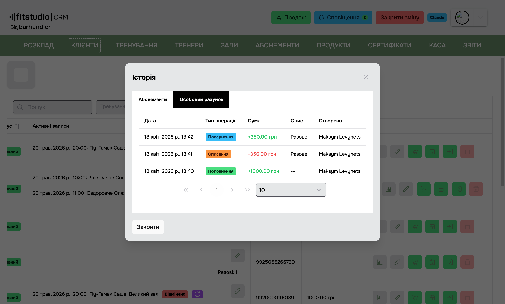

**Account history columns:**

| Column             | Description                                                    |
| ------------------ | -------------------------------------------------------------- |
| **Date**           | Date and time of the operation                                 |
| **Operation type** | **Top-up** ("Поповнення") / **Write-off** ("Списання") / **Refund** ("Повернення") / **Correction** ("Корекція") |
| **Amount**         | `+N грн` (green) or `-N грн` (red), two decimal places         |
| **Description**    | Names of plans and products, "Поповнення особового рахунку", or the reason of a correction; "--" when there is no description |
| **Created by**     | User who made the operation                                    |

If there are no operations, "Немає операцій по особовому рахунку" is shown.

- **Offline** ("Офлайн") — the mark of a row created during the sync of a personal-account payment or a refund made on a computer without internet. The **Date** of such a row is the operation time on the computer. See [Personal account, certificates and refunds](/en/pages/offline-mode#personal-account-certificates-and-refunds).

> 📱 The client sees their account and its full history in the mobile app, on the **Profile → Account** tab.

### 3.2.11.4 Account correction

> The **Adjust** ("Коригувати") button on the **Personal account** tab is available to the **SuperAdmin** role only. It opens the **Personal account correction** ("Коригування особового рахунку") window.

**Fields:**

- **New balance** ("Новий баланс") — the amount the account balance must become (up to two decimal places). The difference "Зміна: ±N грн" is shown below the field.
- **Reason for change** ("Причина зміни") — required, up to 255 characters.

**Checks (the "Save" button is disabled while there is an error):**

| Message | Condition |
|---|---|
| Вкажіть новий баланс | The **New balance** field is empty |
| Новий баланс не може бути відʼємним | The value is below 0 |
| Новий баланс не може перевищувати 99999999.99 | The value is above 99,999,999.99 |
| Баланс не змінився | The new balance equals the current one |
| Вкажіть причину зміни балансу | No reason given |
| Причина не може бути довшою за 255 символів | The reason is longer than 255 characters |

After saving, the account history gets a **Correction** row for the difference, with the reason in the **Description** column. A correction creates no register transaction and is not fiscalized. If the balance changed after the window was opened, the server refuses the correction and the window shows the current balance.

---

## 3.2.12 Client debt

> If a client is checked in to a workout (including with products) with the **Pay later** ("Сплатити пізніше") toggle on, the system creates a debt record.

### 3.2.12.1 Debt badge

> Clients with an unpaid debt have a **red "Борг" (Debt) badge** next to their name in the table row. An additional **Pay debt** ("Сплатити борг", wallet icon) button appears in the **Actions** column; it is disabled when no shift is open. The [Registration](#_329-registration) window shows the warning "Увага!!! У клієнта є борг: …".

### 3.2.12.2 Paying off debt

> Clicking the **Pay debt** button opens the **Debt payment** ("Оплата боргу") modal window:

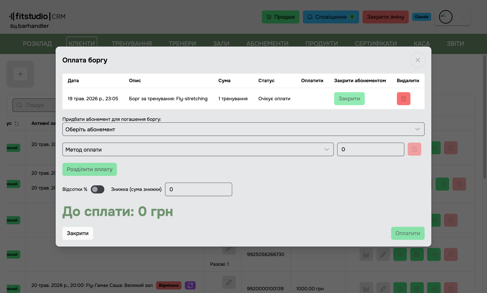

**Window structure:**

1. **Active debts table** — columns: **Date** • **Description** • **Amount** • **Status** • **Pay** ("Оплатити") • **Close with a plan** ("Закрити абонементом") • **Delete**. If there are no debts, "Немає активних боргів" is shown.
   - **Description** — what the debt is for (for example, "Борг за тренування: Fly-stretching").
   - **Amount** — "1 тренування" (1 session) for a session debt without an amount, or the remaining amount in UAH.
   - **Status** — **Awaiting payment** ("Очікує оплати") / **Paid** ("Оплачено").
   - **Pay** — a checkbox for a money debt; the checked debts are paid with the amount from the payment block.
   - **Close with a plan** — the **Close** ("Закрити") button for a session debt and a personal-workout debt. After confirmation ("Закрити борг абонементом "<name>"? Буде знято 1 тренування (залишок: N).") 1 session is deducted from the matching client plan and the debt is closed. The button is disabled when there is no suitable plan.
   - **Delete** (trash-can icon) — deletes the debt without payment.

2. **Buy a plan to settle the debt:** ("Придбати абонемент для погашення боргу:") — shown when there are debts that a plan can cover. Sells a plan and settles the debt from it at the same time:
   - **Choose a plan** ("Оберіть абонемент") — the list of the studio's plans.
   - **Payment method** (Card / Cash / Bank transfer / Personal account) and amount.
   - **Split payment** — adds another payment method.
   - **Discount (amount)** and the **Відсотки %** toggle.
   - **To pay** — the total.

The **Pay** ("Оплатити") button processes the payment and closes the debt(s); the **Close** button closes the window.

Payment rules:

- One payment is distributed across several checked debts; each part is posted as a separate sale transaction. A part cannot exceed the remaining debt.
- A debt is closed once its full amount is paid. When a discount is applied, the debts are closed after the discounted payment.
- A card payment goes through the payment terminal (if connected) once, before the payment is recorded.
- A debt payment is fiscalized as a sale (with an active fiscal integration). The part paid from the personal account is not fiscalized.
- A bank-transfer debt payment requires confirmation in the [Point of sale](/en/menu/pos).

### 3.2.12.3 Debt history

> The **Debt payment** window shows only unpaid debts. The full debt history is on the **Debts** tab of the **History** window (the  button).

The **Debts** tab shows all debts of the client — created, settled and deleted — with the columns: **Date** • **Description** • **Amount** • **Status** • **Created by** ("Створив") • **Deleted by** ("Видалив", user and deletion date) • **Action** ("Дія"). If there were no debts, "Боргів не було" is shown.

The **Status** column has one of three values: **Created** ("Створено"), **Settled** ("Погашено") or **Deleted** ("Видалено"). A deleted debt has the **Deleted** status regardless of its payment status.

Actions in the **Action** column:

- **Delete** (trash can) — for any debt not yet deleted, including a settled one;
- **Restore** (arrow) — for a deleted debt. The debt is restored with the same status, amount and list of clients it had before deletion.

> ℹ️ Deleting a debt is **reversible**: the debt is marked deleted and is excluded from debt lists and totals. The **Deleted by** column shows who deleted the debt and when. Deleting again does not change the date and author of the first deletion.

---

## 3.2.13 Search and filter

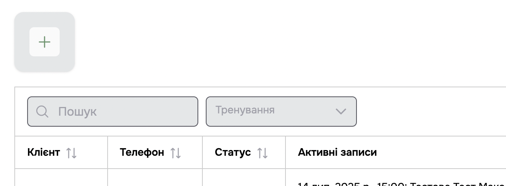

- The **Search** ("Пошук") field searches by surname and first name, phone, email and card number.
- The **Workouts** ("Тренування") filter (multiple selection) shows the clients booked for the selected workouts.

---

## 3.2.14 Excel import and export of clients

> The **Load clients from Excel** ("Завантажити клієнтів з Excel") and **Save clients to Excel** ("Зберегти клієнтів в Excel") buttons are next to the add-client button and are available to the SuperAdmin and Admin roles. Both operations run in the background: while an operation is running, the button is replaced by the label "Завантаження в процесі" (loading in progress) or "Збереження в процесі" (saving in progress).

### 3.2.14.1 File format

- An `.xlsx` file of at most 5 MB ("Файл завеликий. Максимальний розмір — 5 МБ.").
- The data is on the **Clients** sheet; the first row holds the column names.
- Columns (in export order): `id`, `firstName`, `lastName`, `phone`, `email`, `card`, `birthday`, `comment`, `createdAt`, `lastVisit`, `personalBalance`. The `firstName` column is required. The `createdAt`, `lastVisit` and `personalBalance` columns are informational only: the import does not read them. `createdAt` and `lastVisit` are the date and time in the [studio time zone](/en/login/settings#studio-time-zone) in the `yyyy-MM-dd HH:mm` format.

### 3.2.14.2 Import

The **Load clients from Excel** button opens the **Client import** ("Імпорт клієнтів") window with two steps:

1. **File** ("Файл") — the **Choose file** ("Виберіть файл") button. If there is no **Clients** sheet, "Лист "Clients" відсутній у файлі." is shown; if it holds no data — "Файл не містить даних.".
2. **Check** ("Перевірка") — the file name and size, the first 50 rows of the sheet, and the choice **Behaviour on duplicates:** ("Поведінка при дублікатах:"):

| Option | Action |
|---|---|
| **Skip** ("Пропустити", default) | Existing clients are not changed |
| **Update** ("Оновити") | Values from the file replace the existing ones; an empty cell does not erase a value |
| **Fill in** ("Доповнити") | Only the fields that are still empty in the system are filled |

A duplicate is a client with the same `id`, and for a row without `id` — a client with the same phone and first name. Buttons: **Back** ("Назад"), **Import** ("Імпортувати").

After start, the **Loading started** ("Завантаження запущено") window is shown. When finished, the **Loading finished** ("Завантаження завершено") window shows the summary: **Created** ("Створено"), **Updated** ("Оновлено"), **Skipped** ("Пропущено"), **Errors** ("Помилок"), and the first 50 refused rows in the format "Рядок N — reason". Row refusal reasons include:

- "Клієнта з таким id не знайдено" (no client with this id);
- "Кілька клієнтів з таким телефоном та імʼям — вкажіть id" (several clients with this phone and name — specify the id);
- "Не вдалося зберегти клієнта" (the client could not be saved).

Only one import can run at a time ("Попереднє завантаження клієнтів ще триває.").

### 3.2.14.3 Export

The **Save clients to Excel** button starts building the file; the **Saving started** ("Збереження запущено") window is shown. When the file is ready, the **File ready** ("Файл готовий") window opens with the **Cancel** ("Скасувати") and **Download** ("Завантажити") buttons. The file holds the **Clients** sheet with the columns listed in [3.2.14.1](#_32141-file-format); it can be edited and loaded back through import.

---

<a href="javascript:void(0)" onclick="history.back()">⬅️ Back</a>

[Back to home](/en/)
