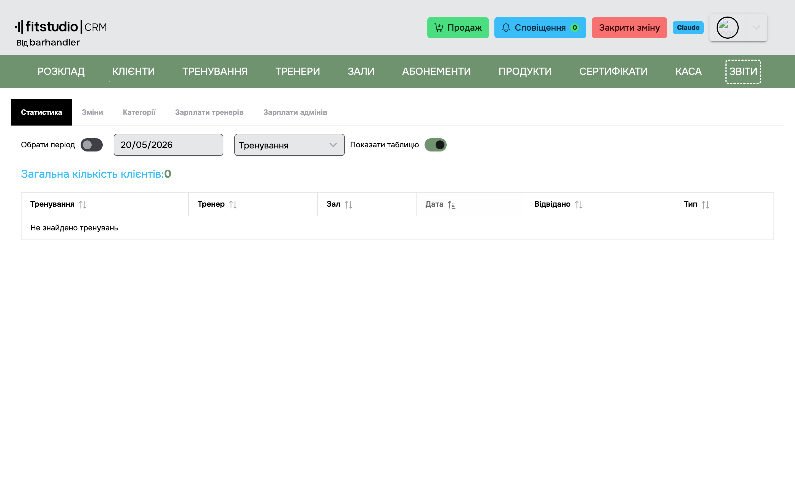
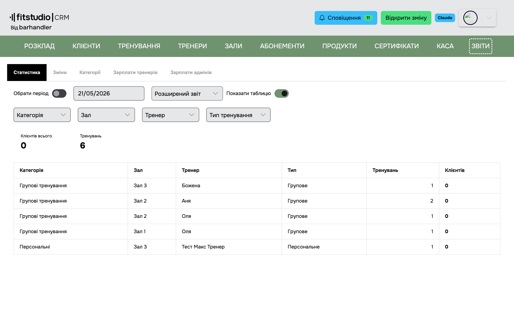
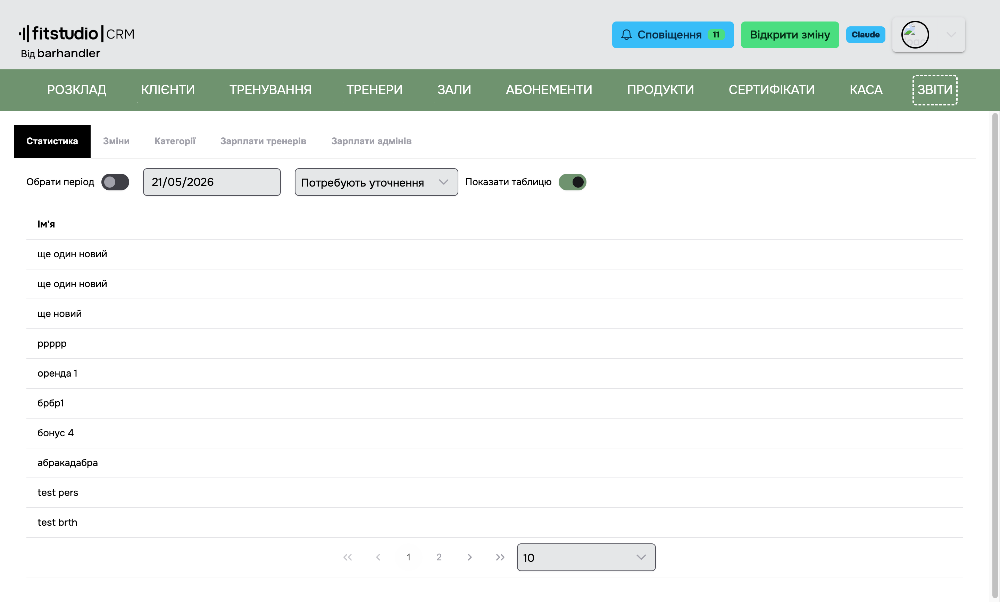
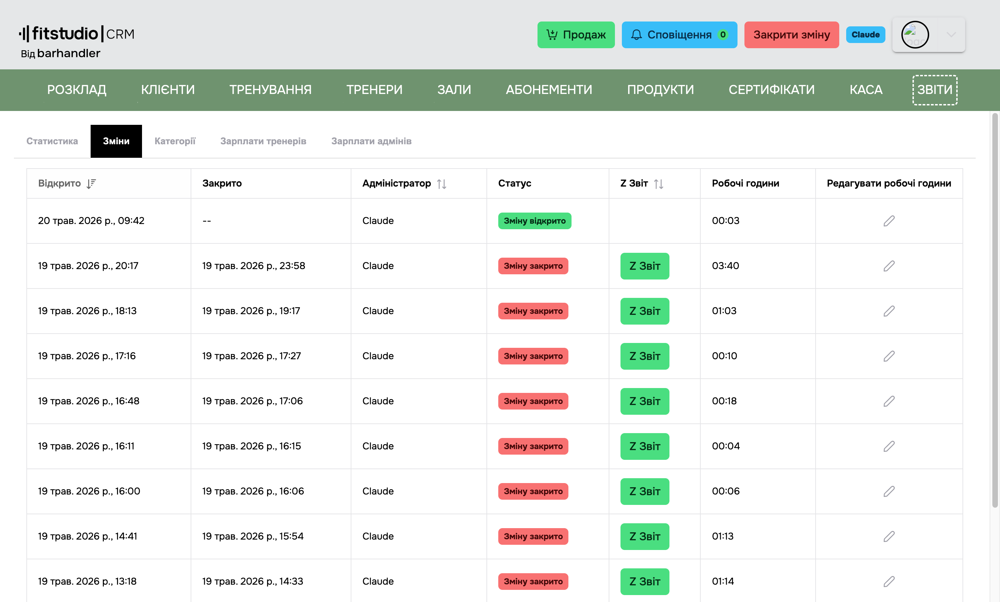
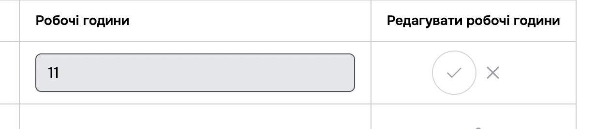
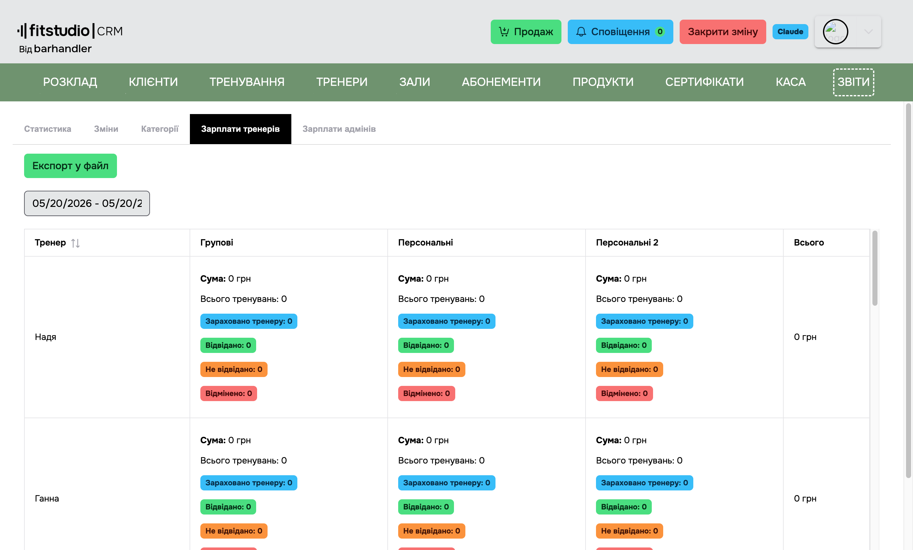
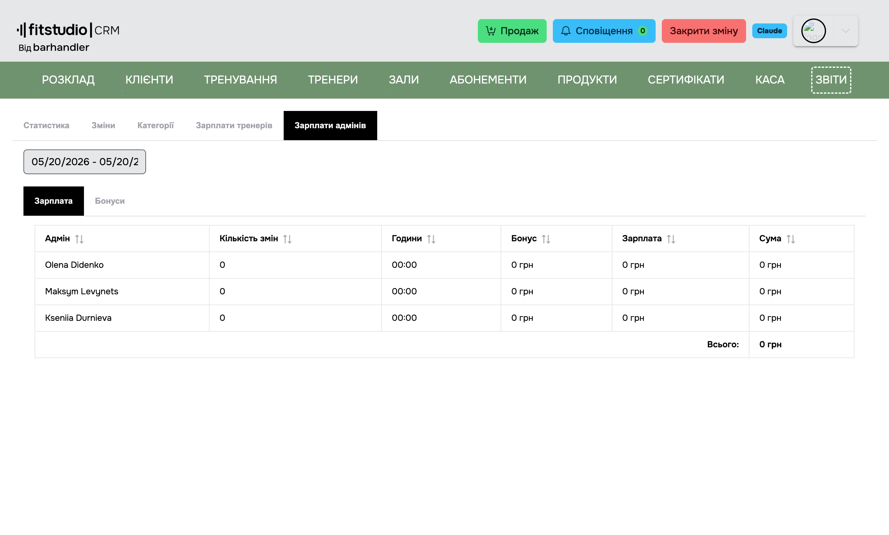

<a href="javascript:void(0)" onclick="history.back()">⬅️ Back</a>

[Back to home](/en/)

# 3.8 Reports

> The **Reports** page contains the following tabs:

- [Statistics](#_3-8-1-statistics)
- [Shifts](#_3-8-2-shifts)
- [Coach payroll](#_3-8-4-coach-payroll)
- [Administrator payroll](#_3-8-5-administrator-payroll)
- [Rating](#_3-8-6-rating) — shown when **Пропонувати оцінити заняття** (offer to rate the class) is enabled in the settings
- [SMS](#_3-8-7-sms)

> ℹ️ **Categories** ("Категорії") has moved from Reports to [Settings → Categories](/en/login/settings#categories).

> ℹ️ **Transactions** ("Транзакції") and the **Extended report** ("Розширений Звіт") have moved to the [Point of sale](/en/menu/pos) page, together with the fiscal reports and cash management.

---

## 3.8.1 Statistics

> A universal report with different breakdowns. Above the table:

- **Period selection** — the report period.
- **Filter** ("Фільтр") — the report type:
  - **Classes** ("Тренування") — an attendance chart and, with the **Показати таблицю** (show table) toggle on, a table of the classes held: **Class**, **Coach**, **Room**, **Date**, **Attended**, **Type** (Group / Personal); above the table — "Загальна кількість клієнтів" (total number of clients). If there are no classes — "Не знайдено тренувань".
  - **Plans** ("Абонементи") — plan sales and usage (chart).
  - **Products** ("Товари") — product sales (chart).
  - **Clients** ("Клієнти") — per-client statistics with a **Search** field. Columns:

    | Column | Content |
    |---|---|
    | **Name** ("Імʼя") | Client |
    | **Всього тренувань**, **Відвідані**, **Відмінені**, **Не відвідані** | Number of bookings in the period (total, attended, cancelled, not attended) |
    | **Дата останнього візиту** | Date of the last visit |
    | **SMS** | Number of SMS sent to the client in the period |
    | **PWA** / **Застосунок** | Whether the web app / mobile app is installed: "Так" (yes), "Ні" (no) or "—" (no data from the client yet) |
    | **ОС** | iPhone / Android / Інша (other) / "—" |
    | **Додаток карта** | Number of times the client card was opened in the app |
    | **Додаток запис на тренування**, **Додаток відміни тренування** | Number of bookings and cancellations through the app |
    | **Веб сторінка запис на тренування** | Number of bookings through the public web page |

  - **Extended report** ("Розширений звіт") — a report on the classes held, with filters:
    - **Category** ("Категорія") — limit to a specific category.
    - **Room** ("Зал") — limit to one room.
    - **Coach** ("Тренер") — limit to one coach.
    - **Class type** ("Тип тренування") — Group / Personal / Rent.

    Columns: **Category**, **Room**, **Coach**, **Type**, **Classes** (the number of classes in the grouped period), **Clients** (the total number of attendances). Rows with zero values are not shown. Above the table there is a **Classes** / **Total clients** summary. If there is no data — "Немає даних за вибраний період".

    

  - **Need clarification** ("Потребують уточнення") — a list of clients whose **phone field is empty** in the [client card](/en/menu/clients#_3-2-6-editing-a-client). Other fields (email, date of birth) are not considered. A client without a phone receives no SMS messages; the [Registration](/en/menu/clients#_3-2-9-registration) window shows "Увага!!! Клієнт потребує уточнення даних" for such a client.

    

---

## 3.8.2 Shifts

> The list of all shifts within the selected period.

**Columns:**

- **Opened** ("Відкрито") — the date and time the shift was opened.
- **Closed** ("Закрито") — the date and time the shift was closed.
- **Administrator** ("Адміністратор") — the administrator's name.
- **Status** ("Статус") — Shift opened ("Зміну відкрито") / Shift closed ("Зміну закрито").
- **Z-report** ("Z Звіт") — the **Z Звіт** button that opens the Z-report of a closed shift.
- **Working hours** ("Робочі години") — the number of hours used for the payroll calculation.
- **Edit working hours** ("Редагувати робочі години") — a column for the SuperAdmin and Admin roles. Only the hours of **one's own closed shifts** can be edited; for other shifts the tooltip "Неможливо Редагувати робочі години. Зміна або не ваша або її не закрито" (cannot edit: the shift is not yours or not closed) is shown.

Pressing **Edit** ("Редагувати") turns the **Working hours** field into an input, and **Save** ("Зберегти") / **Cancel** ("Відмінити") buttons appear in the **Actions** column.

> 💡 A fractional value is entered in hours: 1 h 48 min = 108 ÷ 60 = **1.8 hours**.

---

## 3.8.4 Coach payroll

> The coaches' payroll for the selected period.

**Columns:**

- **Coach** ("Тренер") — the coach's name.
- **Dynamic columns** — the system groups every class in the period by **category**, and each category becomes its own column. The value and the calculation type come **from the class category** ([Categories](/en/login/settings#categories)):
  - **Per person** (`PerPerson`) — `total number of clients × baseRate`.
  - **Per class** (`PerWorkout`) — `number of payable classes × baseRate`. A class counts as payable when at least one client attended it, or when a late cancellation was deducted for it.

  A category cell holds **Сума** (amount), "Всього тренувань" (total classes), "Зараховано тренеру" (credited to the coach) and the number of bookings "Відвідано" / "Не відвідано" / "Відмінено" (attended / not attended / cancelled).
- **Total** ("Всього") — the sum of all categories for that coach.

> The bottom row **Всього:** shows the total across all coaches.

**Export:** the **Експорт у файл** (export to file) button downloads the text file `salary DD.MM-DD.MM.txt` broken down by coach and category.

> ℹ️ The calculation respects the **"Враховувати максимальну к-сть людей при підрахунку зарплат"** (take the maximum number of people into account) setting ([3.8.4.1](#_3-8-4-1-payroll-settings)): if a class has more clients than its capacity, only the capacity is counted.

### 3.8.4.1 Payroll settings

For details see [Settings → Features](/en/login/settings#features). The parameters that affect the calculation are:

- **Minimum number of clients** — if there are fewer clients, the coach is credited with the minimum.
- **Take the maximum number of people into account** — caps the calculation at the class capacity.
- **Remove a recurring booking after N misses** — affects the clients' history within the period.

---

## 3.8.5 Administrator payroll

The tab has the sub-tabs **Зарплата** (salary) and **Бонуси** (bonuses; the second is shown when administrator bonuses are configured).

**Columns of the "Зарплата" tab:**

- **Admin** ("Адмін")
- **Number of shifts** ("Кількість змін") — the number of working shifts in the period.
- **Hours** ("Години") — total hours worked (from the [Shifts](#_3-8-2-shifts) table).
- **Bonus** ("Бонус") — accrued bonuses; the column is shown when administrator bonuses are configured.
- **Salary** ("Зарплата") — `hours × hourly rate from the administrator's profile`, without the bonus.
- **Sum** ("Сума") — `Salary + Bonus`.

The bottom row **Всього:** shows the overall total.

**Columns of the "Бонуси" tab:** **Дата транзакції** (transaction date), **Адмін**, **Клієнт**, **Дата рєестрації** (registration date), **Абонемент** (plan), **Нарахування** (accrual), **Умова** (condition), **Тип клієнта** (client type), **Сума**, **Статус** (**Ухвалено** approved / **Відхилено** rejected). The SuperAdmin and Manager roles have the **Відхилити** (reject, for an approved bonus) and **Ухвалити** (approve, for a rejected bonus) buttons in the **Дії** column; the action requires confirmation.

> Bonuses are configured in [Settings → Features → Administrator bonuses](/en/login/settings#administrator-bonuses).

---

## 3.8.6 Rating

> Ratings that clients leave through the mobile app. The tab is shown when **Пропонувати оцінити заняття** (offer to rate the class) is enabled in the [settings](/en/login/settings).

- The studio's overall average rating and the number of ratings.
- The rating of each coach separately (the **Тренери** block).
- The list of reviews with the columns **Автор** (author), **Оцінка** (rating), **Відгук** (review), **Тренування** (class), **Дата** (date). If there are no reviews — "Ще немає відгуків".
- The **SuperAdmin** and **Admin** roles can delete a review; deletion requires confirmation ("Видалити цей відгук?"), and "Відгук видалено" (review deleted) is shown afterwards.

> ℹ️ Clients see the rating only after a minimum number of ratings has been collected, see [7.9 Ratings and reviews](/en/mobile/ratings).

---

## 3.8.7 SMS

> The **SMS** tab records the messages sent to clients in the selected period (the period picker is above the report).

**Totals:**

| Indicator | Content |
|---|---|
| **Усього SMS** | All SMS sent |
| **Нагадування** | Class reminder SMS |
| **Коди входу** | Login code SMS |
| **Про зміни** | SMS about changes to bookings and classes |
| **Telegram (без SMS)** | Messages delivered through Telegram instead of SMS |

**Кому пішло найбільше** (top recipients) — a table **Клієнт**, **Телефон**, **SMS**.

**Усі надсилання** (all sendings) — a table with the columns **Дата**, **Клієнт**, **Телефон**, **Тип**, **Канал**; 20 rows per page. Channel filter: **Усі канали** (all channels), **Лише SMS** (SMS only), **Лише Telegram** (Telegram only).

| Type | Meaning |
|---|---|
| Код входу | Login code for the app |
| Нагадування | Class reminder |
| Відміна заняття | Class cancellation notice |
| Скасування запису | Booking cancellation notice |
| Перенесення заняття | Class rescheduling notice |
| Підтвердження запису | Booking confirmation notice |
| Прохання оцінити | Offer to rate the class |

Channel: **SMS**, **Telegram (бот)** (bot), **Telegram**.

---

<a href="javascript:void(0)" onclick="history.back()">⬅️ Back</a>

[Back to home](/en/)
