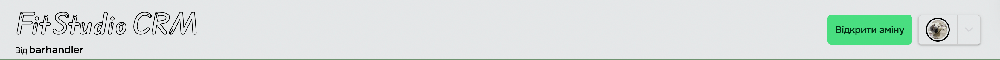
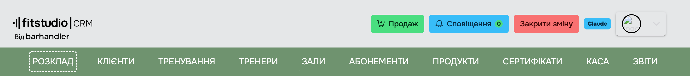
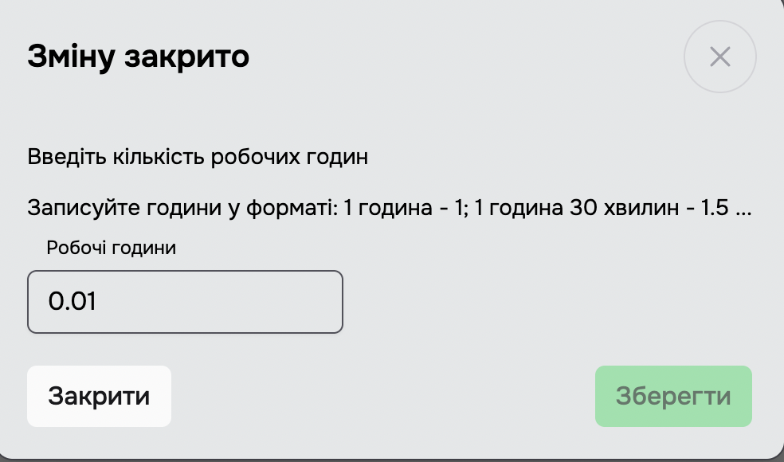
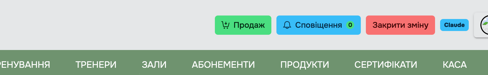
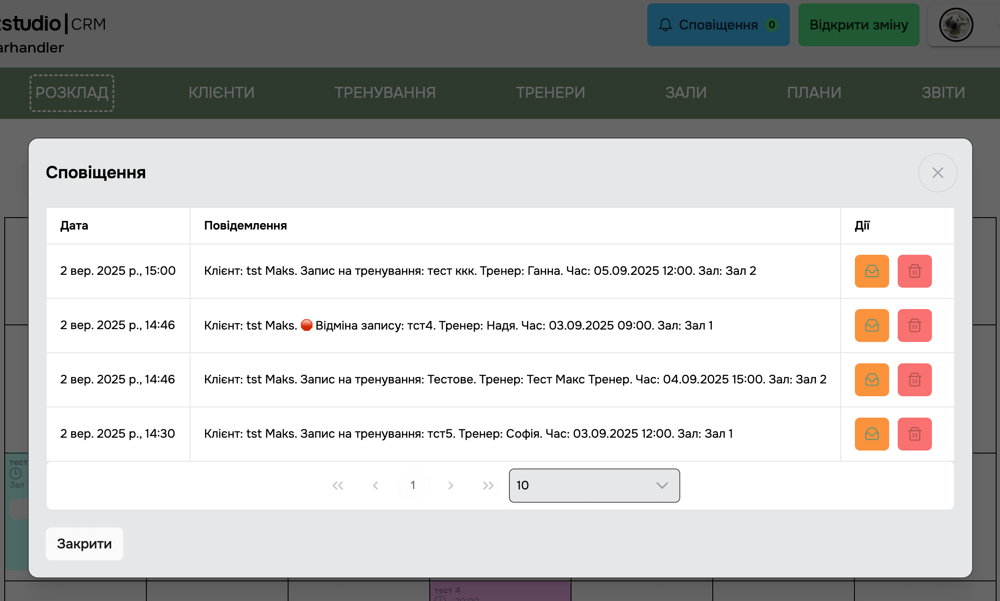

[Back to home](/en/)

# 2. Opening and Closing a Shift

## 2.1 Opening a Shift

> The **Відкрити зміну** (Open shift) button is on the right side of the header while the shift is closed.

Clicking it opens the [«Ви впевнені що хочете продовжити?» (Are you sure you want to continue?) modal](../_modals/are-you-sure-modal.md ":include"). **Продовжити** (Continue) opens the shift, and the message «Зміну відкрито» (Shift opened) appears.

If another user has already opened the shift, the window «Зміну вже відкрито користувачем <name>» (The shift is already opened by user <name>) appears with the **Зрозуміло** (Got it) button; no new shift is opened.

**Restrictions while the shift is closed:**

- The **Продаж** (Sale) button is not shown in the header. The button is available to the **Супер Адмін** (Super Admin) and **Адмін** (Admin) roles only while a shift is open.
- Scanning cards and certificate QR codes is blocked: the system shows the «Необхідно відкрити зміну!» (You need to open a shift!) window with the **Зрозуміло** button.
- When a user with the **Адмін** role goes to the **Клієнти** (Clients) page, the window «Ви не відривали поточну зміну. Деякі дії будуть не доступні» (You have not opened the current shift. Some actions will not be available) appears with the **Зрозуміло** button. Work on the page can continue; some actions are unavailable. The warning is not shown to the **Супер Адмін** and **Менеджер** (Manager) roles.

### Shift opened by another user

If, when a user with the **Адмін** role signs in, the shift is open under another user, the window «Зміна була відкрита <name>. Бажаєте відкрити зміну під своїм користувачем?» (The shift was opened by <name>. Do you want to open the shift under your own user?) appears:

- **Так** (Yes) — the current shift is closed and a new shift is opened under the signed-in user.
- **Ні** (No) — the shift stays with the previous user.

> Shifts are used to track working time and [administrator salaries](/en/menu/reports#_385-administrator-payroll).

---

## 2.2 Closing a Shift

> The **Закрити зміну** (Close shift) button is on the right side of the header while the shift is open.

Clicking it opens the [«Ви впевнені що хочете продовжити?» modal](../_modals/are-you-sure-modal.md ":include"). If the shift was opened by another user, the text is «Зміна була відкрита користувачем <name>. Ви впевненні що хочете закрити зміну?» (The shift was opened by user <name>. Are you sure you want to close the shift?).

After confirmation the **Зміну закрито** (Shift closed) modal appears.

- The **Робочі години** (Working hours) field holds the calculated shift length. Format — a decimal number: 1 hour — `1`, 1 hour 30 minutes — `1.5`.
- The **Зберегти** (Save) button is active only when the value has changed; it saves the entered hours.
- The **Закрити** (Close) button closes the window without changes.
- If a fiscal integration is active, the window also shows the shift Z-report.

> ⚠️ When the **Зміну закрито** window is closed (with **Закрити**, **Зберегти** or the cross), the system signs the user out.

The hours of a closed shift can be changed later on the [Reports → Shifts](/en/menu/reports#_382-shifts) page.

---

## 2.3 Opening and Closing a Shift with a Fiscal Integration

If at least one fiscal integration (Vchasno Kasa or Checkbox) is active in [Settings → Integrations](/en/login/settings#integrations), the **Відкрити зміну** and **Закрити зміну** buttons open the **Відкрити зміну** / **Закрити зміну** window instead of the confirmation window.

The window contains the **Активні фіскальні інтеграції** (Active fiscal integrations) table:

| Column | Value |
| --- | --- |
| **Назва** (Name) | Integration card name |
| **Оператор** (Operator) | Integration type |
| **Статус** (Status) | **Онлайн** (Online) / **Офлайн** (Offline) / **Перевірка…** (Checking…) — connection with the operator |
| **Зміна на інтеграції** (Shift on the integration) | **Відкрита** (Open) / **Закрита** (Closed) / **Перевірка…** — shift state on the operator side |

If the shift state in the system and at the operator differ, the row shows the **Синхронізувати** (Synchronize) button; after synchronization the message «Інтеграцію синхронізовано» (Integration synchronized) appears.

If the integration data could not be read, the line «Не вдалося отримати дані фіскальних інтеграцій. Перевірте зʼєднання та оновіть дані.» (The fiscal integration data could not be obtained. Check the connection and refresh the data.) is shown in place of the table, together with the **Оновити** (Refresh) button, which repeats the read; the window does not have to be closed. When no active integration exists, the line «Жодну фіскальну інтеграцію не підключено» (No fiscal integration is connected) is shown.

Window buttons:

- **Скасувати** (Cancel) — closes the window with no action. Unavailable while an action over the shift is running.
- **Відкрити** (Open) / **Закрити** (Close) — brings the shift of every active integration into the required state, then opens or closes the shift in the system. If the action fails for one of the integrations, the message «<name>: синхронізація не вдалась» (<name>: synchronization failed) appears; the shift in the system is opened or closed anyway.

While the action is running, the action button is unavailable and the window does not close — neither by the **Скасувати** button nor by the Esc key. The window closes once the shift has been opened or closed. When the action did not finish, the message **Дію не завершено** (The action did not finish) is shown with the text «Дію над зміною не завершено. Перевірте стан зміни та повторіть спробу.», the window stays open and the action button becomes available again.

When another user opened the shift, the message «Зміну вже відкрито користувачем <name>» (The shift has already been opened by <name>) is shown, or «Зміну вже відкрито іншим користувачем» (The shift has already been opened by another user) when the name is not known; the shift in the system is not opened a second time and the shift at the integrations is not opened.

On closing, the Z-reports received from the integrations are saved with the shift and shown in the **Зміну закрито** window. Z-reports received in an attempt that did not finish are kept for the next closing attempt; a second Z-report of the same shift is not issued. When the closing request was not carried out, the message **Зміну не закрито** (The shift was not closed) is shown with the text «Запит на закриття зміни не виконано, тому зміна залишається відкритою. Повторіть закриття.», and the shift stays open.

Opening and closing a shift on ПРРО offline-mode registers is covered on the [ПРРО fiscal shift](/en/pages/prro-shift) page.

---

## 2.4 Automatic Shift Closing

If the **Закривати зміну автоматично(закриється 23:57)** (Close the shift automatically (closes at 23:57)) switch is on in [Settings → Functions](/en/login/settings#features), an open shift is closed every day at 23:58 in the studio time zone ([Settings → Studio Time Zone](/en/login/settings#studio-time-zone); defaults to `Europe/Kyiv`). The shift is closed once; if no shift is open, nothing happens. The record «Зміну закрито автоматично» (Shift closed automatically) appears in the notifications.

---

## 2.5 Notifications

The **Сповіщення** (Notifications) button in the header shows the number of unread notifications. The number is refreshed every 10 minutes; if there are unread notifications, the window «Доступні нові сповіщення» (New notifications available) appears with the **Зрозуміло** button.

Notifications are created by events in the studio, including:

- bookings and booking cancellations by clients through the mobile app;
- a booking that needs administrator confirmation;
- automatic removal of a client from a repeat booking (see [Settings → Functions](/en/login/settings#features));
- automatic shift closing;
- service messages from the Fitshandler platform.

Clicking the button opens the **Сповіщення** window with a table: **Дата** (Date), **Повідемлення** (Message), **Дії** (Actions). Available actions:

- **Прочитати** (Read) / **Позначити як непрочитане** (Mark as unread);
- **Видалити** (Delete);
- **Перейти до тренування** (Go to workout) — for notifications related to a workout;
- **Підтвердити** (Confirm) / **Відхилити** (Reject) — for bookings that need confirmation.

The automatic closing does not affect the shift of a computer working without internet. A shift marked "Офлайн" (Offline), created by the server for sales made without internet, is closed from its creation. See [Sales sync](/en/pages/offline-mode#shift).

[Back to home](/en/)
