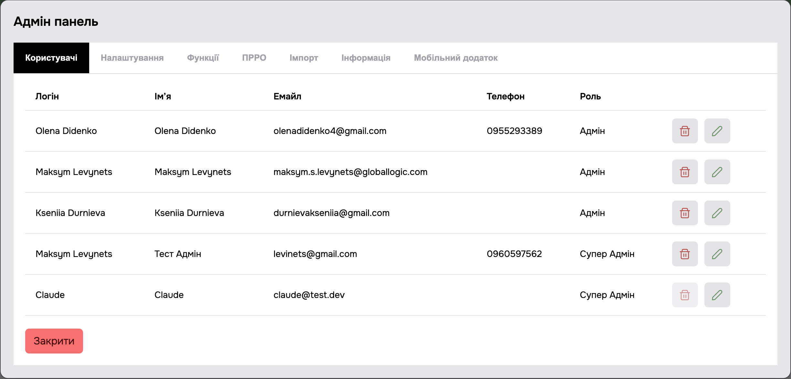
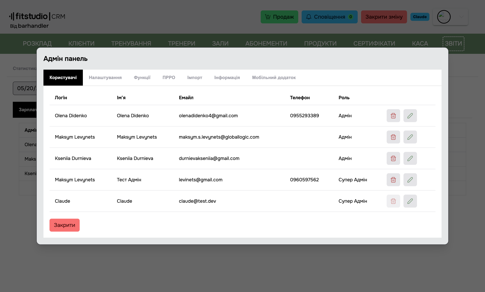
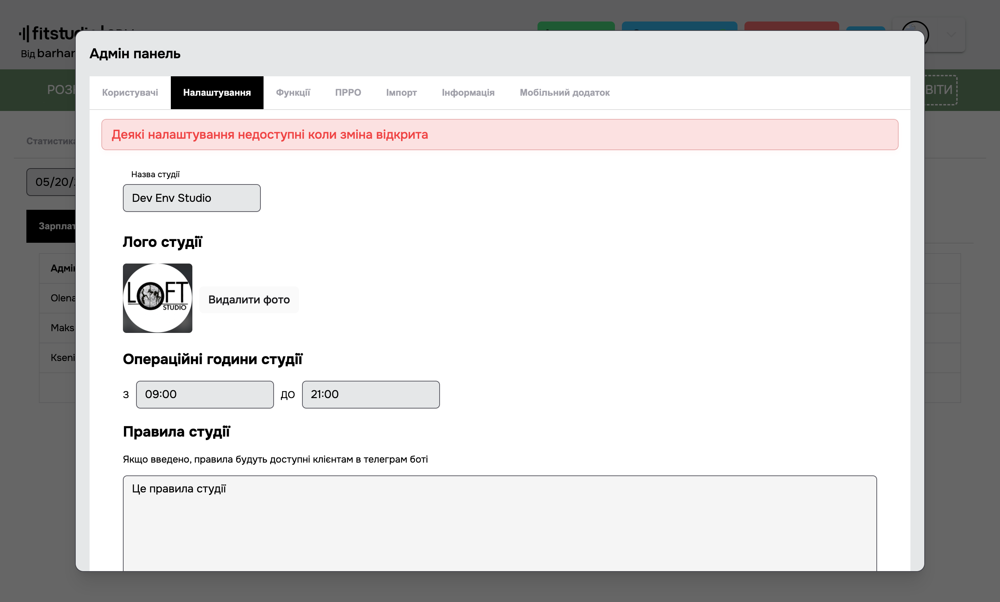
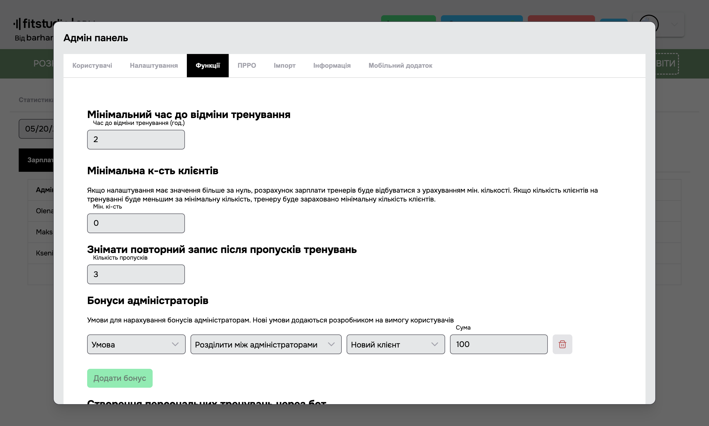
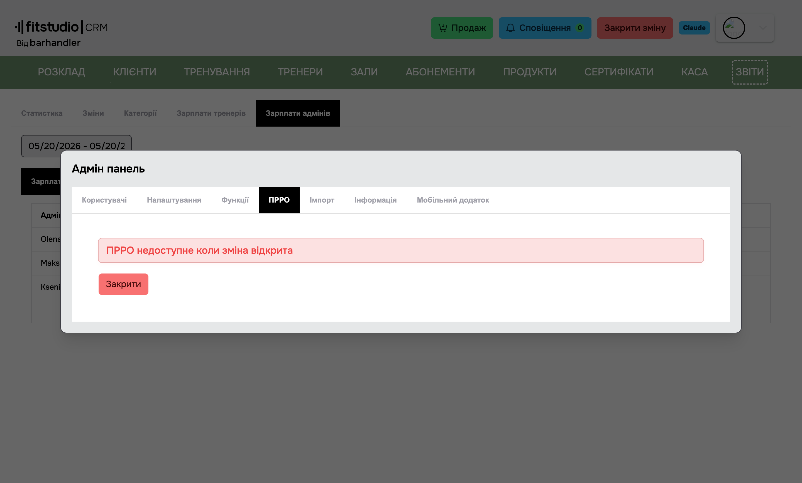
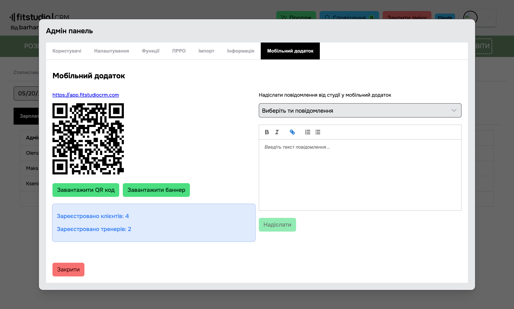

<a href="javascript:void(0)" onclick="history.back()">⬅️ Назад</a>

[Повернутися на головну](/)

# 1.3.2.2 Налаштування

> Сторінка **Налаштування** відкривається пунктом **Налаштування** головного меню і складається з вкладок. Доступ мають ролі **Супер Адмін**, **Адмін** і **Менеджер**.

**Вкладки:**

- [1. Користувачі](#Користувачі) — користувачі студії, запрошення за емейлом.
- [2. Налаштування](#Налаштування) — операційні години, правила студії, часовий пояс, очищення тренувань.
- [3. Функції](#Функції) — бізнес-правила студії.
- [4. Інтеграції](#Інтеграції) — фіскалізація, еквайринг, пристрої. Вкладка відображається лише ролі **Супер Адмін**.
- [5. Інформація](#Інформація) — версії та контакти.
- [6. Мобільний додаток](#Мобільний-додаток) — клієнтський застосунок, онлайн-запис, SMS, самореєстрація.
- [7. Нагадування](#Нагадування) — власні нагадування для працівників студії.
- [8. Категорії](#Категорії) — категорії тренувань для розрахунку зарплати тренерів.
- [9. Інформація про студію](#Інформація-про-студію) — назва, логотип, опис, фотографії та контакти студії.

> Імпорт і експорт клієнтів виконується на сторінці [Клієнти](/menu/clients#_3214-Імпорт-і-експорт-клієнтів-в-excel).

---

## Користувачі

> Список користувачів студії, запрошення нових, редагування ролей і ставок, видалення.

Повний опис вкладки — на сторінці [Користувачі](/login/users).

---

## Налаштування

> Загальні параметри студії. Зміни зберігаються кнопкою **Зберегти**.

Коли зміну відкрито, у верхній частині вкладки відображається повідомлення «Деякі налаштування недоступні коли зміна відкрита».

> Назву студії та логотип задають на вкладці [Інформація про студію](#Інформація-про-студію).

### Операційні години студії

Час початку (**З**) і кінця (**ДО**) робочого дня з кроком 30 хвилин. Кнопка **Зберегти** неактивна, якщо час початку пізніший за час кінця.

### Правила студії

Багаторядкове текстове поле. Введений текст відображається клієнтам у мобільному застосунку в пункті **Правила студії** на картці студії.

> ℹ️ Підпис під заголовком у налаштуваннях — «Якщо введено, правила будуть доступні клієнтам в телеграм боті». Правила відображаються клієнтам у мобільному застосунку.

### Часовий пояс студії

Випадаючий список **Часовий пояс** (за замовчуванням Київ, `Europe/Kyiv`). Часовий пояс визначає дати й час тренувань і звітів студії.

> ⚠️ Якщо в студії є хоча б одне тренування, список заблоковано і під ним відображається повідомлення «Зміна часового поясу недоступна».

### Danger Zone

Кнопка **Очистити тренування** відкриває вікно **Очистити тренування**: «Ця дія незворотня. Всі тренування будуть видалені, а клієнти — відписані. Повернути видалену інформацію буде неможливо.»

Кнопка **Продовжити** стає активною лише після того, як увімкнено перемикач **Я підтверджую видалення** і в поле введено слово **DELETE**. Очищення виконується [фоновою задачею](/pages/processing#_65-Фонові-задачі).

---

## Функції

> Бізнес-правила студії. Зміни зберігаються кнопкою **Зберегти**; після збереження зʼявляється повідомлення «Функції збережено».

### Мінімальний час до відміни тренування

- Поле **Час до відміни тренування (год.)** — ціле число.
- Якщо клієнт скасовує запис пізніше, ніж за вказану кількість годин до початку, тренування списується з абонемента як **Не відвідано**.

### Автовихід при бездіяльності

Поле **Годин** — кількість годин бездіяльності, після якої користувача автоматично виводить із системи. Значення `0` вимикає автовихід.

### Мінімальна к-сть клієнтів

- Поле **Мін. кі-сть** — ціле число.
- Якщо значення більше за нуль і на тренуванні було менше клієнтів, тренеру зараховується мінімальна кількість клієнтів.
- Діє для категорій із типом ставки **За людину**.

### Знімати повторний запис після пропусків підряд

- Поле **Пропусків підряд** — ціле число від `1`; порожнє поле вимикає правило.
- Якщо клієнт із повторним записом пропускає вказану кількість занять підряд (статус **Не відвідано**), система знімає його з повторного запису. Відвідування обнуляє лічильник. Скасування запису, зокрема пізнє, пропуском не вважається.
- Адміністратор отримує про це сповіщення. Див. [Зняття з повторного запису після пропусків](/pages/processing#_69-Зняття-з-повторного-запису-після-пропусків).

### Бонуси адміністраторів

> Умови нарахування бонусів, що враховуються у звіті [Зарплати адмінів](/menu/reports#_385-Зарплати-адмінів).

Кожен бонус — рядок із полів:

| Поле | Значення |
| --- | --- |
| **Умова** | **Перший абонемент клієнта** |
| **Нарахування** | **Розділити між адміністраторами** / **Адміністратор що продав абонемент** |
| **Тип клієнта** | **Будь-який клієнт** / **Новий клієнт** |
| **Сума** | Сума бонусу, ціле число |

Кнопка **Додати бонус** додає рядок; якщо всі умови вже використано, кнопка неактивна з підказкою «Немає доступних умов». Іконка кошика видаляє рядок.

Нарахування бонусів окремому адміністратору вмикається перемикачем **Нараховувати бонуси** на сторінці [Користувачі](/login/users).

### Створення персональних тренувань тренерами

Розділ із заголовком **Створення персональних тренувань у мобільному застосунку**. Налаштування визначає категорії, у яких тренер може створити персональне тренування в мобільному застосунку.

- Перемикач **Дозволити тренерам створювати персональні тренування в мобільному застосунку** — вмикає функцію.
- Перемикач **Всі категорії** — дозволяє всі категорії студії.
- Якщо **Всі категорії** вимкнено, кнопка **Додати категорію** додає рядок із випадаючим списком **Виберіть категорію**; іконка кошика видаляє рядок.

### Нагадувати про дні народження тренерів

- Поле **Днів** — за скільки днів до дня народження тренера в сповіщеннях зʼявляється нагадування.
- Значення `0` вимикає нагадування.

### Функції (перемикачі)

| Перемикач | Дія |
| --- | --- |
| **Повідомляти клієнтам про заміну тренера (Додаток)** | Коли на тренування призначено заміну тренера, записані клієнти отримують сповіщення в мобільному застосунку. |
| **Враховувати максимальну к-сть людей при підрахунку зарплат** | Кількість клієнтів, зарахована тренеру, не перевищує максимальної кількості людей на тренуванні. |
| **Закривати зміну автоматично(закриється 23:57)** | Відкрита зміна закривається щодня о 23:58 за київським часом. Див. [Автоматичне закриття зміни](/pages/shifts#_24-Автоматичне-закриття-зміни). |
| **Нараховувати борг за неявку на персональне (без абонемента) та зараховувати тренеру** | Див. нижче. |
| **Автоматична реєстрація при скануванні картки (клієнт з активним абонементом і записом на сьогодні)** | Див. [Автоматична реєстрація при скануванні картки](/pages/processing#_610-Автоматична-реєстрація-при-скануванні-картки). |

**Борг за неявку на персональне тренування.** Коли перемикач увімкнено і клієнту персонального тренування виставлено статус **Не відвідано** без списання з абонемента (вручну, через пізнє скасування або нічною задачею), а в клієнта немає активного персонального абонемента:

- клієнту створюється борг «Борг за неявку на персональне тренування: <назва>» на суму ціни абонемента, привʼязаного до категорії тренування;
- тренування зараховується тренеру в зарплату.

Борг не створюється, якщо до категорії не привʼязано абонемент або його ціна дорівнює нулю. Для одного заняття борг створюється один раз.

---

## Інтеграції

> Вкладка доступна лише ролі **Супер Адмін**. Містить фіскальні інтеграції (Вчасно Каса, Checkbox), еквайринг Monobank і пристрої.

### Фіскальні інтеграції

Кожна фіскальна інтеграція додається окремою карткою — кнопкою **Додати інтеграцію Вчасно Каса (фіскалізація)** або **Додати інтеграцію Checkbox (фіскалізація)**.

| Інтеграція | Поля |
| --- | --- |
| **Вчасно Каса (фіскалізація)** | **Назва**, **Token** |
| **Checkbox (фіскалізація)** | **Назва**, **Пінкод касира**, **Client Name**, **Client Version**, **License Key** |

- Перемикач **Активна** вмикає картку. Перед активацією показується вікно «Активувати інтеграцію?» — «Зараз перевіримо облікові дані у провайдера. Продовжити?». Якщо перевірка не пройшла, зʼявляється повідомлення «Не вдалося активувати інтеграцію».
- Одночасно активною може бути лише одна картка кожного типу.
- Вимкнення картки підтверджується у вікні «Деактивувати інтеграцію?».

### Monobank Acquiring

Кнопка **Додати інтеграцію Monobank** додає картку еквайрингу: **Token (X-Token)**, список QR-кодів (кнопка **Зчитати QR-коди**, поле **Активний QR**) і фізичні термінали (кнопка **Додати термінал**, назва терміналу та `terminal_id`).

> ⚠️ Картка Monobank Acquiring під час оплати в [Касі](/menu/pos) не використовується.

### Пристрої (менеджер пристроїв)

Налаштування локального менеджера пристроїв, через який система працює з POS-терміналами та принтерами. Налаштування зберігаються лише на цьому пристрої.

- Перемикач **Використовувати менеджер пристроїв**, поле **URL менеджера** (за замовчуванням `http://localhost:9999`), кнопки **Зберегти URL** і **Перевірити зʼєднання** (результат: «Менеджер підключено» / «Менеджер недоступний»).
- Посилання **Завантажити девайс менеджер**: **Windows**, **Mac Apple Silicon**, **Mac Intel**, **Android-планшет**.
- **POS-термінали** — кнопки **Знайти пристрої**, **Додати вручну** (поля **Банк / протокол**, **IP-адреса термінала**, **Порт**, **Назва (не обовʼязково)**, кнопка **Додати та перевірити**) і **Перевірити**. Колонка **Звʼязок**: **Відповідає** / **Не відповідає** / **Не перевірявся**.
- Принтери — **Зареєструвати**, **Тестовий друк**, **Видалити реєстрацію**; **Принтер для чеків**, **Принтер цінників**, перемикач **Друкувати чек після оплати**.

Якщо POS-термінал зареєстровано і менеджер пристроїв увімкнено, оплата методом **Картка** проводиться через термінал. Інакше оплата карткою фіксується без термінала — див. [Оплата карткою без термінала](/pages/processing#_612-Оплата-карткою-без-термінала).

### Фіскалізація операцій

Коли активна фіскальна інтеграція:

- продажі (готівка, картка, безготівкова оплата) фіскалізуються, для кожної операції створюється фіскальний чек;
- оплата боргу фіскалізується в момент оплати; продаж із позначкою **Сплатити пізніше** чека не створює — див. [Борги](/pages/processing#_613-Борги);
- поповнення особового рахунку фіскалізується; оплата з особового рахунку не фіскалізується;
- відкриття й закриття зміни синхронізується з інтеграцією, Z-звіт відображається у вікні **Зміну закрито** — див. [Відкриття та закриття зміни з фіскальною інтеграцією](/pages/shifts#_23-Відкриття-та-закриття-зміни-з-фіскальною-інтеграцією).

> ℹ️ Кнопки **X Звіт** і **Звіт за день** на сторінці [Каса](/menu/pos) доступні, коли відкрито зміну, незалежно від фіскальної інтеграції. З інтеграцією звіти додатково містять фіскальні дані.

---

## Інформація

Версії застосунку (**App**) і сервера (**Api**), контактна адреса та посилання **Посібник користувача**. Детальніше — [Інформація](/login/info).

---

## Мобільний додаток

> Налаштування клієнтського мобільного застосунку студії. Вкладка поділена на розділи, які можна згортати; згорнуті розділи запамʼятовуються в браузері. Перемикачі зберігаються одразу після зміни.

> ℹ️ Опис застосунку з боку клієнта — у розділі [7. Мобільний додаток](/mobile/mobile).

Розділи **Онлайн-запис і вхід**, **Оцінки й відгуки**, **SMS-сповіщення** і **Самореєстрація через застосунок** відображаються лише тоді, коли увімкнено перемикач **Використовувати мобільний додаток для клієнтів**.

### Застосунок

Перемикач **Використовувати мобільний додаток для клієнтів** вмикає клієнтський застосунок студії: вибір студії, запис, публічну сторінку.

Якщо в застосунку вже зареєстровано клієнтів або тренерів студії, вимкнення підтверджується у вікні «Вимкнути мобільний додаток?»: студія перестає показуватися в застосунку (у виборі студій, у пошуку за номером телефону під час реєстрації клієнтів і тренерів), а приєднані клієнти й тренери більше не бачать її у своєму списку. Кнопка **Вимкнути** стає активною після введення великими літерами **SWITCHOFF**.

### Онлайн-запис і вхід

| Перемикач | Дія |
| --- | --- |
| **Онлайн запис із веб сторінки** | Якщо вимкнено, публічна сторінка студії показує «Онлайн запис тимчасово недоступний»; розклад залишається видимим. |
| **Підтверджувати записи з веб сторінки** | Запис із вебсторінки спершу надходить адміністратору в сповіщення з кнопками **Підтвердити** / **Відхилити**. До підтвердження місце за людиною не рахується; після підтвердження їй надходить повідомлення. Записи із застосунку не зачіпає. За замовчуванням увімкнено. |
| **Підтвердження запису гостя по SMS** | Гість підтверджує номер кодом у SMS (платно). Підтвердження через Telegram доступне завжди. |

> ⚠️ Перемикач **Підтвердження запису гостя по SMS** також є загальною умовою для всіх платних SMS студії: якщо його вимкнено, SMS-нагадування, SMS про відміну, скасування й перенесення, про підтвердження запису та пропозиції оцінити заняття не надсилаються.

**Публічне посилання на студію** — посилання на публічну сторінку студії (`<посилання на застосунок>/s/<ідентифікатор студії>`), кнопка **Копіювати** і QR-код. За посиланням клієнти переглядають студію та розклад без реєстрації, а потім входять, щоб записатися.

### Оцінки й відгуки

| Перемикач | Дія |
| --- | --- |
| **Пропонувати оцінити заняття** | Після відвіданого заняття клієнт бачить у застосунку пропозицію оцінити його (зірки й відгук). Рейтинг відображається у [Звітах](/menu/reports). |
| **Пропонувати оцінити заняття в смс (для клієнтів без застосунку)** | Після заняття клієнту надсилається повідомлення з посиланням на оцінку. Канали — див. [Повідомлення клієнтам](/pages/processing#_614-Повідомлення-клієнтам). Активний лише за увімкненого **Пропонувати оцінити заняття**. |
| **Показувати рейтинг клієнтам** | Зірки студії, відгуки та рейтинг у переліку студій. Якщо вимкнено, клієнти рейтингу не бачать; оцінки збираються й відображаються у Звітах. Активний лише за увімкненого **Пропонувати оцінити заняття**. |

### SMS-сповіщення

| Налаштування | Дія |
| --- | --- |
| **SMS про відміну заняття** | Платне SMS клієнтам без застосунку, коли студія відмінила заняття. |
| **SMS про скасування запису** | Платне SMS, коли запис клієнта скасувала студія. Про скасування, зроблене самим клієнтом у застосунку, повідомлення не надсилається. |
| **SMS про перенесення заняття** | Платне SMS, коли змінено дату або час заняття. |
| **Нагадувати про візит** | Поле **Годин**, від `0` до `24`: за скільки годин до заняття нагадати клієнтам без застосунку. `0` вимикає нагадування. Значення зберігається автоматично. |

Три SMS-перемикачі за замовчуванням вимкнено. Вони стосуються лише платних SMS: сповіщення в застосунку та повідомлення в Telegram надсилаються незалежно від них.

Під полем **Нагадувати про візит** відображається використання SMS: «SMS цього періоду: <надіслано> / <ліміт> (залишилось <N>)» або «SMS цього періоду: без ліміту».

**Тексти повідомлень.** Для кожного виду повідомлення задається власний текст українською та англійською (англійський — для тих, хто записався з англійської сторінки):

| Блок | Коли надсилається | Текст за замовчуванням |
| --- | --- | --- |
| **Текст SMS-нагадування** | Нагадування перед візитом | «Fitshandler: <дата>.» |
| **Текст SMS про відміну заняття** | Студія зняла заняття з розкладу | «Тренування на яке ви записані <дата> було відмінено.» |
| **Текст SMS про скасування запису** | Запис конкретної людини скасували | «Ваш запис на тренування <дата> було скасовано.» |
| **Текст повідомлення про перенесення заняття** | Заняття перенесли; у тексті — новий час | «Час вашого тренування змінено. <дата>» |

- Текст складається з поля **Текст до дати**, незмінної позначки **дата та час** (підставляється автоматично) і поля **Текст після дати**.
- Довжина тексту разом із датою — до 500 символів. Під полями відображається кількість символів і кількість SMS, за якою тарифікується повідомлення: одне SMS вміщує 70 символів кирилицею (67 — у кожній частині довшого повідомлення) або 160 символів латиницею (153).
- Рядок **Приклад:** показує готове повідомлення.
- Кнопка **Зберегти текст** зберігає текст; зʼявляється повідомлення «Текст збережено».

### Самореєстрація через застосунок

| Налаштування | Дія |
| --- | --- |
| **Реєстрація через мобільний застосунок** | Клієнт сканує QR-код студії на рецепції і сам реєструється на тренування; абонемент списується автоматично. |
| **Реєстрація тільки з записом** | Клієнт реєструється лише на тренування, на яке записаний. Якщо вимкнено — бачить сьогоднішні тренування з вільними місцями й може зареєструватися на будь-яке з них. За замовчуванням увімкнено. |
| **Приймати оплату** | Перемикач неактивний. |
| **Реєстрація в борг** | Перемикач неактивний. |

Блок **Банер для рецепції** (відображається, коли самореєстрацію увімкнено): список **Зали** і кнопка **Показати банер**, що відкриває банер із QR-кодом. Код змінюється щогодини. Правила самореєстрації — [Самостійна реєстрація за QR-кодом](/pages/processing#_611-Самостійна-реєстрація-за-qr-кодом).

### Посилання на застосунок і повідомлення

- **Посилання на застосунок** — адреса встановлення застосунку (`https://app.fitshandler.com`) і QR-код до неї.
- **Завантажити QR код** — завантажує зображення QR-коду.
- **Завантажити баннер** — завантажує готовий до друку банер із QR-кодом.
- **Зареєстровано клієнтів: N**, **Зареєстровано тренерів: N** — кількість клієнтів і тренерів студії, підключених до застосунку.

### Надіслати повідомлення від студії

Блок **Надіслати повідомлення від студії у мобільний додаток**:

- **Виберіть тип повідомлення** — **Повідомлення клієнтам** або **Повідомлення тренерам**.
- Текстовий редактор із форматуванням. Якщо текст порожній або довший за 4000 символів разом із розміткою, відображається «Повідомлення пусте або занадто довге».
- Кнопка **Надіслати** активна після вибору типу повідомлення. Після надсилання зʼявляється «Повідомлення успішно надіслано».

Повідомлення доставляється лише в мобільний застосунок із позначкою «Студія: <назва>» тим користувачам, у яких увімкнено цей тип сповіщень. Через Telegram і SMS повідомлення не надсилається.

---

## Нагадування

> Власні нагадування для працівників студії. Нагадування клієнтам про візит налаштовуються на вкладці [Мобільний додаток](#Мобільний-додаток).

Таблиця: **Назва**, **Коли**, **Активне**, **Дії**. Кнопка **Додати** відкриває вікно **Нове нагадування** (під час редагування — **Редагувати нагадування**):

- **Назва \*** — обовʼязкове поле;
- **Опис**;
- **Тип** — разове або повторюване;
- **Дата і час**; для повторюваного — **Періодичність**, **З числа**, **До числа**;
- перемикач **Активне**.

Кнопки **Відміна** і **Зберегти**. Нагадування зʼявляється у сповіщеннях студії у вказаний час.

---

## Категорії

> Категорії тренувань для розрахунку зарплати тренерів і привʼязки до абонемента.

| Колонка | Опис |
| --- | --- |
| **Назва** | Назва категорії |
| **Базова ставка категорії** | Сума в грн, що використовується в розрахунку зарплати |
| **Тип ставки** | **За людину** — кількість клієнтів × ставка; **За тренування** — кількість тренувань × ставка |
| **Абонемент** | Абонемент, привʼязаний до категорії |
| **Дії** | Редагувати / Видалити |

Поле пошуку над таблицею шукає за назвою. Розрахунок — [Підрахунок зарплат тренерів](/pages/processing#_63-Підрахунок-зарплат-тренерів).

### Додати / Редагувати категорію

Кнопка **Додати категорію** або кнопка редагування в рядку відкриває форму:

- **Назва** — обовʼязкове поле, щонайменше 3 символи («Мінімум 3 символи»);
- **Базова ставка** — сума в грн;
- **Тип ставки** — **За людину** / **За тренування**;
- **Абонемент** — для типу **За тренування** обовʼязковий (позначено `*`), для **За людину** — необовʼязковий. Під полем відображається «Ціна: N грн».

Кнопки **Закрити** і **Зберегти**. Якщо для типу **За тренування** абонемент не вибрано, сервер відхиляє збереження з повідомленням «Абонемент обов'язковий для типу 'За тренування'».

---

## Інформація про студію

> Інформація, яку клієнт бачить у застосунку в шапці студії, у вікні **Про нас** і на публічній сторінці студії.

- **Назва студії** — використовується в застосунку, повідомленнях клієнтам і фіскальних чеках.
- **Лого студії** — кнопка **Завантажити лого**; кнопка **Видалити фото** прибирає логотип. Розмір файлу — до 5 МБ.
- **Про нас** — опис студії.
- **Фото студії** — до 10 фотографій, що показуються клієнту в розділі «Про нас». Фотографії зберігаються одразу після вибору.
- **Місто** — використовується також для пошуку студії за містом.
- **Телефон** (формат `+380XXXXXXXXX`) і **Адреса**.

Текстові поля зберігаються кнопкою **Зберегти інформацію**; поки зміни не збережено, поруч відображається «Є незбережені зміни».

---

<a href="javascript:void(0)" onclick="history.back()">⬅️ Назад</a>

[Повернутися на головну](/)
