<a href="javascript:void(0)" onclick="history.back()">⬅️ Назад</a>

[Повернутися на головну](/)

# 3.2 Клієнти

## 3.2.1 Таблиця клієнтів

> Таблиця клієнтів містить:

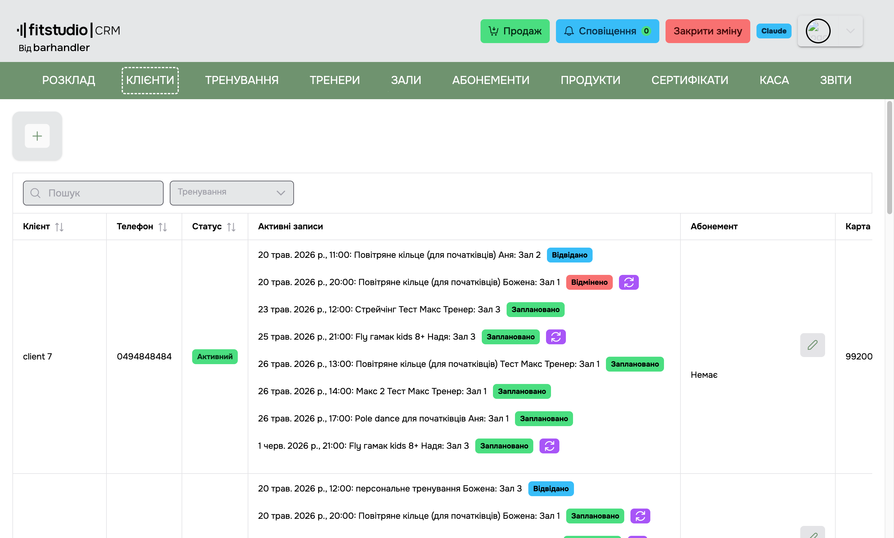

- **Клієнт** — прізвище та імʼя клієнта. Поруч з імʼям показуються бейджі:
  - **Борг** (червоний) — у клієнта є неоплачений борг, див. [Борг клієнта](#_3212-Борг-клієнта);
  - **Очікує підтвердження** (помаранчевий) — картку клієнта створено із запиту з мобільного застосунку або із запису на публічній сторінці, і студія ще не підтвердила запит.
- **Телефон**
- **Статус** — **Активний** або **Неактивний**.
- **Активні записи** — показуються у форматі:  
  `Дата, час, Назва тренування, Тренер, Зал — Статус`  
  Якщо для клієнта задано відпустку, над записами показується бейдж **Відпустка** з періодом «З … по …». Іконка повтору (підказка «Тренування повторюється») позначає повторюваний запис.
- **Статус запису**:
  - **Заплановано** (зелений) — клієнт записаний на тренування
  - **Відвідано** (синій) — клієнта зареєстровано на тренування
  - **Відмінено** (червоний) — тренування відмінено або клієнт відмінив його завчасно
  - **Не відвідано** (помаранчевий) — клієнт не прийшов на тренування або відмінив його пізно
  - **Призупинено** — запис призупинено
  - **Лист очікування** — клієнт перебуває в листі очікування тренування
  - **Видалено з листа очікування** — клієнта прибрано з листа очікування
- **Абонемент** — для кожного абонементу показуються назва, **Статус** (Активний / Неактивний / Призупинено), **Закінчується** (дата або «--») і **Залишок тренувань**; окремим рядком — **Разові: N** (кількість придбаних і не використаних разових тренувань). Якщо абонементів немає, показується «Немає».  
  Для ролей SuperAdmin і Admin доступна кнопка **Редагувати абонементи** (іконка олівця), яка відкриває вікно [Редагування абонементів](#_324-Редагування-абонементів).

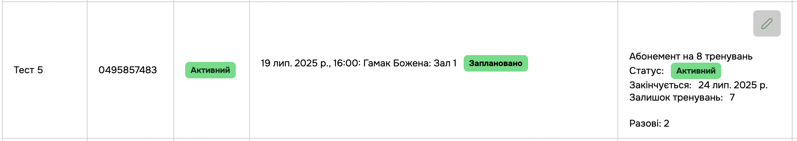

- **Карта** — номер картки клієнта
- **Особовий рахунок** — залишок [особового рахунку](#_3211-Особовий-рахунок) у гривнях; показується, якщо залишок більший за 0.
- **Дії** (ролі SuperAdmin і Admin):
  - **[Сплатити борг](#_32122-Оплата-боргу)** — показується лише за наявності боргу; неактивна, якщо зміну не відкрито.
  - **[Історія](#_325-Історія)** 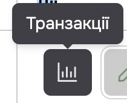
  - **[Редагувати](#_326-Редагування-клієнта)** 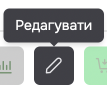
  - **[Продаж](#_327-Продаж)** 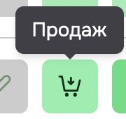 — лише для активного клієнта і за відкритої зміни.
  - **[Запис](#_328-Запис)** 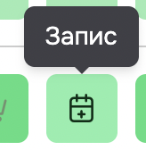 — лише для активного клієнта.
  - **[Реєстрація](#_329-Реєстрація)** 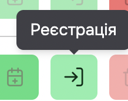 — лише для активного клієнта і за відкритої зміни.
  - **[Видалити](#_3210-Видалення-клієнта)** 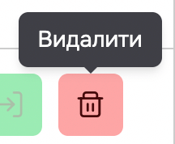 — лише для неактивного клієнта.

Для неактивного клієнта підказки кнопок пояснюють обмеження: «Продаж доступний тільки для активного клієнта», «Запис доступний тільки для активного клієнта», «Реєстрація доступна тільки для активного клієнта», «Деактивуйте клієнта щоби видалити».

Таблицю можна сортувати за колонками **Клієнт**, **Телефон** і **Статус**. Таблиця розбита на сторінки (10, 20 або 50 рядків на сторінці). Якщо клієнтів не знайдено, показується «Не знайдено жодного клієнта».

> ℹ️ Перехід до клієнта з інших розділів (наприклад, кнопка **Перейти до клієнта** у [Реєстрації](#_329-Реєстрація)) відкриває таблицю лише з цим клієнтом: замість пошуку й фільтра показується напис «Показано 1 клієнта» і кнопка **Показати всі**, яка повертає повний список.

---

## 3.2.2 Створення клієнта

> Кнопка **+** (додати клієнта) знаходиться зверху з лівого боку; поруч розташовані кнопки [імпорту й експорту в Excel](#_3214-Імпорт-і-експорт-клієнтів-в-excel). Кнопки доступні ролям SuperAdmin і Admin.

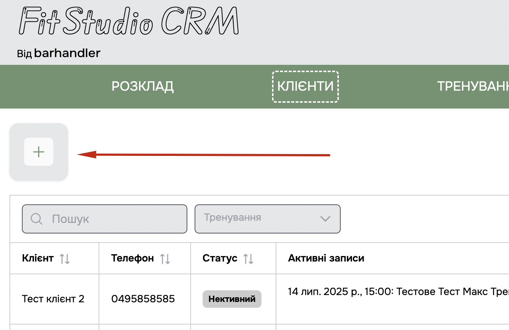

> Після натискання відкриється модальне вікно **Новий клієнт**:

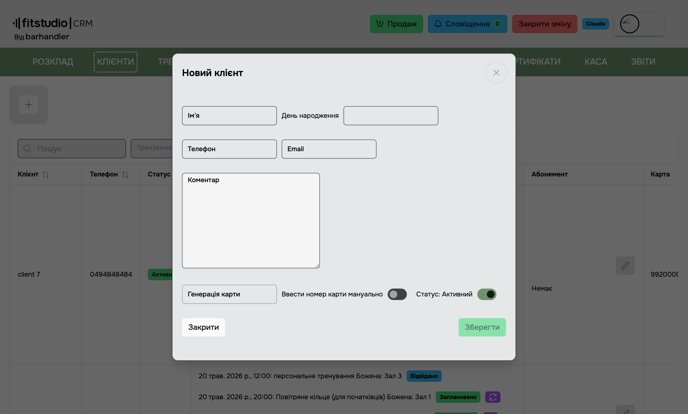

| Поле | Вимоги |
|---|---|
| **Прізвище** | Необовʼязкове поле. |
| **Імʼя** | Обовʼязкове поле. |
| **День народження** | Необовʼязкове поле, формат `дд/мм/рр`. Найпізніша доступна дата — три роки тому від поточної. |
| **Телефон** | Обовʼязкове поле у форматі `0XXXXXXXXX`. |
| **Email** | Необовʼязкове поле; перевіряється формат адреси. |
| **Коментар** | Довільна нотатка про клієнта. |
| **Генерація карти** / **Карта клієнта** | Номер картки — 13 цифр. |
| **Статус** | Тогл **Активний** / **Неактивний**; за замовчуванням — Активний. |

Номер картки задається одним із трьох способів:

- Тогл **Ввести номер карти мануально** вимкнено — система автоматично генерує електронну картку клієнта, поле називається **Генерація карти** і недоступне для введення.
- Тогл увімкнено — поле називається **Карта клієнта**, номер вводиться вручну. Поле обовʼязкове; допускаються лише цифри, рівно 13 («Номер карти клієнта має 13 цифр»).
- Кнопка **Сканувати** відкриває вікно **Сканування картки**: картку зчитують сканером, номер показується в полі **Номер картки**, кнопка **Продовжити** активна лише для коректного 13-значного номера. Після підтвердження номер підставляється в поле **Карта клієнта**, тогл ручного введення вмикається автоматично.

Кнопки вікна: **Закрити**, **Зберегти**.

---

## 3.2.3 Сканування картки

> Скануйте картку клієнта за допомогою сканера (з картки, екрана телефону або з мобільного застосунку).  
> Сканування працює на будь-якій сторінці, крім відкритого модального вікна створення або редагування клієнта. Поки відкрито вікно **Сканування картки** (кнопка **Сканувати** у формі клієнта), зчитаний номер підставляється у форму і реєстрація не відкривається.

- Якщо сканування успішне — відкривається модальне вікно **[Реєстрація](#_329-Реєстрація)**.
- Якщо дані не розпізнані — зʼявиться повідомлення:

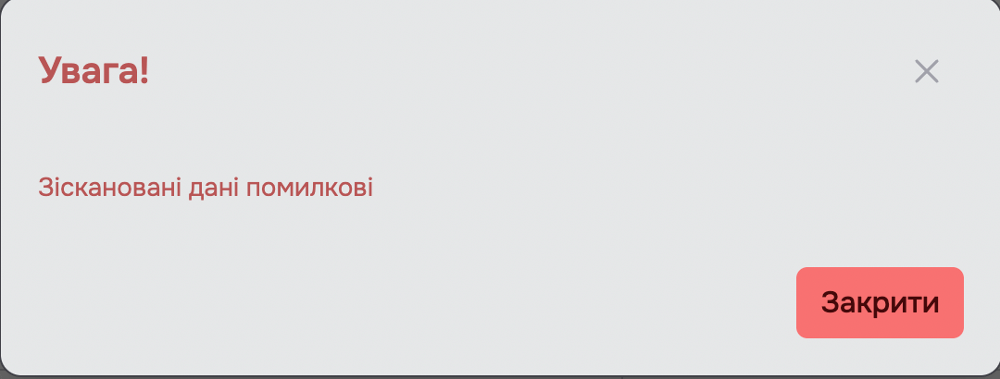

**Якщо дані клієнта не отримано:**

| Ситуація | Повідомлення | Що відбувається далі |
|---|---|---|
| Відкриття вікна **Реєстрація**, сервер не повернув дані клієнта | «Не вдалося отримати дані клієнта. Проведіть реєстрацію вручну.» | Вікно залишається без даних клієнта. |
| Увімкнено налаштування **Автоматична реєстрація при скануванні картки**, сервер не повернув дані клієнта | «Автоматичну реєстрацію не виконано: не вдалося отримати дані клієнта.» | Реєстрація не виконується, абонемент не списується. Відкривається вікно **Реєстрація** для реєстрації вручну; повідомлення «Не вдалося отримати дані клієнта. Проведіть реєстрацію вручну.» у цьому випадку не показується. |
| Увімкнено налаштування **Автоматична реєстрація при скануванні картки**, поки система отримує дані клієнта або готує реєстрацію (на цих етапах вікно не можна закрити): вікно **Реєстрація** відкрито вручну і закрито до завершення автоматичної реєстрації | «Автоматичну реєстрацію перервано. За потреби проведіть реєстрацію вручну.» | Реєстрація не виконується, абонемент не списується. Закрите вікно не відкривається повторно. |
| Увімкнено налаштування **Автоматична реєстрація при скануванні картки**, поки система отримує дані клієнта або готує реєстрацію: вікно **Реєстрація** відкрито вручну і залишається відкритим | Не показується. | Перервана реєстрація не виконується, абонемент не списується. Вікно, відкрите вручну, залишається відкритим з даними клієнта, для якого його відкрито. Після закриття цього вікна вікно очікування автоматичної реєстрації не відображається. |

---

## 3.2.4 Редагування абонементів

> При натисканні на кнопку **Редагувати абонементи** відкривається модальне вікно **Редагування абонементів клієнта**:

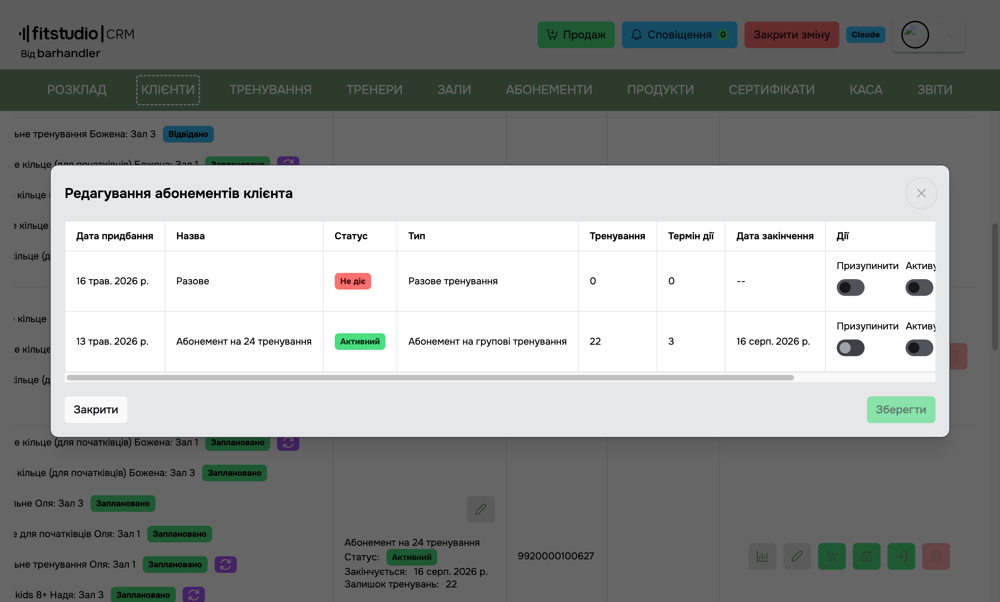

**Колонки:**

- **Дата придбання**
- **Назва**
- **Статус**:
  - **Активний** (зелений)
  - **Неактивний** (сірий)
  - **Призупинено** (помаранчевий)
  - **Не діє** (червоний)
- **Тип** — Абонемент на групові тренування / Абонемент на персональні тренування / Оренда / Разове тренування / Разове персональне тренування
- **Тренування** (залишок) — редагується для активного абонементу (підказка «Редагувати залишок тренувань»); для інших — «Неможливо редагувати залишок тренувань.»
- **Термін дії**
- **Дата закінчення** — редагується для активного абонементу (підказка «Редагувати дату закінчення»); для інших — «Неможливо редагувати дату закінчення.»
- **Дії**:
  - **Призупинити** — доступно для активного абонементу.
  - **Активувати** — доступно для неактивного або призупиненого абонементу, якщо в клієнта немає іншого активного абонементу того самого типу.
  - **Видалити** — доступно лише для разових абонементів; видалення потребує підтвердження.

> Після внесення змін кнопка **Зберегти** стане активною. Натискання збереже зміни та закриє вікно. Кнопка **Закрити** закриває вікно без збереження.

---

## 3.2.5 Історія

> При натисканні на кнопку **Історія** відкривається модальне вікно **Історія** з трьома вкладками: **Абонементи**, **Особовий рахунок** ([3.2.11.3](#_32113-Історія-рахунку)) і **Борги** ([3.2.12.3](#_32123-Історія-боргів)).

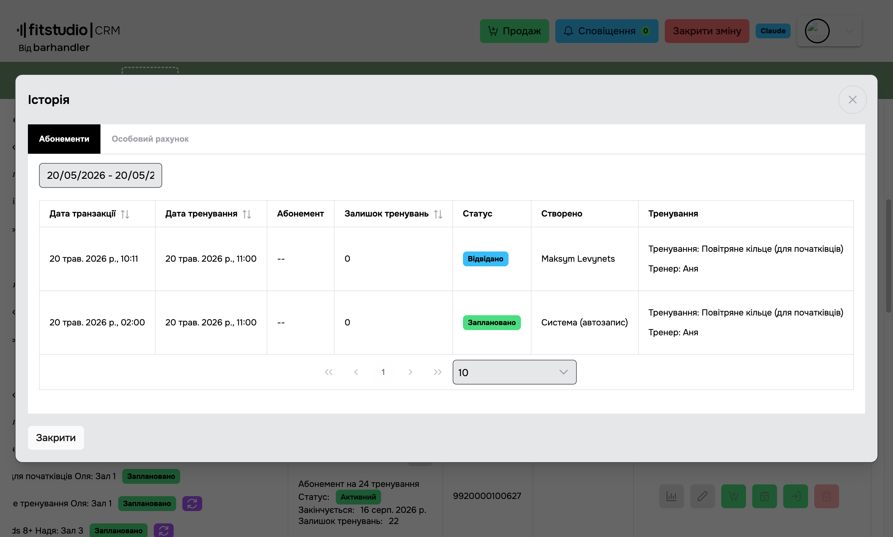

Вкладка **Абонементи** містить історію руху тренувань по абонементах. Період задається вибором діапазону дат у календарі (не пізніше сьогоднішньої дати).

| Колонка | Опис |
|---|---|
| **Дата транзакції** | Дата й час операції |
| **Дата тренування** | Дата й час тренування, до якого відноситься операція |
| **Абонемент** | Назва абонементу або «--» |
| **Залишок тренувань** | Залишок після операції |
| **Опис** | Пояснення операції |
| **Статус** | Причина операції (бейдж) або «--» |
| **Створено** | Користувач, що провів операцію |
| **Тренування** | «Тренування: <назва>», «Тренер: <імʼя>» |

Якщо операцій немає, показується «Не знайдено жодної транзакції».

---

## 3.2.6 Редагування клієнта

> При натисканні на кнопку **Редагувати** відкривається вікно **Редагування клієнта** з тими самими полями, що й при [створенні клієнта](#_322-Створення-клієнта); поля заповнені поточними даними.  
> Поле **Карта клієнта** доступне для введення лише при увімкненому тоглі **Ввести номер карти мануально**; номер також можна зчитати кнопкою **Сканувати**.

> ℹ️ Якщо студія входить у **мережу** (група закладів) і клієнт відомий іншим студіям групи, угорі форми показується позначка **«Клієнт із мережі»**. Позначка не обмежує редагування: імʼя й телефон можна змінити, і зміна застосовується до спільного реєстру та до інших студій мережі.

---

## 3.2.7 Продаж

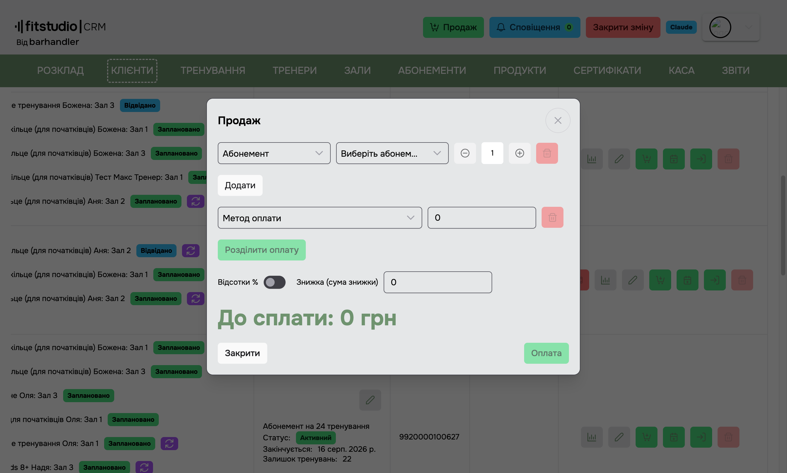

**Модальне вікно продажу містить:**

- Рядки продажу. У кожному рядку обирається тип — **Абонемент**, **Товар** або **Поповнення рахунку**, — а потім:
  - для типу **Абонемент** — абонемент зі списку;
  - для типу **Товар** — товар зі списку. Товар із нульовим залишком позначено «(немає в наявності)» і недоступний для вибору; при залишку менше 3 показується «(залишилось N шт.)». Під вибраним товаром показується «Залишок: N шт.»;
  - для типу **Поповнення рахунку** — поле **Сума поповнення**, див. [3.2.11.1](#_32111-Поповнення-рахунку).
- Контролер кількості (від 1 до 20) для абонементу й товару.
- Кнопка **Додати** — додає ще один рядок продажу.
- **Метод оплати** — Картка / Готівка / Безготівкова; за наявності коштів на особовому рахунку — також «Особовий рахунок — X грн». Кнопка **Розділити оплату** додає ще один метод оплати.
- Поле знижки (**Знижка (сума знижки)** або, при увімкненому тоглі **Відсотки %**, **Знижка (%)**).
- **До сплати** — підсумкова сума.
- Кнопки **Закрити** і **Оплата**.

Обмеження:

- Якщо сума платежів не дорівнює сумі до сплати, показується «Сума платежів меньша або більша за суму до оплати!», оплата недоступна.
- Товар за 0 грн не продається: система показує «Товар за 0 грн не продається» і пропонує вказати ціну товару або прибрати його з продажу.
- Якщо за методу **Картка** доступний платіжний термінал, під методом показується «Термінал доступний — оплата пройде через нього при підтвердженні».

---

## 3.2.8 Запис

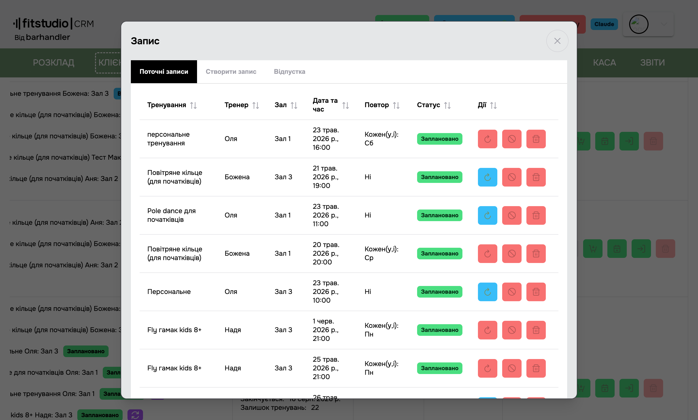

Модальне вікно **Запис** має три вкладки: **Поточні записи**, **Створити запис**, **Відпустка**.

**Вкладка «Поточні записи»** — таблиця записів клієнта з колонками **Тренування**, **Тренер**, **Зал**, **Дата та час**, **Повтор** («Кожен(у,і): <дні>» або «Ні»), **Статус**, **Дії**. Доступні дії залежать від статусу запису:

| Дія | Коли доступна |
|---|---|
| **Відмінити поточне тренування** | Запис зі статусом **Заплановано** |
| **Видалити запис та повтори** | Запис зі статусом **Заплановано** на регулярне тренування |
| **Повернути запис** | Запис зі статусом **Відмінено** або **Не відвідано** |
| **Змінити статус на відмінено** | Запис зі статусом **Не відвідано** |
| **Поновити** | Запис зі статусом **Призупинено** |
| **Повторювати** / **Не повторювати** (**Налаштування повторювань**) | Повторюване тренування |

Під час відміни повторюваного запису відкривається вікно **Скасувати запис** з варіантами **Скасувати тільки це заняття** і **Скасувати це і всі наступні**. Вимкнення повтору потребує підтвердження у вікні **Вимкнути повтор**; у ньому перелічено майбутні дати, з яких клієнта буде видалено. Кнопка **Зберегти зміни** зберігає зміни у вкладці.

**Вкладка «Створити запис»:**

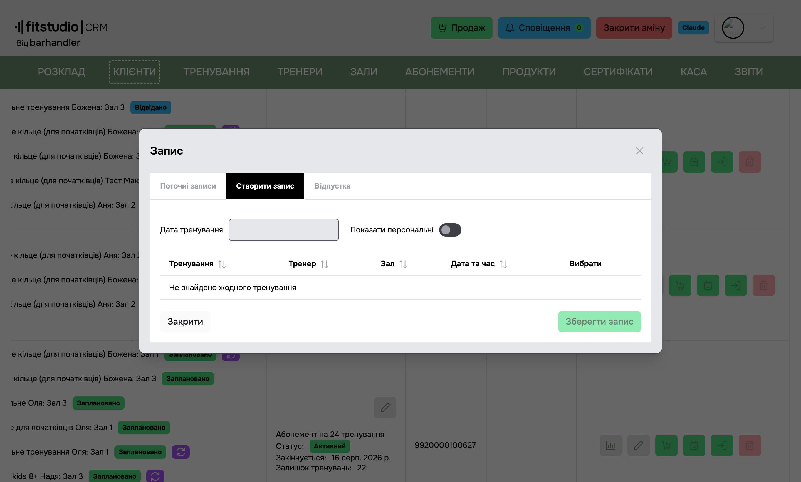

- Виберіть **Дату тренування** — зʼявиться список тренувань (колонки **Тренування**, **Тренер**, **Зал**, **Дата та час**, **Вибрати**). Тогл **Показати персональні** додає до списку персональні тренування.
- Якщо тренування на вибрану дату перенесено, у списку показуються час, зал і тренер-замінник цієї дати. Тренування, відмінене на вибрану дату (зокрема перенесене), у списку не показується. Тренування на сьогодні показується до моменту його початку (година та хвилина за часовим поясом студії).
- Увімкніть тогл **Вибрати**, щоб додати тренування. Не можна вибрати два різні тренування, що починаються в ту саму годину.

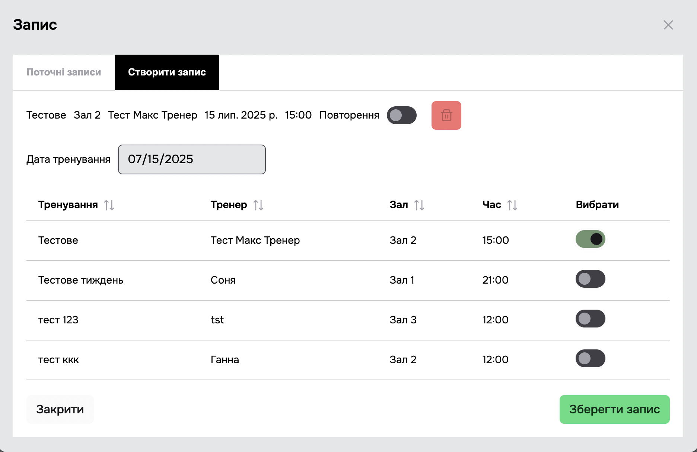

- Вибране тренування зʼявиться у списку зверху.
- Для регулярного тренування доступний тогл **Повторення**. Якщо тренування проходить у кілька днів тижня, обираються дні повтору; потрібно вибрати принаймні один день («Будь ласка виберить принаймні один день»).
- Якщо кілька наступних тренувань повністю заповнені, система показує вікно **Обмеження повтору** з пропозицією записати клієнта з першої дати з вільними місцями (кнопка **Записати з <дата>**). Якщо вільних місць немає на жодному з наступних тренувань, показується вікно **Неможливо поставити повтор**.
- Кнопка **Зберегти запис** створює запис; після створення показується сповіщення «Запис успішно створено».

### 3.2.8.1 Немає місць

> Якщо тренування переповнене, воно позначається червоним. При наведенні показується підказка _"Немає місць"_.

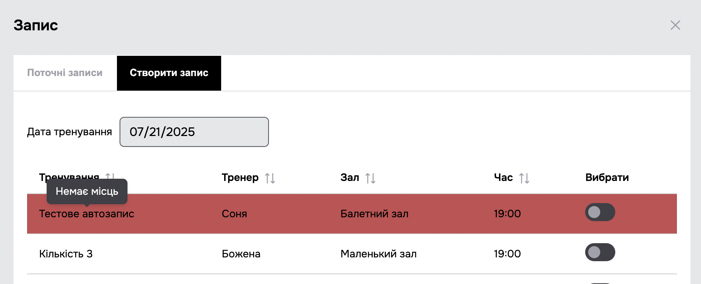

- Адміністратор може все одно записати або зареєструвати клієнта.
- У мобільному застосунку на переповнене тренування клієнт може стати лише в лист очікування, див. [7.5 Тренування](/mobile/workouts).

### 3.2.8.2 Відпустка клієнта

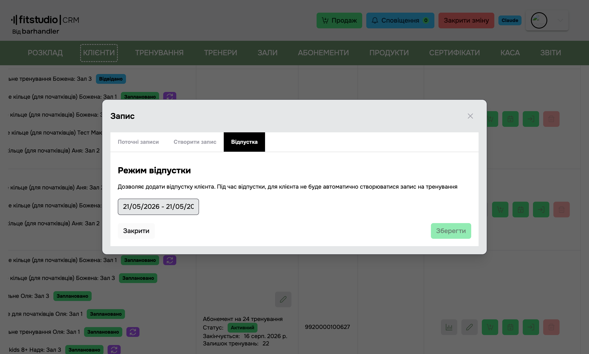

- Вкладка **Відпустка** (**Режим відпустки**) дозволяє додати період відпустки клієнта.
- Під час відпустки для клієнта не створюються автоматично записи на тренування.

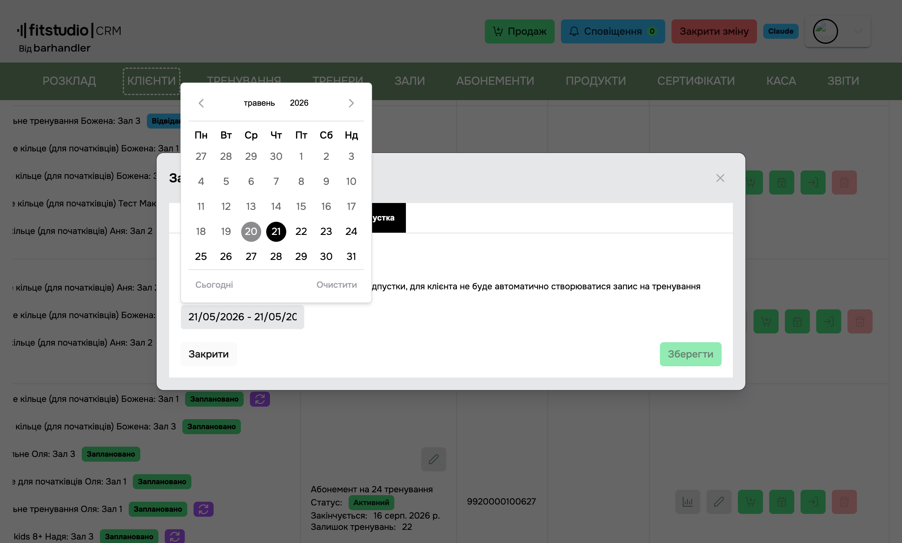

- Відпустка задається вибором періоду в календарі; найраніша дата початку — завтрашній день. Доданий період показується як «Відпустка з … по …».
- Період можна видалити. Кнопка **Зберегти** зберігає зміни.

---

## 3.2.9 Реєстрація

> Модальне вікно **Реєстрація** містить заголовок «Клієнт: <прізвище та імʼя>» і кнопку **Перейти до клієнта**, яка відкриває [таблицю клієнтів](#_321-Таблиця-клієнтів) лише з цим клієнтом.

Над даними показуються попередження:

- «Увага!!! Клієнт потребує уточнення даних» — у картці клієнта не вказано телефон;
- «Увага!!! У клієнта є борг: …» — у клієнта є неоплачений борг.

Для активних абонементів показуються окремі блоки **Поточний абонемент (групові тренування)** і **Поточний абонемент (персональні тренування)** із залишком тренувань.

- Якщо клієнт має активні записи, у списку **Поточні тренування** відображаються тренування поточного дня; вибрані тренування показуються в таблиці **Вибрані тренування:** (колонки **Назва**, **Зал**, **Тренер**, **Дата**, **Час**, **Абонемент**, **Ціна тренування**, **Видалити**).
- Непотрібні тренування можна видалити з таблиці.

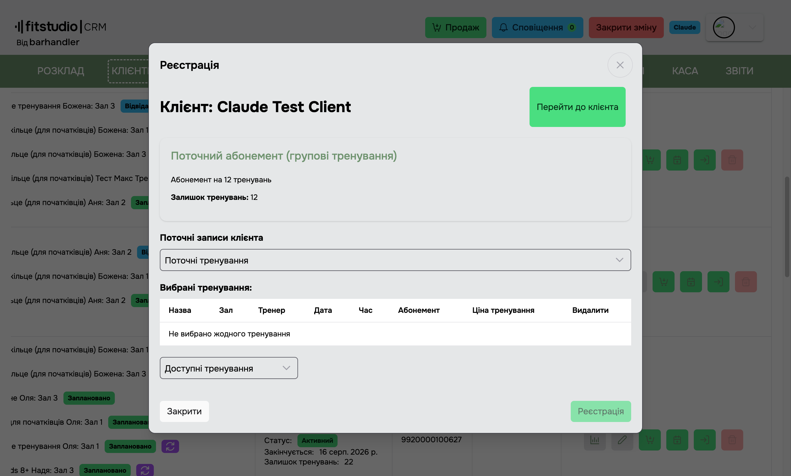

- Якщо є активний абонемент — тоді кнопка **Реєстрація** активна, а сума до сплати = 0.
- Натискання зареєструє клієнта та спише тренування з абонемента.

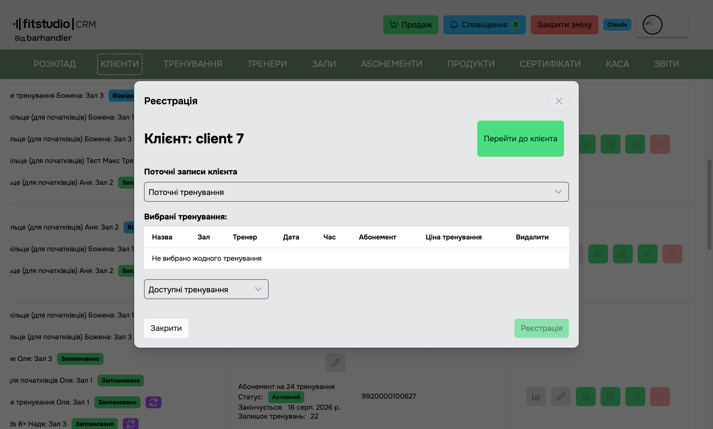

- Якщо абонементів немає — натисніть **Додати абонемент**.
- Можна придбати разове тренування або абонемент.

**`Увага! Неможливо продати більше разових тренувань, ніж потрібно для обраних тренувань.`**

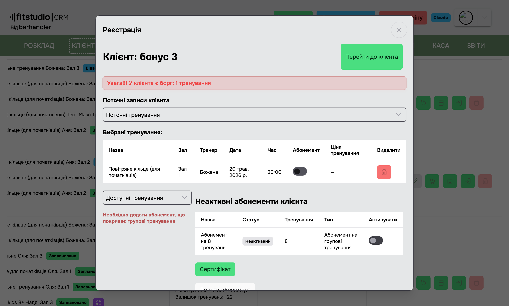

- Тогл **Сплатити пізніше** — для відкладеної оплати.
- У такому випадку створюється [борг клієнта](#_3212-Борг-клієнта), і клієнт матиме позначку **Борг**.

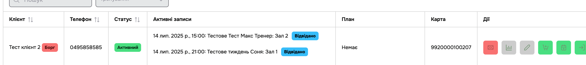

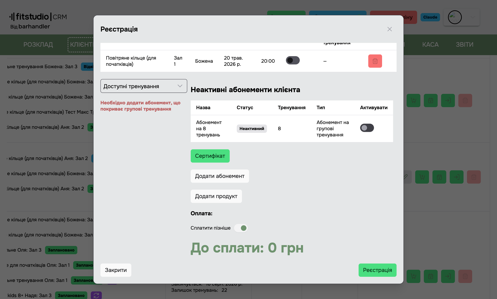

- Якщо клієнт не має записів, можна обрати тренування зі списку **Доступні тренування** (для кожного показано «Місць: N» і «Записи: N»).
- Також можна записати навіть при наявності запланованих.

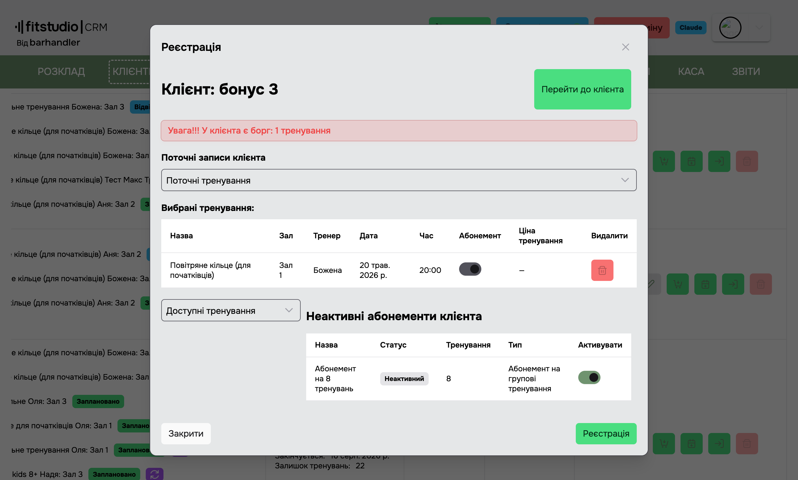

- Якщо є неактивні абонементи — їх можна активувати (таблиця **Неактивні абонементи клієнта**, колонка **Активувати**).
- Якщо є заздалегідь куплені разові тренування — їх можна використати (таблиця **Разові абонементи клієнта**, колонка **Використовувати**).
- Кнопка **Сертифікат** відкриває погашення [сертифіката](/menu/certificates).

**Інформація про абонемент:**

- Якщо абонемент скоро закінчується, система попередить.

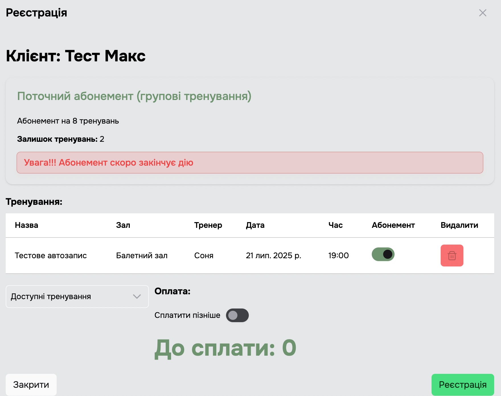

**Додати товар** — дозволяє додати товар до транзакції, навіть якщо реєстрація на тренування проводиться коштом абонементу.

**Причини недоступності кнопки «Реєстрація».** Якщо кнопка неактивна, над нею показується перелік причин, зокрема:

| Повідомлення | Умова |
|---|---|
| Виберіть хоча б одне тренування | Не вибрано жодного тренування |
| Необхідно додати абонемент, що покриває групові тренування / оренду / вибране персональне тренування | Немає абонементу для вибраного тренування |
| Вибрано надлишок разових абонементів | Разових тренувань більше, ніж вибраних тренувань |
| Перевірте суми оплат — разом вони не дають потрібної суми | Сума платежів не дорівнює сумі до сплати |
| Вкажіть оплату за вибрані заняття | Для тренування з ціною за заняття не вказано оплату |
| У переліку абонементів є незаповнений рядок — виберіть у ньому абонемент або приберіть рядок | Доданий рядок абонементу порожній |

### 3.2.9.1 Реєстрація на персональне тренування

> Персональні тренування мають **фіксовану ціну за тренування цілком** (а не за одного клієнта). У модалці реєстрації для них працює інший спосіб оплати — з частковими внесками і автоматичним обліком боргу між усіма записаними клієнтами.

**Особливості:**

- У колонці **Ціна тренування** показується **сума, яку лишилося сплатити** за це тренування — не ціна абонементу, а саме залишок по конкретному заняттю.
- Якщо клієнт вніс [передоплату](/menu/schedule#передоплата-за-персональне-тренування) за це тренування, її сума віднімається від ціни абонемента, який продається за тренування: до оплати лишається тільки залишок.
- Якщо передоплачене тренування покриває абонемент із тривалістю, передоплата автоматично зараховується на [особовий рахунок](#_3211-Особовий-рахунок) клієнта після реєстрації.
- Поле суми поряд із полем **Метод оплати** приймає довільну суму (наприклад, частину вартості).

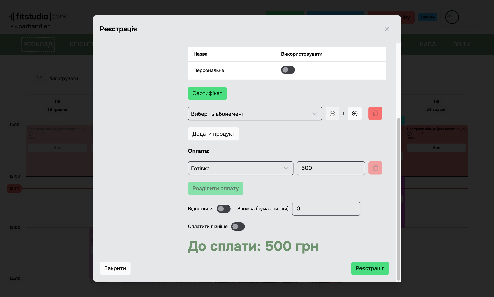

**Часткова оплата і борг між клієнтами:**

> Якщо тренування для 2+ людей і один із записаних оплачує **частково**, система автоматично рахує **борг за все тренування** і показує його всім іншим записаним клієнтам. Як тільки сумарно по всіх клієнтах студія отримала повну вартість заняття — борг закривається автоматично.

Приклад: персональне на 2 особи, вартість **1300 грн**. Перший клієнт (`client 5`) платить готівкою **500 грн**. При відкритті [Реєстрації](#_329-Реєстрація) другого клієнта (`тест бонус`) на це саме тренування:

- зверху модалки червоний бейдж **«Увага!!! У клієнта є борг: 800 грн»** (1300 − 500);
- у колонці **Ціна тренування** теж стоїть **800 грн** — стільки лишилось погасити, щоб тренування було повністю оплачене.

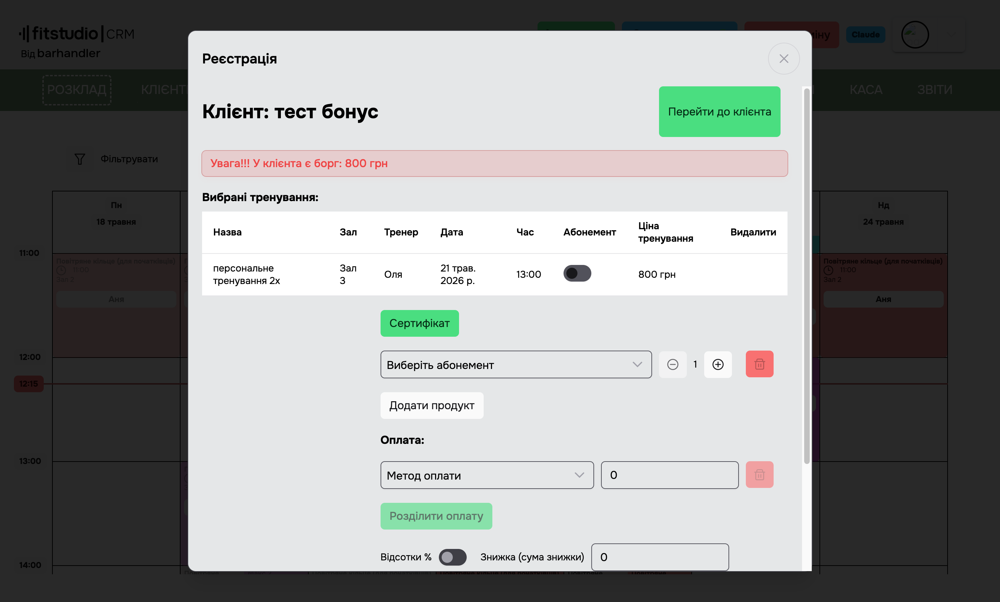

> ℹ️ Запис у [Борг клієнта](#_3212-Борг-клієнта) створюється і у першого, і у другого клієнта на ту саму суму залишку — будь-хто з них може його погасити (готівкою, карткою, з [Особового рахунку](#_3211-Особовий-рахунок) чи через абонемент). Після повної оплати запис автоматично закривається у всіх учасників.

---

## 3.2.10 Видалення клієнта

- Неможливо видалити клієнта зі статусом **Активний**.
- Спочатку потрібно деактивувати, після чого кнопка **Видалити** стане доступною.

---

## 3.2.11 Особовий рахунок

> Кожен клієнт має **Особовий рахунок** — передоплату, з якої можна оплачувати абонементи, товари й разові тренування. Залишок показується в колонці **Особовий рахунок** таблиці клієнтів і в мобільному застосунку клієнта.

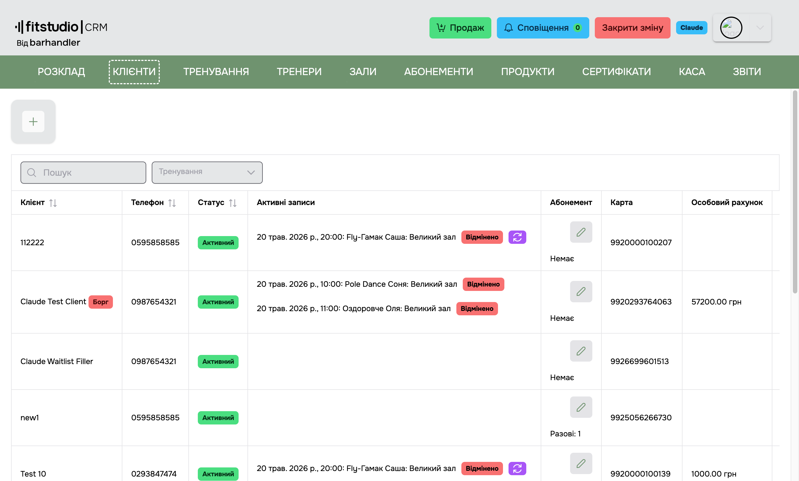

### 3.2.11.1 Поповнення рахунку

> Поповнення робиться через модалку **Продаж**:

1. Натиснути  у рядку клієнта.
2. Обрати тип **Поповнення рахунку**.
3. Ввести **Суму поповнення** (ціле число) і обрати метод оплати — **Готівка**, **Картка** або **Безготівкова**. Оплата з особового рахунку для поповнення недоступна. Суму можна розділити між кількома методами (**Розділити оплату**).
4. Натиснути **Оплата**.

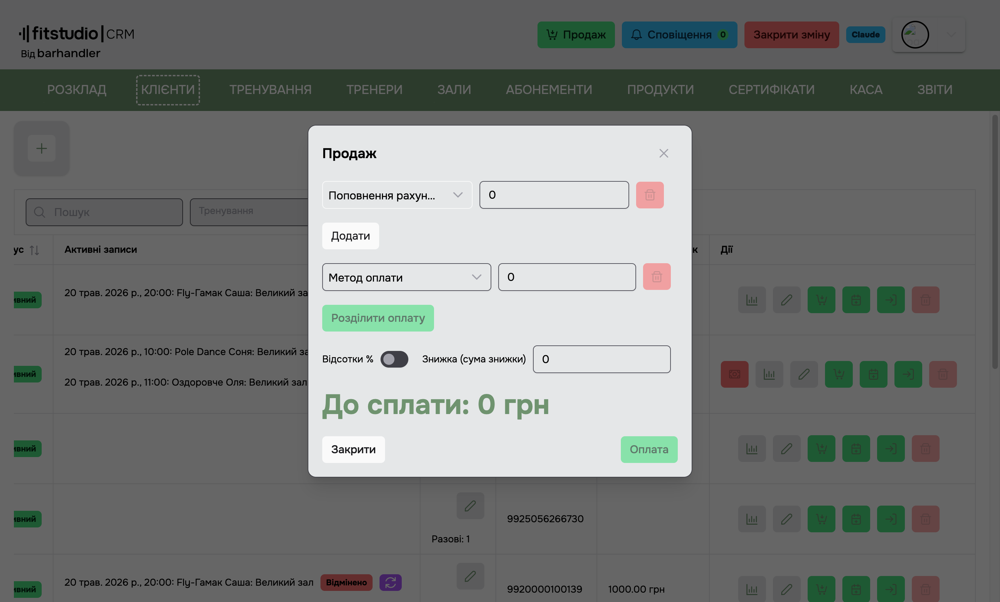

Вимоги й поведінка:

- Поповнення проводиться окремою операцією. Якщо в тому самому продажу є абонементи або товари, система показує «Поповнення проводиться окремо» і не проводить операцію.
- Кожен метод оплати проводиться окремою касовою транзакцією на свою суму. Сума транзакції з методом **Готівка** або **Картка** зараховується на рахунок одразу; сума транзакції з методом **Безготівкова** зараховується після підтвердження платежу.
- Транзакція поповнення з методом **Безготівкова** отримує статус платежу **Очікує на підтвердження**, як і інші безготівкові транзакції. До підтвердження сума на особовий рахунок не зараховується. Підтвердження кнопкою **Підтвердити** у [Касі](/menu/pos) зараховує суму один раз; повторне підтвердження суму не зараховує.
- Якщо одна з транзакцій не пройшла після того, як інші вже проведено, показується «Поповнення проведено частково» з уже зарахованою сумою. Повторне натискання **Оплата** без змін у формі проводить лише непроведені частини. Якщо після часткового проведення змінено суму чи оплати, система показує «Поповнення вже проведено частково» і не проводить операцію.
- Поповнення з методом **Готівка** збільшує баланс готівки в касі на суму поповнення; методи **Картка** і **Безготівкова** баланс готівки не змінюють.
- За активної фіскальної інтеграції поповнення фіскалізується чеком з однією позицією «Поповнення особового рахунку» на суму транзакції.
- В історії рахунку поповнення має опис «Поповнення особового рахунку».
- Повернення поповнення не передбачене. Метод оплати поповнення змінюється дією **Змінити метод оплати** у [Касі](/menu/pos); правила зміни, зокрема для непідтвердженого поповнення з методом **Безготівкова**, наведено в описі цієї дії.

### 3.2.11.2 Оплата з рахунку

> При продажі абонементу чи товару або при [Реєстрації](#_329-Реєстрація) клієнта, якщо залишок рахунку більший за 0, у списку методів оплати зʼявляється **«Особовий рахунок — X грн»**, де X — поточний залишок.

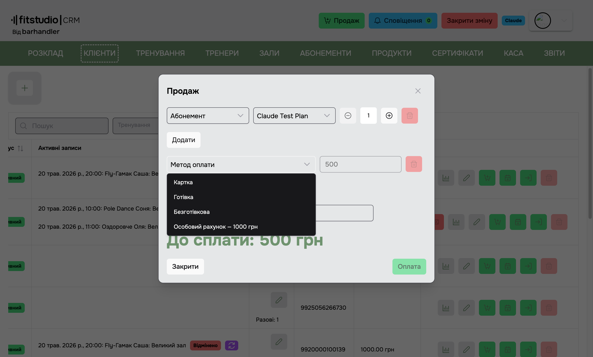

- Обрати **Особовий рахунок** як метод (повна оплата) або вказати суму в частковій оплаті через **Розділити оплату** разом з готівкою чи карткою.
- Якщо сума більша за залишок, показується «Недостатньо коштів на особовому рахунку (доступно X грн)», оплата недоступна.
- Оплата з особового рахунку **не фіскалізується**.

### 3.2.11.3 Історія рахунку

> Кнопка  відкриває модалку **Історія**; вкладка **Особовий рахунок** містить поточний баланс («Поточний баланс: X грн») і всі рухи коштів.

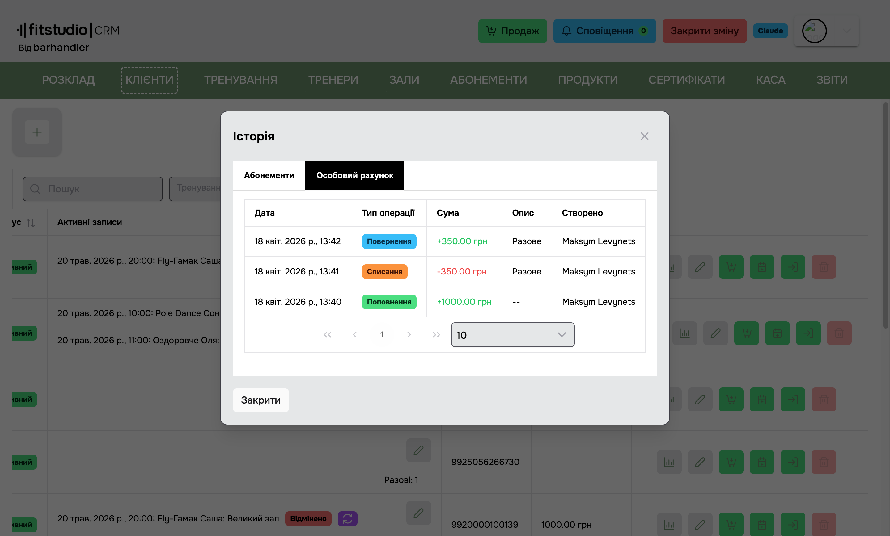

**Колонки історії рахунку:**

| Колонка          | Опис                                                              |
| ---------------- | ----------------------------------------------------------------- |
| **Дата**         | Дата й час операції                                               |
| **Тип операції** | **Поповнення** / **Списання** / **Повернення** / **Корекція**     |
| **Сума**         | `+N грн` (зелений) або `-N грн` (червоний), два знаки після коми  |
| **Опис**         | Назви абонементів і товарів, «Поповнення особового рахунку» або причина корекції; «--», якщо опису немає |
| **Створено**     | Користувач, що провів операцію                                    |

Якщо операцій немає, показується «Немає операцій по особовому рахунку».

- **Офлайн** — позначка рядка, створеного під час синхронізації оплати з особового рахунку або повернення, виконаних на компʼютері без інтернету. **Дата** такого рядка — час операції на компʼютері. Див. [Особовий рахунок, сертифікати й повернення](/pages/offline-mode#Особовий-рахунок-сертифікати-й-повернення).

> 📱 Клієнт бачить свій рахунок і повну історію в мобільному застосунку на вкладці **Кабінет → Рахунок**.

### 3.2.11.4 Коригування рахунку

> Кнопка **Коригувати** на вкладці **Особовий рахунок** доступна лише ролі **SuperAdmin**. Вона відкриває вікно **Коригування особового рахунку**.

**Поля:**

- **Новий баланс** — сума, яка має стати залишком рахунку (до двох знаків після коми). Під полем показується різниця «Зміна: ±N грн».
- **Причина зміни** — обовʼязкове поле, до 255 символів.

**Перевірки (кнопка «Зберегти» неактивна, поки є помилка):**

| Повідомлення | Умова |
|---|---|
| Вкажіть новий баланс | Поле **Новий баланс** порожнє |
| Новий баланс не може бути відʼємним | Значення менше 0 |
| Новий баланс не може перевищувати 99999999.99 | Значення більше 99 999 999,99 |
| Баланс не змінився | Новий баланс дорівнює поточному |
| Вкажіть причину зміни балансу | Причину не вказано |
| Причина не може бути довшою за 255 символів | Причина довша за 255 символів |

Після збереження в історії рахунку зʼявляється рядок типу **Корекція** на суму різниці з причиною в колонці **Опис**. Корекція не створює касової транзакції і не фіскалізується. Якщо баланс змінився з моменту відкриття вікна, сервер відхиляє корекцію, а вікно показує актуальний баланс.

---

## 3.2.12 Борг клієнта

> Якщо клієнта зареєстровано на тренування (у тому числі з товарами) з увімкненим тоглом **Сплатити пізніше**, система створює запис боргу.

### 3.2.12.1 Позначка боргу

> Клієнти з неоплаченим боргом мають **червоний бейдж «Борг»** поряд з імʼям у рядку таблиці. У колонці **Дії** зʼявляється додаткова кнопка **Сплатити борг** (іконка гаманця); кнопка неактивна, якщо зміну не відкрито. У вікні [Реєстрації](#_329-Реєстрація) показується попередження «Увага!!! У клієнта є борг: …».

### 3.2.12.2 Оплата боргу

> Натискання кнопки **Сплатити борг** відкриває модалку **Оплата боргу**:

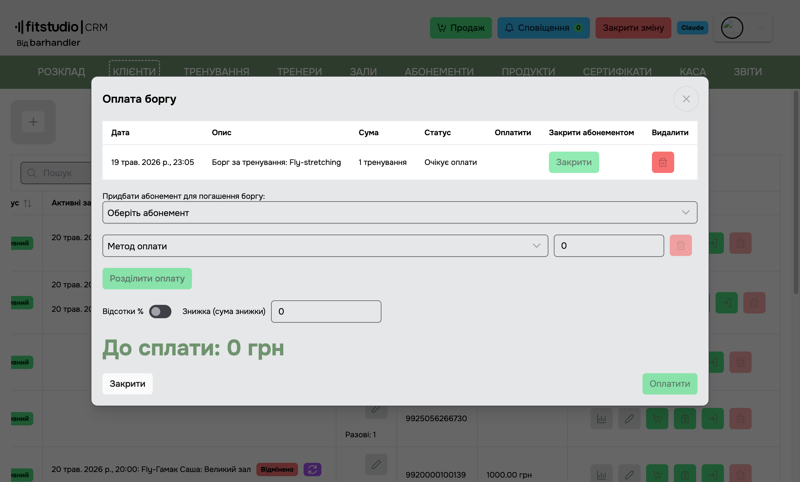

**Структура модалки:**

1. **Таблиця активних боргів** — колонки: **Дата** • **Опис** • **Сума** • **Статус** • **Оплатити** • **Закрити абонементом** • **Видалити**. Якщо боргів немає, показується «Немає активних боргів».
   - **Опис** — за що борг (наприклад, «Борг за тренування: Fly-stretching»).
   - **Сума** — «1 тренування» для боргу за тренування без суми або залишок до сплати в грн.
   - **Статус** — **Очікує оплати** / **Оплачено**.
   - **Оплатити** — позначка для грошового боргу; позначені борги оплачуються сумою з блоку оплати.
   - **Закрити абонементом** — кнопка **Закрити** для боргу за тренування й боргу за персональне тренування. Після підтвердження («Закрити борг абонементом "<назва>"? Буде знято 1 тренування (залишок: N).») з відповідного абонементу клієнта списується 1 тренування, борг закривається. Кнопка неактивна, якщо підходящого абонементу немає.
   - **Видалити** (іконка кошика) — видалити борг без оплати.

2. **Придбати абонемент для погашення боргу:** — показується, якщо є борги, які можна покрити абонементом. Продаж абонементу одночасно зі списанням з нього боргу:
   - **Оберіть абонемент** — список абонементів студії.
   - **Метод оплати** (Картка / Готівка / Безготівкова / Особовий рахунок) і сума.
   - **Розділити оплату** — додає ще один метод оплати.
   - **Знижка (сума знижки)** і тогл **Відсотки %**.
   - **До сплати** — підсумкова сума.

Кнопка **Оплатити** проводить оплату й закриває борг (борги); кнопка **Закрити** закриває вікно.

Правила оплати:

- Одна оплата розподіляється між кількома позначеними боргами; кожна частина проводиться окремою касовою транзакцією продажу. Сума частини не може перевищувати залишок боргу.
- Борг закривається, коли сплачено всю його суму. Якщо застосовано знижку, борги закриваються після оплати зі знижкою.
- Оплата карткою проходить через платіжний термінал (якщо він підключений) один раз до запису оплати.
- Оплата боргу фіскалізується як продаж (за активної фіскальної інтеграції). Частина, сплачена з особового рахунку, не фіскалізується.
- Безготівкова оплата боргу потребує підтвердження в [Касі](/menu/pos).

### 3.2.12.3 Історія боргів

> Модалка **Оплата боргу** показує лише неоплачені борги. Повна історія боргів — на вкладці **Борги** модалки **Історія** (кнопка ).

Вкладка **Борги** показує всі борги клієнта — створені, погашені й видалені — з колонками: **Дата** • **Опис** • **Сума** • **Статус** • **Створив** • **Видалив** (користувач і дата видалення) • **Дія**. Якщо боргів не було, показується «Боргів не було».

Колонка **Статус** має одне з трьох значень: **Створено**, **Погашено** або **Видалено**. Видалений борг має статус **Видалено** незалежно від статусу оплати.

Дії в колонці **Дія**:

- **Видалити** (кошик) — для будь-якого боргу, який ще не видалено, зокрема погашеного;
- **Повернути** (стрілка) — для видаленого боргу. Борг відновлюється з тим самим статусом, сумою й переліком клієнтів, які мав до видалення.

> ℹ️ Видалення боргу **зворотне**: борг позначається видаленим і не враховується в списках боргів і підрахунках. У колонці **Видалив** показано, хто й коли видалив борг. Повторне видалення не змінює дату й автора першого видалення.

---

## 3.2.13 Пошук і фільтр

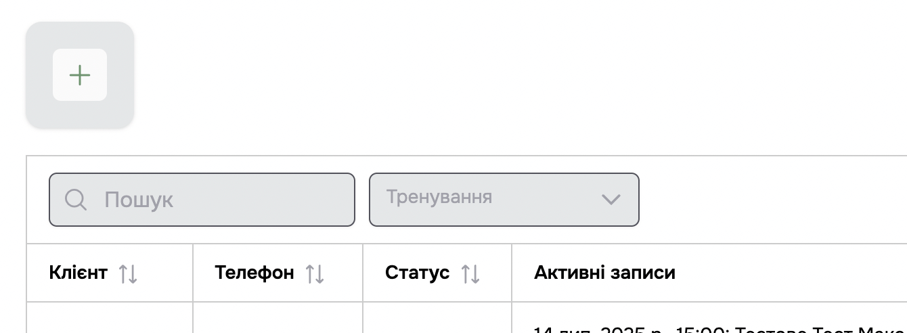

- Поле **Пошук** шукає за прізвищем та імʼям, телефоном, email і номером картки.
- Фільтр **Тренування** (вибір кількох тренувань) показує клієнтів, записаних на вибрані тренування.

---

## 3.2.14 Імпорт і експорт клієнтів в Excel

> Кнопки **Завантажити клієнтів з Excel** і **Зберегти клієнтів в Excel** розташовані поруч із кнопкою додавання клієнта і доступні ролям SuperAdmin і Admin. Обидві операції виконуються у фоні: поки операція триває, замість кнопки показується позначка «Завантаження в процесі» або «Збереження в процесі».

### 3.2.14.1 Формат файлу

- Файл `.xlsx`, розмір — не більше 5 МБ («Файл завеликий. Максимальний розмір — 5 МБ.»).
- Дані — на аркуші **Clients**, перший рядок — назви колонок.
- Колонки (у порядку експорту): `id`, `firstName`, `lastName`, `phone`, `email`, `card`, `birthday`, `comment`, `createdAt`, `lastVisit`, `personalBalance`. Колонка `firstName` обовʼязкова. Колонки `createdAt`, `lastVisit` і `personalBalance` лише інформаційні: імпорт їх не читає. `createdAt` і `lastVisit` — дата й час за [часовим поясом студії](/login/settings#часовий-пояс-студії) у форматі `рррр-ММ-дд ГГ:хх`.

### 3.2.14.2 Імпорт

Кнопка **Завантажити клієнтів з Excel** відкриває вікно **Імпорт клієнтів** з двома кроками:

1. **Файл** — кнопка **Виберіть файл**. Якщо аркуша **Clients** немає, показується «Лист "Clients" відсутній у файлі.»; якщо в ньому немає даних — «Файл не містить даних.».
2. **Перевірка** — назва й розмір файлу, перші 50 рядків аркуша і вибір **Поведінка при дублікатах:**

| Варіант | Дія |
|---|---|
| **Пропустити** (за замовчуванням) | Наявних клієнтів не змінювати |
| **Оновити** | Значення з файлу замінюють наявні; порожня клітинка не стирає значення |
| **Доповнити** | Заповнити лише ті поля, які в системі ще не заповнені |

Дублікатом вважається клієнт із тим самим `id`, а для рядка без `id` — клієнт із тим самим телефоном та імʼям. Кнопки: **Назад**, **Імпортувати**.

Після запуску показується вікно **Завантаження запущено**. Після завершення — вікно **Завантаження завершено** з підсумком: **Створено**, **Оновлено**, **Пропущено**, **Помилок**, і переліком перших 50 відхилених рядків у форматі «Рядок N — причина». Причини відхилення рядка, зокрема:

- «Клієнта з таким id не знайдено»;
- «Кілька клієнтів з таким телефоном та імʼям — вкажіть id»;
- «Не вдалося зберегти клієнта».

Одночасно може виконуватися лише одне завантаження («Попереднє завантаження клієнтів ще триває.»).

### 3.2.14.3 Експорт

Кнопка **Зберегти клієнтів в Excel** запускає формування файлу; показується вікно **Збереження запущено**. Коли файл готовий, відкривається вікно **Файл готовий** з кнопками **Скасувати** і **Завантажити**. Файл містить аркуш **Clients** з колонками, перерахованими в [3.2.14.1](#_32141-Формат-файлу); його можна змінити й завантажити назад через імпорт.

---

<a href="javascript:void(0)" onclick="history.back()">⬅️ Назад</a>

[Повернутися на головну](/)
