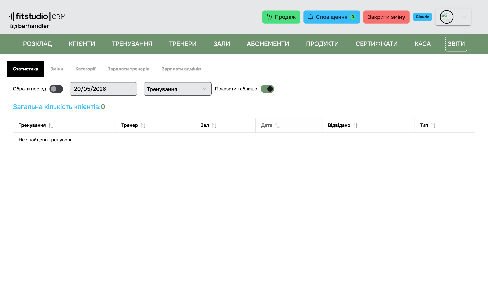
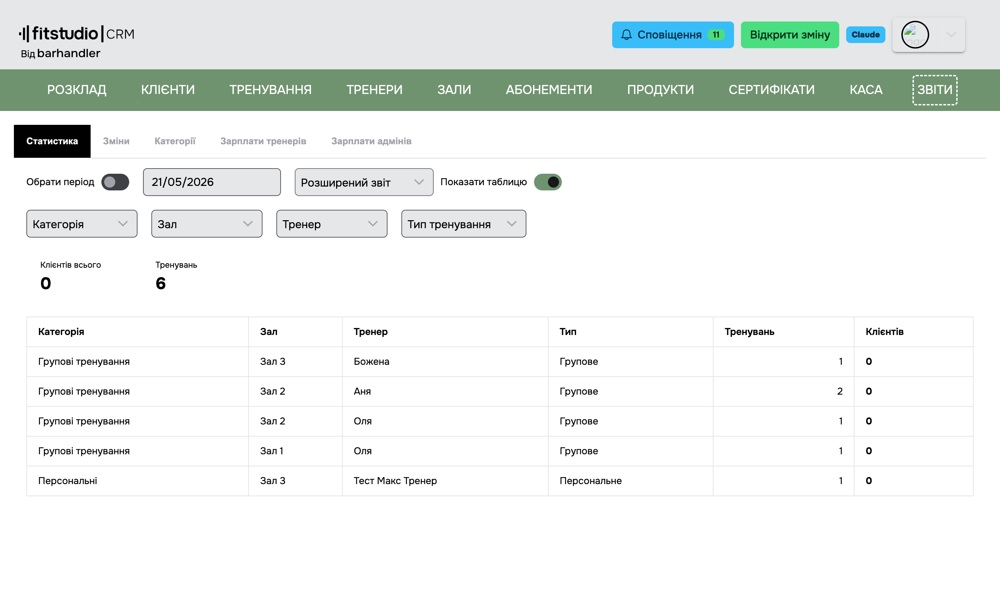
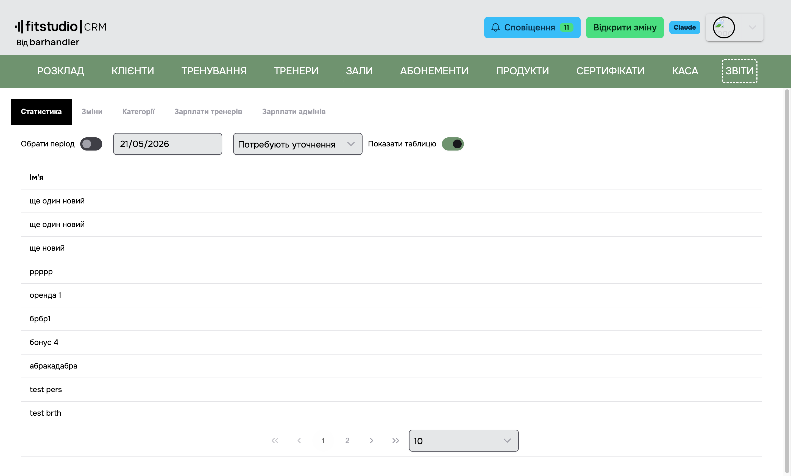
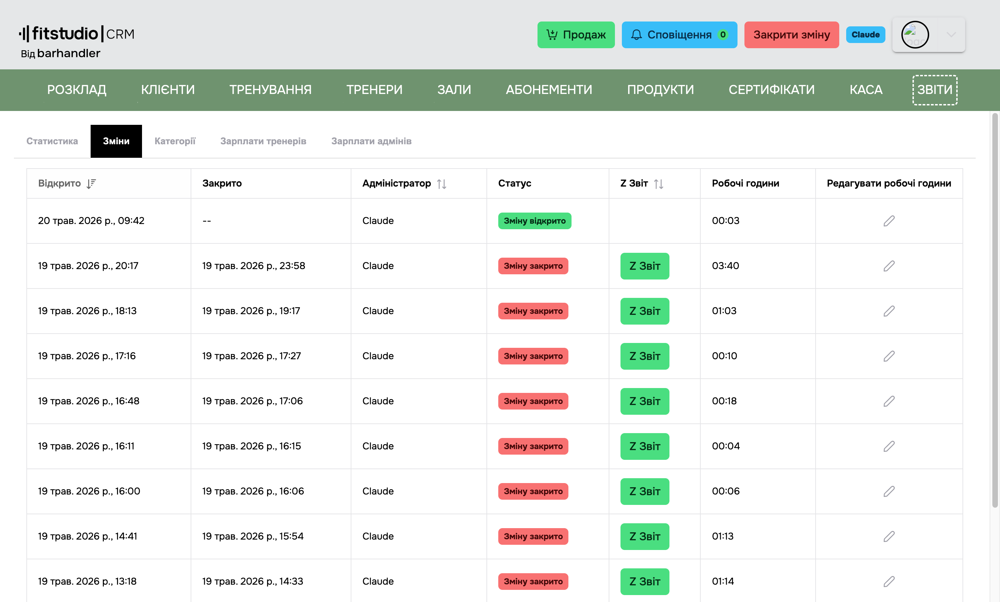
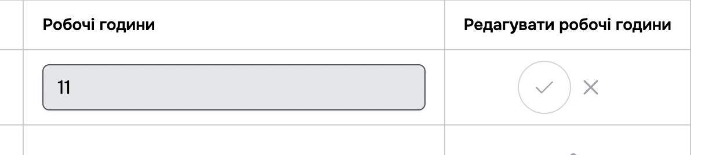
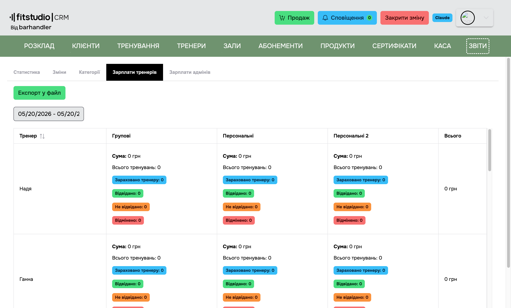
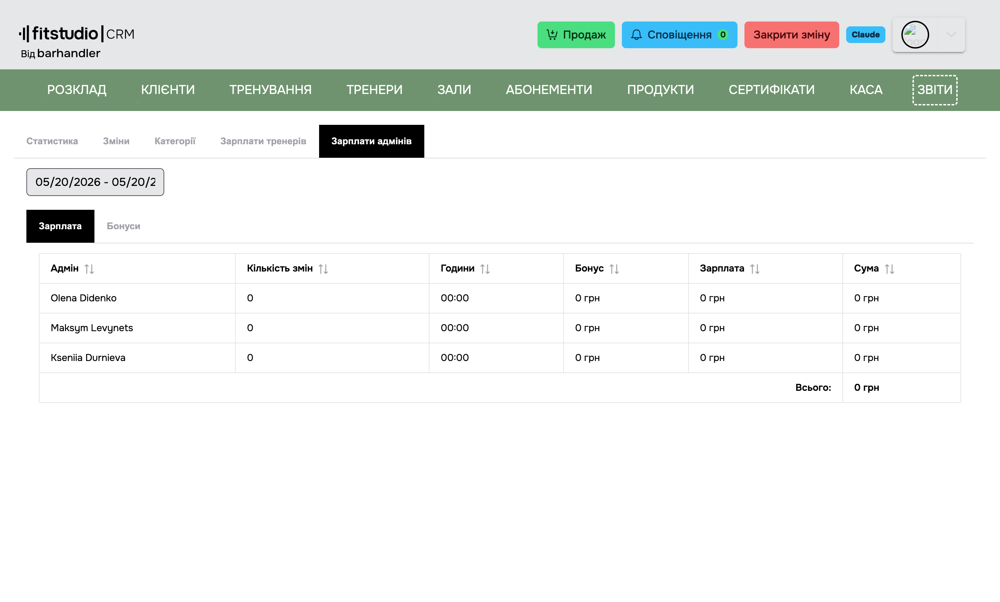

<a href="javascript:void(0)" onclick="history.back()">⬅️ Назад</a>

[Повернутися на головну](/)

# 3.8 Звіти

> Сторінка **Звіти** містить наступні вкладки:

- [Статистика](#_381-Статистика)
- [Зміни](#_382-Зміни)
- [Зарплати тренерів](#_384-Зарплати-тренерів)
- [Зарплати адмінів](#_385-Зарплати-адмінів)
- [Рейтинг](#_386-Рейтинг) — показується, якщо в налаштуваннях увімкнено **Пропонувати оцінити заняття**
- [SMS](#_387-sms)

> ℹ️ **Категорії** перенесено зі Звітів до [Налаштування → Категорії](/login/settings#Категорії).

> ℹ️ **Транзакції** і **Розширений Звіт** перенесено на сторінку [Каса](/menu/pos) разом з фіскальними звітами і керуванням готівкою.

---

## 3.8.1 Статистика

> Універсальний звіт з різними розрізами. Над таблицею:

- **Вибір періоду** — період звіту.
- **Фільтр** — тип звіту:
  - **Тренування** — графік відвідувань і, при увімкненому тоглі **Показати таблицю**, таблиця проведених тренувань: **Тренування**, **Тренер**, **Зал**, **Дата**, **Відвідано**, **Тип** (Групове / Персональне); над таблицею — «Загальна кількість клієнтів». Якщо тренувань немає — «Не знайдено тренувань».
  - **Абонементи** — продажі і використання абонементів (графік).
  - **Товари** — продажі товарів (графік).
  - **Клієнти** — статистика по клієнтах з полем **Пошук**. Колонки:

    | Колонка | Зміст |
    |---|---|
    | **Імʼя** | Клієнт |
    | **Всього тренувань**, **Відвідані**, **Відмінені**, **Не відвідані** | Кількість записів за період |
    | **Дата останнього візиту** | Дата |
    | **SMS** | Кількість SMS, надісланих клієнту за період |
    | **PWA** / **Застосунок** | Чи встановлено вебзастосунок / мобільний застосунок: «Так», «Ні» або «—» (дані від клієнта ще не надходили) |
    | **ОС** | iPhone / Android / Інша / «—» |
    | **Додаток карта** | Кількість відкриттів картки клієнта в застосунку |
    | **Додаток запис на тренування**, **Додаток відміни тренування** | Кількість записів і відмін через застосунок |
    | **Веб сторінка запис на тренування** | Кількість записів через публічну вебсторінку |

  - **Розширений звіт** — звіт по проведених тренуваннях з фільтрами:
    - **Категорія** — обмежити конкретною категорією.
    - **Зал** — обмежити одним залом.
    - **Тренер** — обмежити одним тренером.
    - **Тип тренування** — Групове / Персональне / Оренда.

    Колонки: **Категорія**, **Зал**, **Тренер**, **Тип**, **Тренувань** (кількість занять у згрупованому періоді), **Клієнтів** (сумарна кількість відвідувань). Рядки з нульовими значеннями не показуються. Над таблицею — підсумок **Тренувань** / **Клієнтів всього**. Якщо даних немає — «Немає даних за вибраний період».

    

  - **Потребують уточнення** — список клієнтів, у яких **не заповнено поле телефону** в [картці клієнта](/menu/clients#_326-Редагування-клієнта). Інші поля (email, дата народження) не враховуються. Клієнт без телефону не отримує SMS-повідомлень; у вікні [Реєстрації](/menu/clients#_329-Реєстрація) для нього показується «Увага!!! Клієнт потребує уточнення даних».

    

---

## 3.8.2 Зміни

> Список усіх змін за обраний період.

**Колонки:**

- **Відкрито** — дата й час відкриття зміни.
- **Закрито** — дата й час закриття зміни.
- **Адміністратор** — імʼя адміна.
- **Статус** — Зміну відкрито / Зміну закрито.
- **Z Звіт** — кнопка **Z Звіт** перегляду Z-звіту за закриту зміну.
- **Робочі години** — число в годинах для розрахунку зарплати.
- **Редагувати робочі години** — колонка для ролей SuperAdmin і Admin. Редагувати можна години **тільки своїх закритих** змін; для інших показується підказка «Неможливо Редагувати робочі години. Зміна або не ваша або її не закрито».

При натисканні **Редагувати** поле **Робочі години** стає інпутом, у колонці **Дії** зʼявляються кнопки **Зберегти** / **Відмінити**.

> 💡 Дробове значення вводиться в годинах: 1 год 48 хв = 108 ÷ 60 = **1,8 год**.

---

## 3.8.4 Зарплати тренерів

> Розрахунок зарплати тренерів за обраний період.

**Колонки:**

- **Тренер** — імʼя тренера.
- **Динамічні колонки** — система групує всі тренування періоду за **категоріями**, і кожна категорія стає окремою колонкою. Значення і тип розрахунку беруться **з категорії тренування** ([Категорії](/login/settings#Категорії)):
  - **За людину** (`PerPerson`) — `сумарна кількість клієнтів × baseRate`.
  - **За тренування** (`PerWorkout`) — `кількість оплачуваних тренувань × baseRate`. Оплачуваним вважається заняття, на яке прийшов хоча б один клієнт або за яке було списання через пізню відміну.

  Клітинка категорії містить **Сума**, «Всього тренувань», «Зараховано тренеру» і кількість записів «Відвідано» / «Не відвідано» / «Відмінено».
- **Всього** — сума всіх категорій для тренера.

> Внизу таблиці — рядок **Всього:** із загальною сумою по всіх тренерах.

**Експорт:** кнопка **Експорт у файл** завантажує текстовий файл `salary ДД.ММ-ДД.ММ.txt` з розбивкою по тренерах та категоріях.

> ℹ️ Розрахунок враховує налаштування **«Враховувати максимальну к-сть людей при підрахунку зарплат»** ([3.8.4.1](#_3841-Налаштування-зарплат)): якщо клієнтів на тренуванні більше за місткість тренування, зараховується лише місткість.

### 3.8.4.1 Налаштування зарплат

Деталі див. у [Налаштування → Функції](/login/settings#Функції). Поточні впливаючі параметри:

- **Мінімальна кількість клієнтів** — якщо клієнтів менше, тренеру зарахується мінімум.
- **Враховувати максимальну к-сть людей** — обмежує підрахунок капасіті тренування.
- **Знімати повторний запис після N пропусків** — впливає на історію клієнтів у періоді.

---

## 3.8.5 Зарплати адмінів

Вкладка має підвкладки **Зарплата** і **Бонуси** (друга показується, якщо налаштовано бонуси адміністраторів).

**Колонки вкладки «Зарплата»:**

- **Адмін**
- **Кількість змін** — кількість робочих змін за період.
- **Години** — сумарно відпрацьовані години (з таблиці [Зміни](#_382-Зміни)).
- **Бонус** — нараховані бонуси; колонка показується, якщо налаштовано бонуси адміністраторів.
- **Зарплата** — `години × погодинна ставка з профілю адміна`, без бонусу.
- **Сума** — `Зарплата + Бонус`.

Внизу таблиці — рядок **Всього:** із загальною сумою.

**Колонки вкладки «Бонуси»:** **Дата транзакції**, **Адмін**, **Клієнт**, **Дата рєестрації**, **Абонемент**, **Нарахування**, **Умова**, **Тип клієнта**, **Сума**, **Статус** (**Ухвалено** / **Відхилено**). Ролі SuperAdmin і Manager мають у колонці **Дії** кнопки **Відхилити** (для ухваленого бонусу) і **Ухвалити** (для відхиленого); дія потребує підтвердження.

> Бонуси налаштовуються в [Налаштування → Функції → Бонуси адміністраторів](/login/settings#Бонуси-адміністраторів).

---

## 3.8.6 Рейтинг

> Оцінки, які клієнти залишають через мобільний застосунок. Вкладка показується, якщо в [налаштуваннях](/login/settings) увімкнено **Пропонувати оцінити заняття**.

- Загальний середній рейтинг студії та кількість оцінок.
- Рейтинг кожного тренера окремо (блок **Тренери**).
- Перелік відгуків з колонками **Автор**, **Оцінка**, **Відгук**, **Тренування**, **Дата**. Якщо відгуків немає — «Ще немає відгуків».
- Ролі **SuperAdmin** і **Admin** можуть видалити відгук; видалення потребує підтвердження («Видалити цей відгук?»), після видалення показується «Відгук видалено».

> ℹ️ Клієнтам рейтинг показується лише після накопичення мінімальної кількості оцінок, див. [7.9 Рейтинги та відгуки](/mobile/ratings).

---

## 3.8.7 SMS

> Вкладка **SMS** — облік повідомлень, надісланих клієнтам, за обраний період (вибір періоду — над звітом).

**Підсумки:**

| Показник | Зміст |
|---|---|
| **Усього SMS** | Усі надіслані SMS |
| **Нагадування** | SMS-нагадування про заняття |
| **Коди входу** | SMS з кодом входу |
| **Про зміни** | SMS про зміни в записах і заняттях |
| **Telegram (без SMS)** | Повідомлення, доставлені через Telegram замість SMS |

**Кому пішло найбільше** — таблиця **Клієнт**, **Телефон**, **SMS**.

**Усі надсилання** — таблиця з колонками **Дата**, **Клієнт**, **Телефон**, **Тип**, **Канал**; по 20 рядків на сторінці. Фільтр каналу: **Усі канали**, **Лише SMS**, **Лише Telegram**.

| Тип | Значення |
|---|---|
| Код входу | Код для входу в застосунок |
| Нагадування | Нагадування про заняття |
| Відміна заняття | Повідомлення про відміну заняття |
| Скасування запису | Повідомлення про скасування запису |
| Перенесення заняття | Повідомлення про перенесення заняття |
| Підтвердження запису | Повідомлення про підтвердження запису |
| Прохання оцінити | Пропозиція оцінити заняття |

Канал: **SMS**, **Telegram (бот)**, **Telegram**.

---

<a href="javascript:void(0)" onclick="history.back()">⬅️ Назад</a>

[Повернутися на головну](/)
