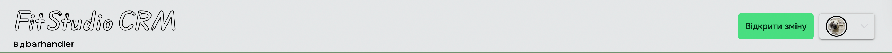
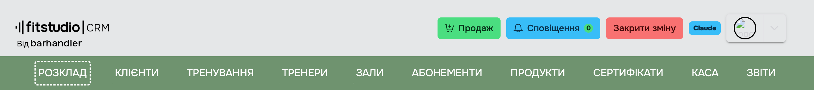
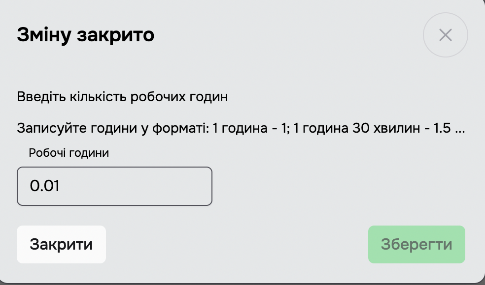
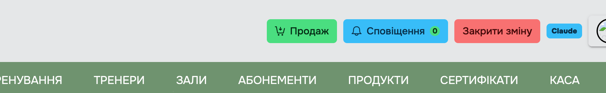
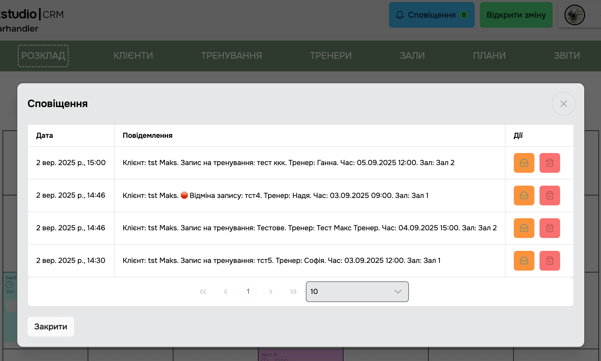

[Повернутися на головну](/)

# 2. Відкриття та закриття зміни

## 2.1 Відкриття зміни

> Кнопка **Відкрити зміну** розташована в хедері праворуч, коли зміну закрито.

Після натискання відкривається [модальне вікно «Ви впевнені що хочете продовжити?»](../_modals/are-you-sure-modal.md ":include"). Кнопка **Продовжити** відкриває зміну; зʼявляється повідомлення «Зміну відкрито».

Якщо зміну вже відкрив інший користувач, показується вікно «Зміну вже відкрито користувачем <імʼя>» з кнопкою **Зрозуміло**; нова зміна не відкривається.

**Обмеження, поки зміну закрито:**

- Кнопка **Продаж** у хедері не відображається. Кнопка доступна ролям **Супер Адмін** і **Адмін** лише за відкритої зміни.
- Сканування карток і QR-кодів сертифікатів блокується: система показує вікно «Необхідно відкрити зміну!» з кнопкою **Зрозуміло**.
- Під час переходу на сторінку **Клієнти** користувач із роллю **Адмін** отримує вікно «Ви не відривали поточну зміну. Деякі дії будуть не доступні» з кнопкою **Зрозуміло**. Роботу на сторінці можна продовжити, частина дій недоступна. Для ролей **Супер Адмін** і **Менеджер** попередження не показується.

### Зміна, відкрита іншим користувачем

Якщо під час входу користувача з роллю **Адмін** зміна відкрита іншим користувачем, показується вікно «Зміна була відкрита <імʼя>. Бажаєте відкрити зміну під своїм користувачем?»:

- **Так** — поточна зміна закривається, і відкривається нова зміна від імені користувача, що увійшов.
- **Ні** — зміна залишається за попереднім користувачем.

> Зміни використовуються для обліку робочого часу та [зарплат адміністраторів](/menu/reports#_385-Зарплати-адмінів).

---

## 2.2 Закриття зміни

> Кнопка **Закрити зміну** розташована в хедері праворуч, коли зміну відкрито.

Після натискання відкривається [модальне вікно «Ви впевнені що хочете продовжити?»](../_modals/are-you-sure-modal.md ":include"). Якщо зміну відкрив інший користувач, текст вікна: «Зміна була відкрита користувачем <імʼя>. Ви впевненні що хочете закрити зміну?».

Після підтвердження зʼявляється модальне вікно **Зміну закрито**.

- Поле **Робочі години** містить розраховану тривалість зміни. Формат — десяткове число: 1 година — `1`, 1 година 30 хвилин — `1.5`.
- Кнопка **Зберегти** активна лише тоді, коли значення змінено; вона зберігає вказані години.
- Кнопка **Закрити** закриває вікно без змін.
- Якщо активна фіскальна інтеграція, у вікні додатково відображається Z-звіт зміни.

> ⚠️ Після закриття вікна **Зміну закрито** (кнопкою **Закрити**, **Зберегти** або хрестиком) система виконує вихід користувача.

Години закритої зміни можна змінити пізніше на сторінці [Звіти → Зміни](/menu/reports#_382-Зміни).

---

## 2.3 Відкриття та закриття зміни з фіскальною інтеграцією

Якщо в [Налаштуваннях → Інтеграції](/login/settings#Інтеграції) активна хоча б одна фіскальна інтеграція (Вчасно Каса або Checkbox), кнопки **Відкрити зміну** і **Закрити зміну** відкривають вікно **Відкрити зміну** / **Закрити зміну** замість вікна підтвердження.

Вікно містить таблицю **Активні фіскальні інтеграції**:

| Колонка | Значення |
| --- | --- |
| **Назва** | Назва картки інтеграції |
| **Оператор** | Тип інтеграції |
| **Статус** | **Онлайн** / **Офлайн** / **Перевірка…** — наявність звʼязку з оператором |
| **Зміна на інтеграції** | **Відкрита** / **Закрита** / **Перевірка…** — стан зміни на боці оператора |

Якщо стан зміни в системі й в операторі різний, у рядку відображається кнопка **Синхронізувати**; після синхронізації зʼявляється повідомлення «Інтеграцію синхронізовано».

Якщо дані інтеграцій прочитати не вдалося, замість таблиці показано рядок «Не вдалося отримати дані фіскальних інтеграцій. Перевірте зʼєднання та оновіть дані.» і кнопку **Оновити**, яка повторює читання; вікно закривати не потрібно. Якщо жодної активної інтеграції немає, показано рядок «Жодну фіскальну інтеграцію не підключено».

Кнопки вікна:

- **Скасувати** — закриває вікно без дій. Недоступна, поки виконується дія над зміною.
- **Відкрити** / **Закрити** — переводить зміну в кожній активній інтеграції в потрібний стан і після цього відкриває або закриває зміну в системі. Якщо для однієї з інтеграцій дія не вдалася, показується повідомлення «<назва>: синхронізація не вдалась»; зміна в системі все одно відкривається або закривається.

Поки дія виконується, кнопка дії недоступна, і вікно не закривається — ні кнопкою **Скасувати**, ні клавішею Esc. Вікно закривається після того, як зміну відкрито або закрито. Якщо дію не завершено, показано повідомлення **Дію не завершено** з текстом «Дію над зміною не завершено. Перевірте стан зміни та повторіть спробу.», вікно залишається відкритим, а кнопка дії знову доступна.

Якщо зміну відкрив інший користувач, показано повідомлення «Зміну вже відкрито користувачем <імʼя>» (без відомого імені — «Зміну вже відкрито іншим користувачем»); зміна в системі не відкривається вдруге, зміна в інтеграціях не відкривається.

Під час закриття Z-звіти, отримані від інтеграцій, зберігаються разом зі зміною і відображаються у вікні **Зміну закрито**. Z-звіти, отримані в спробі, яку не завершено, зберігаються для наступної спроби закриття; другий Z-звіт тієї самої зміни не формується. Якщо запит на закриття не виконано, показано повідомлення **Зміну не закрито** з текстом «Запит на закриття зміни не виконано, тому зміна залишається відкритою. Повторіть закриття.», і зміна залишається відкритою.

Відкриття і закриття зміни на касах ПРРО офлайн-режиму описано на сторінці [Фіскальна зміна ПРРО](/pages/prro-shift).

---

## 2.4 Автоматичне закриття зміни

Якщо в [Налаштуваннях → Функції](/login/settings#Функції) увімкнено перемикач **Закривати зміну автоматично(закриється 23:57)**, відкрита зміна закривається щодня о 23:58 за часовим поясом студії ([Налаштування → Часовий пояс студії](/login/settings#часовий-пояс-студії); за замовчуванням `Europe/Kyiv`). Зміна закривається один раз; якщо відкритої зміни немає, нічого не відбувається. У розділі сповіщень зʼявляється запис «Зміну закрито автоматично».

---

## 2.5 Сповіщення

Кнопка **Сповіщення** в хедері показує кількість непрочитаних сповіщень. Кількість оновлюється кожні 10 хвилин; якщо є непрочитані сповіщення, показується вікно «Доступні нові сповіщення» з кнопкою **Зрозуміло**.

Сповіщення створюються за подіями в студії, зокрема:

- запис і скасування запису клієнтами через мобільний застосунок;
- запис, що потребує підтвердження адміністратором;
- автоматичне зняття клієнта з повторного запису (див. [Налаштування → Функції](/login/settings#Функції));
- автоматичне закриття зміни;
- службові повідомлення платформи Fitshandler.

Натискання кнопки відкриває вікно **Сповіщення** з таблицею: **Дата**, **Повідемлення**, **Дії**. Доступні дії:

- **Прочитати** / **Позначити як непрочитане**;
- **Видалити**;
- **Перейти до тренування** — для сповіщень, повʼязаних із тренуванням;
- **Підтвердити** / **Відхилити** — для записів, що потребують підтвердження.

Автоматичне закриття не впливає на зміну компʼютера, що працює без інтернету. Зміна з позначкою «Офлайн», створена сервером для продажів, виконаних без інтернету, закрита від створення. Див. [Синхронізація продажів](/pages/offline-mode#Зміна).

[Повернутися на головну](/)
